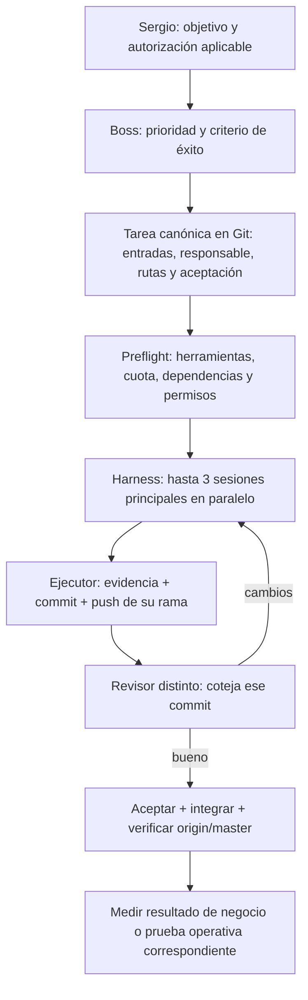

# Operar OnIA con una persona y sesiones por tarea

Propuesta operativa solicitada por Sergio el 8 de noviembre de 2026. No activa servicios, integraciones, envíos, cobros ni producción. Extiende el harness y el registro de tareas existentes. GitHub `oninteligenciaartificial/onia`, rama `master`, es la fuente central.

## Responsabilidades y contexto

Sergio decide objetivo, prioridades, compromisos y efectos externos. Boss coordina el negocio y prepara encargos; Codex coordina su ejecución técnica, verifica capacidad, usa el harness y publica evidencia. Un ejecutor realiza una tarea delimitada; otra sesión revisa la entrega. Un área es una responsabilidad estable, no un bot que deba estar vivo todo el día.

Los chats sirven para decidir y conversar. Los archivos versionados conservan reglas, tareas, decisiones, evidencia, resultados y próximos pasos. Una sesión nueva recupera ID + commit + briefing + archivos necesarios; no necesita todo el historial de la empresa. Para continuar la misma tarea interrumpida se usa `reanudar` con el mismo SID; para otro objetivo se prepara otro ID y otro contexto. No mezclar marketing, finanzas y cambios técnicos en una sesión indefinida.

El JSON de `tareas/ID.json` sigue siendo el registro canónico. `encargos/ID.md` es una proyección generada, no otra cola editable. Notion puede mostrar una proyección y los chats pueden mostrar resúmenes; ninguno sustituye el estado verificado de GitHub. Logs privados y credenciales no se publican: al repo van recibos saneados suficientes para retomar y auditar.

## Flujo único



Los subagentes son ayuda dentro de una tarea: archivo y objetivo exclusivos, límites explícitos y sin nietos en el perfil actual. Máximo tres sesiones principales no significa máximo tres contextos si hay hijos. Para el lote de referentes: tres padres y hasta tres hijos, uno por padre. Revisoras sin hijos. Cerrar los hijos antes de cerrar el padre.

## Áreas sin crear otro sistema

| Función de la empresa | Área existente del harness | Entregas y medida útil |
|---|---|---|
| Dirección, prioridades y administración | organizacion | Lista ordenada con dependencias; decisiones faltantes identificadas; tareas aceptadas vs pendientes. |
| Marketing y ventas | marketing | Oferta, evidencia y recorrido comercial; interesados, inscritos y pagos confirmados como estados separados. |
| Contenido y marca | marketing / video | Brief, pieza, revisión y destino; publicación sólo con autorización aplicable; medir respuesta del público cuando exista. |
| Entrega, alumnos y soporte | organizacion; automatizaciones para implementación autorizada | Requisitos de acceso, entrega comprobada y resolución; no declarar aprendizaje por tener un documento. |
| Operaciones e integraciones | automatizaciones | Un evento→resultado por tarea; deduplicación, errores, recuperación y permisos probados antes de activar. |
| Producto y desarrollo | producto / desarrollo | Brief en este repo; código en su repositorio de producto verificado; pruebas de comportamiento y revisión antes de despliegue. |
| Finanzas y control | organizacion para registro y análisis | Ingresos cobrados, gastos, devoluciones y compromisos basados en comprobantes; ninguna sesión compra, cobra o compromete dinero por inferencia. |

Estas funciones no agregan claves nuevas al CLI. Separar proyectos cuando tengan entregables o permisos distintos, y conectar las dependencias por ID y commit. Por ejemplo: investigación de oferta → decisión comercial → borrador de página → revisión → publicación autorizada. La investigación no activa toda esa cadena.

## Contrato mínimo de cada tarea

Un objetivo observable, responsable, insumos verificables, carpetas exclusivas, entregables, aceptación, dependencias, permisos, modelo/esfuerzo, cuota disponible y salida en caso de fallo. `preparado → en_curso → para_revision → aceptado`; `en_espera` registra una dependencia o fallo con próximo paso concreto. No marcar aceptado por ejecutar sin error, por cantidad de archivos o por un resumen convincente.

Antes de despachar, comprobar que la dependencia está satisfecha, no hay rutas solapadas, hay cupo y la autorización cubre la acción. Al terminar, cotejar evidencia, cambios y publicación remota; revisión distinta sobre el commit exacto. Si pide cambios, retomar el mismo ejecutor con el veredicto, conservar las versiones y volver a revisar. Sin reintentos ciegos ante efectos externos de resultado incierto.

La cantidad de sesiones se elige por trabajo independiente y capacidad, no por número de áreas. Revisar también ocupa un cupo. Dos sesiones productivas y un revisor pueden ser más útiles que tres ejecutoras acumulando entregas sin revisar. El límite técnico actual es tres; esta regla no programa tareas por sí sola.

## Camino hacia automatización sostenida

1. **Operación por encargo, comprobada:** tareas delimitadas, sesiones aisladas, publicación autónoma, revisión y continuidad. Terminar el estudio actual y convertir sólo los próximos pasos autorizados en encargos.
2. **Lecturas controladas por servicio:** probar en recurso de prueba identidad, alcance, rechazo de escritura y errores. Que una herramienta aparezca en un chat no demuestra que la ejecutora tenga el acceso ni que sea sólo lectura.
3. **Un flujo de negocio completo:** seleccionar con Sergio un recorrido, sus datos mínimos y un resultado medible. Probar con datos de juguete, duplicados, permisos insuficientes y recuperación. No activar todas las áreas a la vez.
4. **Rutinas recurrentes:** después de probar el flujo, diseñar disparadores, cola persistente, deduplicación, límites de cuota/reintentos y alertas. Ese scheduler no existe por tener el harness; necesita implementación y prueba propias, con autorización antes de efectos externos.
5. **Ampliar por evidencia:** automatizar otra área cuando la anterior conserve trazabilidad, calidad y recuperación. Medir trabajo útil aceptado, errores/retrabajo, cuota observada, tiempos de espera y resultado real; no confundir más agentes con una empresa funcionando.

El control humano se concentra en decisiones nuevas, incertidumbres importantes y efectos no autorizados. Las acciones reversibles dentro de un encargo aprobado avanzan sin volver a pedir el mismo sí. Compras, mensajes, publicaciones comerciales y cambios productivos mantienen sus autorizaciones específicas. No se promete operación 24/7 hasta que sus mecanismos y recuperación se hayan probado.

## Consulta y continuidad

```bash
cd ~/repos/onia-coordinador
H=_investigacion-onia/base-operativa/05-herramientas/scripts/harness.py
python3 "$H" estado
python3 "$H" retomar ID
```

`retomar` consulta; `reanudar` ejecuta la continuación y requiere revisión esperada/actor/sí aplicable. Los comandos completos y límites están en [ORQUESTACION](ORQUESTACION.md); el contrato de registros, en [CONTINUIDAD](../05-herramientas/cloud/CONTINUIDAD.md). Las sesiones CLI del VPS no son chats nuevos de la barra lateral. El reporte al usuario debe dar IDs, estado real, enlaces a entregas y commit publicado.

## Auditoría y extensión propuesta · 8/11, cuentas secundarias

[Modelos efectivos, hijos, selección por tarea y pausas](MODELOS-Y-PAUSAS-20261108.md). Los perfiles declarativos existen; `en_espera` no detiene procesos y el inventario automático de modelos por hijo todavía requiere extensión. No se activa un scheduler.

## Próximos frentes concretos · 2026-11-08T22:19:23-04:00

Sergio pide continuar el frente actual y explicar cómo abrir otros. Este apartado prioriza próximos entregables; no crea otra cola ni lanza áreas por inferencia. El estado ejecutable sigue en cada tarea canónica. Consulta del harness en este turno: cero sesiones principales vivas; el visor humano sí permanece disponible. Los intentos más recientes de A, B, C y acceso AV finalizaron con `turn.completed` y sus tareas esperan acciones de continuidad/revisión, no están aceptadas.

| Orden | Frente y fuente canónica | Próximo entregable y condición de avance |
|---|---|---|
| 1 | [Cuentas y navegador](tareas/cuentas-secundarias-20261108.json) | Alta personal de Instagram y prueba de acceso para análisis con un solo responsable del perfil. Google informado por Sergio; conexión MCP autenticada aún pendiente. |
| 2 | Referentes: [A](tareas/cerebros-a-20261108.json), [B](tareas/cerebros-b-20261108.json), [C](tareas/cerebros-c-20261108.json) | Recuperar faltantes de A y revisar B/C con otros SID. Mantener prioridad A/Erik, Sol 6.1 high ejecutoras y ultra revisoras. El siguiente despacho necesita que esté resuelta la pausa del lote y su preflight. Boss conserva la integración final. |
| 3 | Workshop: [decisiones](../05-herramientas/2026-11-08-harness/00-decisiones.md) y [plan](../05-herramientas/2026-11-08-harness/plan-workshop.md) | Próximo frente de negocio propuesto: piloto de diez minutos de clase 1, lenguaje simple y ejercicio con Claude. Confirmar rúbrica y sí de lanzamiento previstos en las decisiones; la preparación de clases completas no está hecha. |
| 4 | Ventas y contenido: [análisis aceptado](evidencias/analisis-lote1-20261108/INFORME.md) | Preparar un recorrido y una pieza cada vez, con aceptación propia. Borradores, interesados, inscritos y pagos son estados distintos. VIP sigue propuesto. No activar mensajes, publicación ni cobro. |
| 5 | Administración, finanzas y automatizaciones | Encargo posterior propuesto: inventario de datos disponibles y una rutina verificable con datos de prueba. No asumir acceso contable, balances, ni permiso para tocar n8n/producción. |

Forma de pedir un frente: «Frente: X. Resultado: Y. Para cuándo: Z. Usá estas fuentes. Está listo cuando cumple estos criterios. Permitido: preparar/probar... Límites: sin publicar/gastar...». El coordinador lo convierte en ID, rutas exclusivas, dependencias, responsable, modelo/esfuerzo y presupuesto. Los frentes pueden esperar en cola; como pauta, dos ejecutoras y un cupo para revisión, dentro del máximo tres. Los hijos cuentan para contexto/cuota aunque no sean otro cupo principal. Compartir navegador o sistema externo exige serializar ese recurso aunque los archivos sean distintos.

Cuando otra tarea bloquee el frente, conservar avances, commit cuando corresponda, evidencia, SID y la condición exacta que permite retomarlo. Una corrección dentro del alcance vuelve al mismo ejecutor; una dependencia compartida tiene su tarea delimitada. `en_espera` por sí solo no detiene procesos. El criterio de salida es aceptación demostrada, revisor distinto y hash integrado en origin/master; no cantidad de documentos ni horas activas.

Cuota más reciente observada en este turno: 36% de la ventana semanal usado, 8nov2026 22:17:07 America/Caracas, saldo adicional 0. Es cuota compartida, no costo exclusivo ni disponibilidad futura. Volver a comprobar antes de despachar. Selección automática de modelo, pausa cooperativa, telemetría completa de hijos y scheduler 24/7 siguen propuestos en [modelos y pausas](MODELOS-Y-PAUSAS-20261108.md), no implementados.

Comprobaciones de este turno: consulta acotada de tareas y estado real del harness; lectura de decisiones de negocio; inventario del wrapper MCP y perfiles soportados por la instalación existente. No se lanzaron sesiones, instalaron paquetes, inspeccionaron cuentas ni reiniciaron procesos. El próximo paso humano inmediato es terminar Instagram dentro del visor; las otras áreas anteriores son una propuesta de secuencia, no trabajos ejecutándose en segundo plano.
