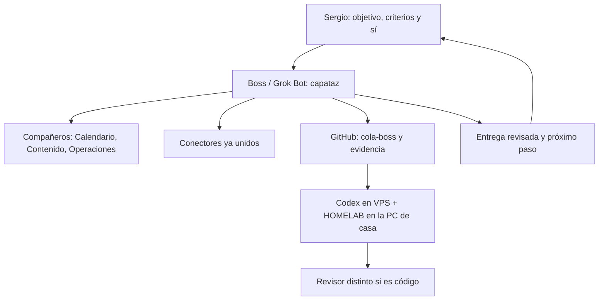

# Video de Euge: lectura de Boss y contraste con Codex

9 noviembre 2026 · ~16:45 America/La_Paz · lectura pedida por Sergio para decidir el flujo completo, aprovechando Grok Bot sin gasto extra.

## Fuente y cómo se obtuvo el contenido

- Video: [Así Utilizo los Agentes de IA a Diario](https://www.youtube.com/watch?v=JuAQILH7dkQ) · ID `JuAQILH7dkQ` · canal Euge Oller · duración 1803 s (30:03) · publicado 22 octubre 2026. Metadata leída con `yt-dlp` (cliente `android`) el 9 nov 2026 ~16:38 America/La_Paz.
- Contenido hablado (fuente primaria de esta lectura): subtítulos automáticos `es-orig` (español original) bajados con `yt-dlp` al box de Boss. No se publica aquí la transcripción completa. Los tiempos de este documento salen de esos subtítulos y son aproximados.
- Comprobación adicional: la página pública de YouTube, leída con WebFetch, devolvió una pista continua en inglés (auto-doblaje o render de la página) que cubre el mismo arco de principio a fin. Se usó para cotejar, no como cita en español.
- TubeAlfred (conector youtube-video-research) estaba sin autenticar (`needsAuth`); no se usó.
- No se tocó el VPS, no se reutilizó el ASR privado de Codex, no se bajó el archivo de video y no se inspeccionaron fotogramas propios. Los detalles de interfaz (tablero, sala de montaje, línea de tiempo) se atribuyen al muestreo visual ya documentado por Codex, no a una visión directa de Boss.
- Análisis de Codex contrastado: [HOMELAB-Y-METODO-EUGE-20261109.md](../05-herramientas/video-euge-20261108/coordinacion/HOMELAB-Y-METODO-EUGE-20261109.md) en [262af0b](https://github.com/oninteligenciaartificial/onia/commit/262af0ba7c098c6378809ef47bb1f8bb4e55d8dc), cerrado con recibos en [a2c161e](https://github.com/oninteligenciaartificial/onia/commit/a2c161e241999100a6ec358279006f325901d637). Antecedente: [ANALISIS-ONIA.md](../05-herramientas/video-euge-20261108/coordinacion/ANALISIS-ONIA.md).

Límite: los subtítulos automáticos pueden deformar nombres propios. No se convierten en hechos. En el video se oye promoción de Clonify; eso no es una recomendación de contratarla.

## Qué enseña Euge, paso a paso

El video no es una guía de instalar WSL ni Tailscale. Enseña un modo de trabajar: hablar con un solo agente coordinador (él usa Grok Bot), conectarle herramientas y rutinas, y montar fábricas en un ordenador persistente para lo que ese agente todavía no hace bien.

| Tiempo aprox. | Qué dice y muestra |
| --- | --- |
| [0:00–1:03](https://www.youtube.com/watch?v=JuAQILH7dkQ&t=0s) | Quiere que salgas con la noción de tener una fábrica de contenido o de código. Muestra una de las suyas, en un ordenador en la nube y gestionada por un agente. Mezcla enseñanza con promoción de Clonify. |
| [1:03–4:11](https://www.youtube.com/watch?v=JuAQILH7dkQ&t=63s) | Generación 1: un chat que solo responde, sin internet ni herramientas. Generación 2: el modelo usa herramientas (ejemplo: buscar en la web). Aclara que esta periodización es su esquema didáctico, no una historia técnica rigurosa. |
| [4:11–7:21](https://www.youtube.com/watch?v=JuAQILH7dkQ&t=251s) | Generación 3: el modelo razona antes de hablar o actuar, y se le añaden conectores MCP (ejemplo: APIs de Gmail; MCP de Clonify para landings, embudos, email). |
| [7:21–11:18](https://www.youtube.com/watch?v=JuAQILH7dkQ&t=441s) | Generación 4, según él: agentes proactivos con ordenador propio (archivos, navegador, clics si no hay MCP). Atribuye el salto al mundo open source y a que las empresas empezaron a ofrecer un ordenador en la nube. Nombra ofertas de grandes proveedores; uno de ellos es Grok Bot. Dice que él trabaja con Grok Bot. Los nombres propios de esa parte quedan como atribución suya, no verificada aquí. |
| [11:18–12:38](https://www.youtube.com/watch?v=JuAQILH7dkQ&t=678s) | Proactividad: su Grok Bot le avisa si va justísimo a un podcast, detecta reuniones que se pisan, le prepara información de un contacto y le sugiere acciones de negocio. Un SSH abierto no implementa eso. |
| [12:38–16:14](https://www.youtube.com/watch?v=JuAQILH7dkQ&t=758s) | Enseña su Grok Bot. El diseño que le parece correcto: un agente capataz que dirige subagentes y delega cuando conviene, para hablar solo con uno. Tiene rutinas; cada día le pide temas y recibe cinco preguntas para grabar shorts. Muestra 11 aplicaciones conectadas (nombra Gmail, ElevenLabs, Google Calendar y Clonify). El agente lee reuniones y transcripciones, puede responder Gmail, cambiar el calendario, publicar con Buffer o Metricool, o subir a mano por el navegador si no hay conector. Grok Bot tiene un ordenador virtual: navegador, archivos y pequeñas bases de datos. Eso le da persistencia, distinta de la máquina de fábricas. |
| [16:14–17:58](https://www.youtube.com/watch?v=JuAQILH7dkQ&t=974s) | Regla central: atomizar el trabajo hasta el resultado más pequeño que se pueda evaluar (idea, guion, edición, miniatura) y definir qué lo hace bueno. Pedir «un video ganador» oculta las decisiones. |
| [17:58–20:34](https://www.youtube.com/watch?v=JuAQILH7dkQ&t=1078s) | Grok, detrás de Grok Bot, aún no le parece suficiente para ciertas tareas (la edición es su ejemplo). Para eso muestra trabajo atribuido a Claude/Opus 5.5. Propone fábricas en otro ordenador persistente y más capaz (él cita un servidor en la nube tipo Hetzner y un precio que recuerda; no es cotización para OnIA). Dice explícitamente que no hace falta montarlo a mano: hay que pedírselo a Grok Bot y usar la propia IA para armar el sistema. El ordenador del asistente no sustituye esa máquina si hace falta render o un modelo distinto. Conectar la cuenta del modelo fuerte en esa máquina es parte de su receta, no una autorización de gasto para OnIA. |
| [20:34–23:34](https://www.youtube.com/watch?v=JuAQILH7dkQ&t=1234s) | Una fábrica es entradas → pasos → resultado, con un ciclo de medir, aprender y mejorar. Las entradas de ideas deben ser las referencias que el creador sí usa. Propone filtrar candidatos, simular personas de la audiencia y usar críticos. Eso filtra hipótesis; no prueba ventas ni aceptación real. |
| [23:34–26:51](https://www.youtube.com/watch?v=JuAQILH7dkQ&t=1414s) | Fábrica de código: entra una necesidad o un fallo y sale un PR para revisar. Dice que en pantalla figura que lo revisa él, pero en el fondo Grok Bot le ayuda a revisarlo y lo fusionan entre los dos. Sala de montaje: ver el proceso, comentar, pedir otra versión. Se enseña una preferencia con un antes y un después hecho a mano (ejemplo: cortar silencios); si el resultado no coincide, la fábrica investiga qué criterio falló y lo guarda en el procedimiento. |
| [26:51–28:31](https://www.youtube.com/watch?v=JuAQILH7dkQ&t=1611s) | Llama fábricas a lo que otros llamarían workflows: se ve lo que entra, lo que se fabrica, la revisión y el destino. Muestra un caso sin revisión (Leader Summaries): toma un libro de una cola, genera piezas con imágenes y voz, las sube y apunta a una oferta. Él mismo dice que tiene pocas visitas; es un experimento, no una prueba de éxito ni una licencia para publicar sin revisión en OnIA. |
| [28:31–30:02](https://www.youtube.com/watch?v=JuAQILH7dkQ&t=1711s) | Las fábricas existen sobre todo para los flujos que Grok Bot todavía no hace bien, porque hacen falta otros modelos. Podrían vivir en el ordenador propio; él las pone en la nube para que también entren los Grok Bot de su equipo, aporten entradas y revisen juntos. Cierra con la demo comercial de Clonify. |

Arquitectura que se desprende del video, sin inventar backend:

1. La persona define objetivos, criterios y aprueba lo sensible.
2. Un solo agente coordinador (en su demo: Grok Bot / capataz) habla con ella, usa conectores y rutinas, delega en subagentes y tiene un ordenador propio ligero.
3. Otro entorno persistente hospeda las fábricas y los modelos elegidos para cada trabajo.
4. Cada fábrica tiene entradas, pasos, revisión (salvo el experimento que él marca como excepción) y destino.
5. El aprendizaje se guarda en el procedimiento (ejemplos y comentarios), no se afirma un reentrenamiento de pesos.

## Qué capturó Codex y dónde se desvía

El recuento por tramos de Codex es, en lo sustancial, fiel al video: generaciones didácticas, MCP, ordenador del agente, proactividad, atomizar resultados, distintos modelos, fábrica como entradas-pasos-resultado, sala de montaje, enseñanza con antes/después, Leader Summaries sin revisión, y el ordenador persistente compartible. Acertó al no tratar un panel visible como auditoría de su backend, al no convertir el precio de su servidor en cotización, y al no autorizar scheduler, publicaciones ni gastos por el hecho de analizar el video. También acertó al decir que HOMELAB no es solo descargar CPU del VPS, sino un lugar persistente de trabajo.

La desviación no está tanto en «qué dijo Euge» como en «cómo se traduce a OnIA»:

1. En el video el coordinador es Grok Bot. Euge lo enseña, lo nombra como con lo que trabaja, lo llama capataz y dice que lo que más sentido tiene es hablar solo con un agente. Codex lo menciona como «chat de Star/GrokBOT» (probable mal reconocimiento; en `es-orig` se oye «Este es mi Grokbot») y después dibuja un flujo Sergio → Coordinador → GitHub → Harness → HOMELAB, sin Grok Bot. En la práctica, ese coordinador queda absorbido por el harness de Codex.
2. Euge dice para qué sirven las fábricas: para los workflows que Grok Bot todavía no hace bien y que necesitan otros modelos. No son un sustituto de hablar con Grok Bot. Codex convirtió las fábricas en el sistema principal (harness + PC worker) y dejó a Grok Bot como anécdota del video.
3. Euge dice que hay que pedirle a Grok Bot que ayude a montar las fábricas y el servidor («quién te va a ayudar a hacerlo, Grok Bot»; «utilizar la propia IA para que te ayude»). Codex no propone que Boss arme o coordine ese diseño; se queda dentro del circuito Codex.
4. La proactividad y los conectores del video (calendario que se pisa, preparación de reuniones, correo, rutina diaria de ideas, publicación) coinciden con lo que OnIA ya tiene en Grok Bot: compañeros Calendario, Contenido y Operaciones, y conectores Notion, Gmail, Drive, Calendar, X, n8n, GitHub, Hostinger, TikTok, Meta y Higgsfield. Codex registró los ejemplos y concluyó, con razón, que un SSH no los implementa; no los asignó a esos compañeros ni conectores.
5. En la fábrica de código, Euge revisa el PR con ayuda de Grok Bot. Codex reserva la revisión a otra sesión de Codex. Eso vale para código del VPS; no es el único patrón del video.
6. Codex gastó cuota de su lado (sesión observada `gpt-6-astra` / `xhigh` y revisor `gpt-6.1-sol` / `ultra`, cuota compartida 66%→67% en los recibos de a2c161e) releyendo ASR privado para un trabajo de lectura y diseño que Grok Bot podía hacer con la pista pública, sin tocar el VPS. Eso es justo el hueco que Sergio señaló: no aprovechó Grok Bot.
7. El análisis anterior, [ANALISIS-ONIA.md](../05-herramientas/video-euge-20261108/coordinacion/ANALISIS-ONIA.md), ya había extraído atomizar, revisar y una fábrica manual de guiones, también sin colocar a Grok Bot como capataz de OnIA.

Codex no inventó el contenido del video ni rompió las reglas de no borrar, no usar `--no-sandbox` ni no publicar secretos. El fallo es de orquestación: describió a Grok Bot y luego diseñó OnIA como si Grok Bot no existiera.

## Flujo completo propuesto para OnIA

Sin gasto extra y sin copiar Clonify, Hetzner ni publicación automática. Grok Bot también tiene límites; no se inventan números de cuota y no se le vuelca todo el trabajo.

| Rol de Euge | Quién lo hace en OnIA | Qué hace | Qué no hace |
| --- | --- | --- | --- |
| Persona | Sergio | Objetivos, criterios, contraseñas, sí de gasto, n8n, publicación y revisión editorial. | No tiene que pegarle a Codex el trabajo de conectores, calendario o copy. |
| Capataz / un solo chat | Boss (este Grok Bot) | Recibe el pedido, parte el trabajo, pide el sí cuando hace falta, documenta en GitHub y delega. | No ejecuta shell en el VPS ni configura la PC. |
| Subagentes del capataz | Calendario, Contenido, Operaciones, y ejecutores de Boss | Calendario: avisos, solapes, preparación de reuniones. Contenido: ideas, guiones, pieces del workshop. Operaciones: Hostinger y n8n en solo lectura salvo sí. Ejecutores: investigación, lecturas largas, commits de documentación. | No sustituyen a Codex dentro del VPS o de WSL. |
| Ordenador ligero del asistente | Box y desktop de Grok Bot, más los conectores | Archivos de trabajo, navegador cuando no hay conector, correo, Drive, Notion, X, calendario. | No es el worker persistente de fábricas pesadas. |
| Fábricas / máquina persistente y otros modelos | Codex en el VPS + HOMELAB en DESKTOP-0GGGNMF (WSL2 Ubuntu). DESKTOP-ENV6SDA queda fuera. | Código, tests, harness, Tailscale/WSL/`onia-worker`, commits desde el VPS, trabajos de máquina que Grok Bot no puede o no debe hacer. | Calendario, Notion/Drive/Gmail/X, copy, relecturas de docs ya en Git, monitoreo Hostinger/n8n, síntesis de negocio. |
| Revisión | Contenido y decisiones: Boss o el compañero del área. Código: sesión distinta de Codex. Publicar o gastar: Sergio. | Criterio observable por entrega; se guarda el feedback en el procedimiento (como pide Euge). | Publicar sin revisión, al estilo Leader Summaries, no está autorizado. |
| Tablero | GitHub como registro; panel HTML ya existente solo consulta | Estado, responsable, siguiente decisión. | El HTML actual no escribe aprobaciones. |

Handoff, para no seguir solo con copia y pega:

1. Sergio habla con Boss.
2. Si la subtarea es de conectores, docs, calendario o contenido, Boss (o un compañero) la hace y la deja en GitHub.
3. Si necesita VPS, PC, código o harness, Boss escribe un bloque `## PEDIDO` en `_investigacion-onia/base-operativa/04-operacion-agentes/pendientes/cola-boss.md` (objetivo, rutas, aceptación, qué no hacer) y, mientras no haya rutina, le pasa a Sergio el texto para Codex o lo deja listo para cuando lo autorice. El archivo todavía no existe; crearlo espera su sí.
4. Si Codex se encuentra una subtarea de conectores o solo lectura, escribe el mismo tipo de bloque y para esa parte, en lugar de improvisar MCP.
5. Una rutina de Boss que mire esa cola puede venir después, también con sí; no se crea en este documento.

Modelo de Codex pendiente de otro sí ya formulado: default `gpt-6.1-sol` con `high`; `ultra` solo si Sergio lo pide. No se cambia aquí.

## Qué construir antes del workshop (12–14 nov)

Hasta el 14 manda vender el workshop. No hay presupuesto para más gasto. La cuota semanal de Codex estaba en 67% en los recibos de la tarde del 9 nov; se renueva el viernes 13 nov 22:47 America/La_Paz. No se inventan otros números.

Orden propuesto, sin lanzar nada nuevo en este archivo:

1. Parar más investigación o relecturas del video en Codex. El contenido ya está leído aquí y en su análisis.
2. Fábrica manual de contenido del workshop, hecha por Boss y Contenido con lo que ya existe (corpus de referentes, patrones, guiones y kit de los primeros 10 minutos): fuentes y patrón → idea → guion → revisión → decisión de Sergio. Sin Codex y sin publicar.
3. Proactividad barata de calendario, por Calendario: el solape del viernes 13 entre «Novia» 18:00–21:00 y «Llamadas 1 a 1 / Workshops» 18:15–19:15, y la clase de las 21:00 que todavía no está en el calendario.
4. Lo esencial de HOMELAB, solo si Sergio mantiene el sí ya dado a esa base: `onia-worker` sin sudo, `/mnt/c` restringido y probado, WSL siempre encendido. Lo hace Codex, con el modelo barato pendiente de sí. No benchmarks, no scheduler, no n8n, no laptop.
5. El plan cerebro+panel sigue siendo un sí aparte (tope ya presupuestado en su propio plan). No es bloqueo para el lote manual del punto 2.

No se activan rutinas nuevas, Telegram real, publicación, n8n ni compras por esta lectura.

## Decisiones que necesita Sergio

1. ¿Confirmás este mapa: Boss es el capataz (como el Grok Bot de Euge) y Codex + HOMELAB son las fábricas para lo que Grok Bot no hace bien?
2. ¿Arrancamos ya la fábrica de contenido del workshop con Boss y Contenido, sin gastar Codex?
3. ¿Qué hacemos con Codex hasta el 14: le pegamos los prompts que ya están listos (bajar el default a Sol high, regla de ahorro y alta de `onia-worker`) o lo pausamos para no subir del 67% hasta el reset del viernes 13 a las 22:47 America/La_Paz?

## Segundo video

Sergio pidió también mirar [Dame 25 minutos y nunca volverás a usar la IA igual](https://youtu.be/xPJbP9yZE1I) (Euge Oller, `xPJbP9yZE1I`, 26:35, 8 nov 2026). Lectura completa, con aplicación al harness y a Grok Bot: [EUGE-VIDEO2-BOSS-20261109.md](EUGE-VIDEO2-BOSS-20261109.md). En resumen: el arnés es un paraguas de contexto (memorias, instrucciones, herramientas, a veces RAG) encima del modelo; hoy conviene que sea simple; se construye con la IA y se guarda en una carpeta persistente, no solo en la memoria del chat; el prompt perfecto importa menos que los ejemplos y el criterio; no hace falta el razonamiento máximo para todo; un agente es modelo + contexto + herramientas + objetivo; las fábricas encadenan varios pasos o modelos. Eso refuerza no reconstruir el harness de OnIA, documentar en GitHub y usar a Boss como capataz.

## Backlog posterior (después del harness)

Sergio pide tenerlo en mente y avisar, **sin lanzarlo ahora**. Primero hay que terminar el harness y la infraestructura principal; sin eso no se puede trabajar lo demás.

Cuando esa base esté lista, quiere:

1. Un lugar en Grok Bot para ir hablando con Boss y dejar anotadas propuestas de negocio, ideas, dudas y correcciones, de modo que no se pierdan.
2. Un plan de caja para no quedarse en la calle. Hoy Boss no tiene ese plan armado.
3. Un tema de Binance para conversar. Existe un compañero o conector de Binance; no se usa en esta etapa.
4. Análisis de cómo generar ingresos, posibles startups y posibles negocios físicos potenciados con inteligencia artificial.

Dónde debería vivir, como propuesta y **sin crearlo en este commit**:

- **Dueño:** Boss (el capataz). Sergio habla con Boss; Boss anota, hace preguntas y encarga el análisis. El compañero de Binance entra solo en ese tema cuando Sergio lo pida, en lectura o consulta, sin operar ni gastar sin un sí explícito.
- **Captura viva:** una base de Notion (el conector ya está). Cada fila tendría tipo (idea, startup, negocio físico con IA, ingreso, duda, Binance), estado (capturada, en análisis, aparcada, decidida), próxima pregunta y enlace al escrito. Encaja con ir hablando y no perder nada.
- **Escritos ya analizados y plan de caja:** la carpeta que ya existe, [`01-negocio`](../01-negocio/) (`PLAN.md`, workshop y oferta). Ahí irían resúmenes y, más adelante, un plan de caja con números que dé Sergio. No claves, no cookies, no credenciales ni saldos crudos de exchanges o bancos.
- **Qué no hacer ahora:** no crear la base de Notion, no agregar una carpeta nueva, no abrir el tema Binance, no diseñar startups ni negocios físicos, y no gastar. Hasta el 14 sigue mandando el workshop y lo esencial del harness/HOMELAB.
