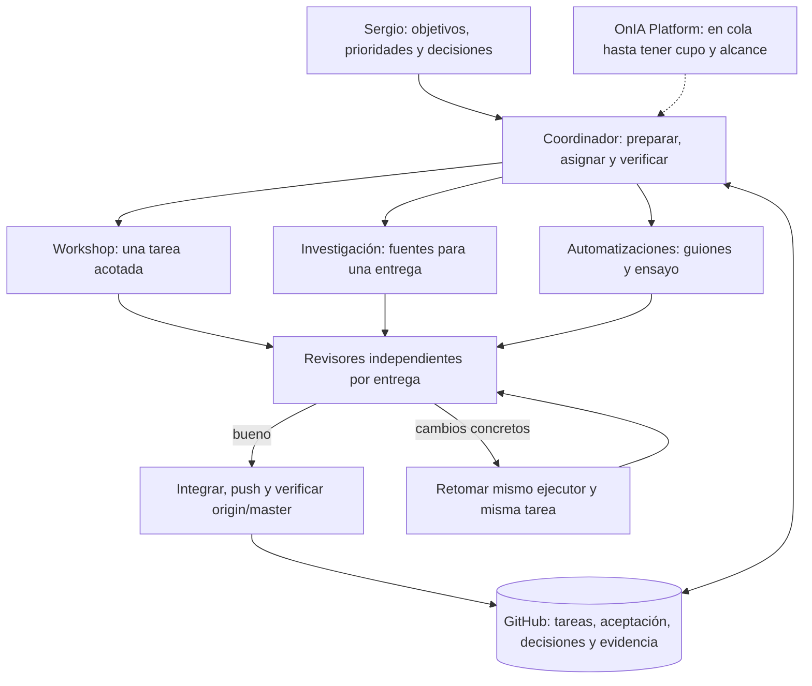

# Cómo trabajar juntos con varias sesiones

Propuesta para Sergio, 8–9 noviembre de 2026. GitHub `oninteligenciaartificial/onia`, `origin/master`, es la memoria compartida. [Diseño del siguiente paso](../05-herramientas/2026-11-08-harness/ESCALADO-CARRILES-PROPUESTA.md). No es un scheduler implementado ni una autorización para nuevos frentes.

## Mapa que usaríamos



Hay un máximo global de **tres sesiones principales del harness**, incluyendo revisores, usando el mismo registro de operación. Una revisión ocupa un cupo; no se añaden tres revisoras encima de tres ejecutoras. El límite no es por coordinador ni un límite universal de Codex. Los hijos no entran en ese contador: en este lote se limitó cada ejecutora a un hijo activo, sin nietos, y las revisoras a cero. El navegador con cuentas es otro recurso exclusivo: una sola sesión puede tomar su perfil a la vez.

## Ejemplo de un lote que podrías encargar

| Sesión | Tarea concreta | Entradas y entrega | Hijos y modelo |
|---|---|---|---|
| Workshop | Revisar únicamente el guion de clase 1 | Decisiones aprobadas + cerebros aceptados; guion con ejercicios y brechas | Ejecutora Sol6.1 high; un hijo para cotejar ejercicios si aporta valor |
| Investigación | Comprobar cinco noticias de IA para una fecha | Fuentes primarias, fechas, citas verificables y límites; no publicar | Ejecutora Sol6.1 high; un hijo con archivo exclusivo si la investigación se divide |
| Automatizaciones | Convertir fuentes ya aceptadas en dos ideas y dos guiones de prueba | Cerebros + fuentes aceptadas; borradores para Sergio en prueba ficticia | Ejecutora Sol6.1 high; sin hijo si no hace falta |
| OnIA Platform | Preparar mejora acotada del panel | Espera cupo, instrucciones técnicas y rutas de su repo de producto | Modelo a seleccionar según la dificultad; no despacho automático hoy |

Si los guiones dependen de noticias que aún no están aceptadas, se espera esa dependencia o se trabaja con otras fuentes previamente aceptadas. No se consume una entrega incompleta para aparentar paralelismo. Cada fila necesita ID, aceptación y rutas concretas antes de lanzarse; esta tabla no crea tareas ni autoriza su ejecución.

Para una revisión de las entregas anteriores se usa **otra sesión Sol6.1 ultra**, sin hijos y en sólo lectura. El modelo solicitado, el observado en los metadatos del runtime y el uso informado se registran por separado; elegir `--modelo` no prueba por sí solo el modelo efectivo. No asignamos el modelo sólo por el nombre del área.

## Qué conserva cada contexto

El coordinador lleva objetivos, prioridades, dependencias, permisos, decisiones y estado. Cada ejecutora carga reglas comunes, memoria pertinente, briefing y archivos de una sola tarea, en su worktree y rama. Un hijo recibe una pregunta concreta y un archivo propio; no recibe todo el negocio por defecto. El revisor recibe el commit exacto, aceptación y evidencia suficiente para revisarlo desde su entorno.

Las sesiones CLI del VPS no son chats nuevos de la barra lateral de ChatGPT. Su mapa real está en `tareas/<id>.json`, logs privados y `~/operacion/sesiones.tsv`. Las tarjetas de subagentes de este chat corresponden a delegaciones nativas de esta conversación; son otro nivel de contexto, no la lista completa del harness.

No hace falta mantener todo el contexto vivo: antes de relevar una sesión se guardan resultado parcial, commit publicado, errores, siguiente acción y bloqueos. `retomar` consulta/reconstruye el contexto; `reanudar` ejecuta de nuevo sobre el mismo session ID. Una continuación no debe duplicar commits ya publicados.

## Cuándo parar, corregir y dejar en espera

- **Falta acceso, decisión o permiso:** registrar `en_espera`, el motivo, qué desbloquea y quién decide. No dejar una sesión de modelo esperando indefinidamente ni reintentar ciegamente. La dependencia se considera bloqueada aunque otras tareas independientes puedan avanzar.
- **Revisor pide cambios:** conservar el veredicto; reabrir y reanudar la misma ejecutora con una corrección concreta. Nueva revisión sobre el nuevo commit antes de aceptar.
- **Cuota o recursos insuficientes:** no lanzar más; cerrar el turno de forma ordenada y guardar el punto de continuación. No subir el límite para resolver lentitud.
- **Sergio pide stop:** dejar de despachar. Las sesiones vivas deben llegar a un punto seguro y guardar estado; no matar procesos ajenos ni borrar sus worktrees.
- **Producción, n8n, envíos o gasto:** preparar la propuesta; ejecutar sólo con autorización explícita que cubra esa acción. Aprobar investigación o un lote de guiones no autoriza publicar ni enviar a Telegram.

Hoy esa coordinación la realiza el coordinador mediante el harness. La propuesta pendiente añade un loop con aprobación de lote, dependencias, prioridades, pausas e idempotencia. El panel mostraría una proyección de los registros; Telegram sería una interfaz de decisiones, sin convertirse en una segunda cola.

## Comandos vigentes para observar y continuar

Desde el VPS, en el checkout coordinador:

```bash
cd /home/onia-codex-worker/repos/onia-coordinador
H=_investigacion-onia/base-operativa/05-herramientas/scripts/harness.py
python3 -B "$H" --operacion /home/onia-codex-worker/operacion estado
python3 -B "$H" retomar cerebros-a-20261108
python3 -B "$H" historial cerebros-a-20261108
```

Los siguientes comandos son plantillas operativas, no un nuevo lanzamiento autorizado. `REV` es la revisión vigente que devuelve el registro, `ID` una tarea preparada, y `ACTOR` su responsable. Se vuelve a leer `REV` antes de cada mutación; no se reutiliza una revisión antigua.

```bash
python3 -B "$H" lanzar "$ID" --revision-esperada "$REV" --actor "$ACTOR" \
  --si-sergio --modelo gpt-6.1-sol --esfuerzo high --auth-chatgpt --subagentes-maximos 1
python3 -B "$H" reanudar "$ID" --revision-esperada "$REV" --actor "$ACTOR" \
  --si-sergio --modelo gpt-6.1-sol --esfuerzo high --auth-chatgpt --subagentes-maximos 1
python3 -B "$H" cerrar "$ID" --revision-esperada "$REV" --actor "$ACTOR" \
  --resultado 'Entrega y hash remoto comprobados' --comprobacion 'Pruebas y límites documentados' \
  --conservar-worktree
python3 -B "$H" revisar "$ID" --revision-esperada "$REV" --actor "$ACTOR" \
  --revisor "$REVISOR" --si-sergio --modelo gpt-6.1-sol --esfuerzo ultra --auth-chatgpt
python3 -B "$H" revisar "$ID" --revision-esperada "$REV" --recoger --conservar-worktree
```

Luego se acepta únicamente un veredicto bueno vigente y se integra el commit. La tarea se comunica como terminada tras verificar `origin/master`. [Comandos y condiciones completos](ORQUESTACION.md).

## Cómo medir si esto sirve a una empresa unipersonal

Medir entregas aceptadas por hora/cuota, correcciones por entrega, tiempo en espera, antigüedad de la cola y errores que llegan a Sergio. Contar sesiones abiertas por sí solo no mide avance. El primer producto práctico sería un lote pequeño de ideas y guiones con fuentes verificables y decisión de Sergio; después se ampliaría por área, usando evidencia y sin automatizar decisiones comerciales todavía ambiguas.

La fábrica actual prepara un diseño y un ensayo ficticio. Todavía no recibe noticias en bucle, no tiene un panel autenticado conectado y no envía mensajes de Telegram. Los próximos pasos requieren escoger el lote y aprobar la implementación propuesta.
