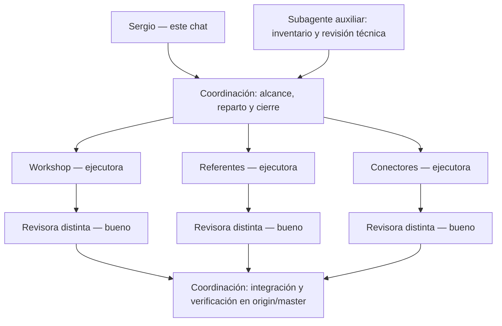

# Mapa de trabajo del lote

Este chat coordina el alcance y el cierre. Cada ejecutora y cada revisora tiene contexto propio. Las seis sesiones CLI del lote terminaron; los tres análisis quedaron aceptados. No son seis chats nuevos de la barra lateral.

## Contexto y continuidad

- Cada ejecutora recibió una tarea, criterio de aceptación, fuentes pertinentes y una carpeta exclusiva. Su worktree y Git privados separaron archivos y publicación; el contexto pertenece a su sesión Codex.
- Cada revisora recibió el briefing, commit/base, criterios y evidencias saneadas. No depende de compartir el historial de la ejecutora.
- Coordinación recupera estado/entregas/comprobaciones, sin importar todo el historial de seis sesiones. Los JSON canónicos, recibos y Git conservan continuidad; un resumen no reemplaza leer la evidencia necesaria.
- Máximo tres sesiones vivas del harness. Esas reservas no son un límite general de subagentes anidados; el encargo futuro de Grokbot necesita definirlo.
- El auxiliar nativo visible en la app realizó inventario/revisión técnica. Las tres ejecutoras y tres revisoras se lanzaron por CLI en el VPS. [Resultados, IDs y commits](INFORME.md).

## Medición

Cobertura de criterios → fuentes y límites → revisión independiente → hashes y publicación remota. Son medidas de entrega del análisis. Ventas, aprendizaje real de alumnos y conectores operativos requieren sus propias pruebas posteriores.

El encargo profundo de Grokbot sólo se analizó; no se lanzaron sus grupos ni subagentes por referente. [Evaluación](REVISION-ENCARGO-GROKBOT.md).

Al finalizar la publicación de este lote se hace stop por indicación de Sergio. La corrección de problemas y el lanzamiento del encargo de Grokbot son la continuación posterior al corte.
