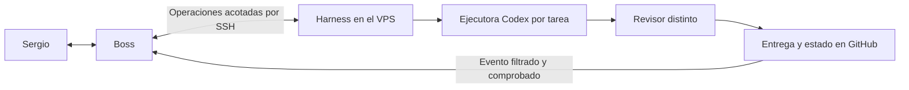

# Conexión Boss–Codex: propuesta técnica y encargo compartido

ID `conexion-boss-codex-20261110`. Preparado el 10 de noviembre de 2026, America/La_Paz.
El [registro del harness](../../tareas/conexion-boss-codex-20261110.json) conserva el estado. Esta nota contiene el diseño que Boss debe revisar y el trabajo pendiente en ambos extremos.

## Resultado pedido por Sergio

Sergio quiere trabajar desde Boss y que Boss y Codex se pasen encargos, preguntas y resultados sin copiar prompts entre chats. Pidió que ambos revisen la conexión y que se aproveche lo existente. No necesita otro panel. Este encargo técnico tiene su sí; no autoriza nuevos trabajos comerciales, gastos, cambios de producción o de la PC. La revisión de G01 conserva su registro previo, pero no es requisito para conectar el sistema.

## Qué existe y qué falta comprobar

- GitHub master contiene el cerebro y los contratos de trabajo. El harness existente prepara, asigna, lanza, reanuda, cierra y revisa tareas, con tres cupos globales y un escritor por ruta. No se sustituye.
- `cola-boss.md` transporta mensajes; no despacha ni confirma lectura. Un PEDIDO no autentica la autorización de Sergio.
- El código actual de `harness_sesiones.status` llama a `sync` y puede actualizar sesiones y el índice. No debe exponerse como consulta estrictamente de sólo lectura sin adaptar esa parte.
- No hay herramienta de Grok accesible desde esta sesión Codex. La existencia de llaves SSH en el usuario del VPS no identifica a su propietario ni acredita acceso de Boss. No se probó ninguna llave ajena.
- Falta que Boss confirme sus capacidades reales: GitHub, cliente SSH, acceso ya configurado al VPS, conectores Command y disparadores de GitHub/webhook. La documentación del producto no acredita disponibilidad en esta cuenta.

## Propuesta de Codex

1. **Entrada:** Boss invoca una interfaz pequeña sobre el harness del VPS. Preferencia inicial: SSH con llave dedicada y comando restringido; si su entorno ofrece Command MCP, presentar esa misma interfaz como herramienta. SSH directo permite empezar sin instalar un servidor MCP. No hace falta abrir el escritorio de Boss a Codex.
2. **Operaciones:** consultar una tarea, enviar una petición/corrección vinculada a su ID, ejecutar una tarea autorizada y recuperar la entrega. La propuesta no permite shell arbitrario, elegir otro repositorio/base/operación, leer archivos privados ni modificar configuración. Los nombres de estas operaciones son un contrato propuesto, no comandos ya instalados.
3. **Retorno:** usar un evento de GitHub filtrado por repositorio y resultado de tarea para despertar a Boss. Si su cuenta no permite ese filtro, considerar un webhook autenticado de una rutina de Boss. La URL, token y destinos de red permanecen privados. Un HTTP 200 sería recepción, no revisión terminada. No usar n8n ni crear una rutina de sondeo frecuente con un LLM.
4. **Conversación de trabajo:** Boss recibe `id`, revisión, estado, pregunta pendiente, commit y enlace a evidencia. Puede contestar sobre el mismo ID; la retoma apunta a la sesión concreta del harness. No importa el historial entero de este chat ni controla esta ventana de Codex. Cada ejecutora recupera el contexto pertinente de GitHub.
5. **Parada:** deshabilitar el acceso del puente para nuevas ejecuciones y pausar su disparador debe conservar tareas, logs y ramas. No matar trabajos ni borrar llaves al revocar. Los procesos que ya estén activos se gestionan por identidad y tarea, con alcance explícito.

El primer transporte se elige después del informe de Boss. Si SSH está bloqueado, comparar un conector HTTPS autenticado con una bandeja de GitHub y consumidor local; esta última opción requiere implementar un despachador que hoy no existe. No habilitar uno por tratarlo como simple conexión.

## Controles y cambios mínimos previstos

- Extender `harness.py` y `harness_sesiones.py` donde corresponda; un adaptador pequeño, posiblemente `harness_boss.py`, traduce operaciones. No agregar otro registro de estados ni reconstruir el harness.
- Autoridad de lanzamiento separada de la petición: autorización identificada, alcance, revisión/hash del briefing, modelo, esfuerzo, intentos y caducidad; el puente valida un permiso local que el canal remoto no puede crear o ampliar. `--si-sergio` solo no es prueba de autenticidad.
- Idempotencia por ID de solicitud y tarea: repetir una petición devuelve el intento existente. Retoma preserva session ID y cambios; no vuelve a ejecutar desde cero por un timeout de red.
- Primero una consulta saneada sin efectos. No exportar stdout completo, prompts, logs crudos, rutas privadas ni credenciales. No autoactualizar el código del adaptador desde commits remotos; versión fijada y revisada.
- SSH, si se elige: clave exclusiva en el entorno de Boss, verificar huella del host por canal confiable, comando forzado, sin PTY ni forwarding. No reutilizar credenciales de GitHub, usuario root ni listener desconocido. La restricción de una llave no aísla todo el usuario del VPS; revisar permisos del adaptador y su configuración.
- Retorno con evento único, deduplicación y filtro que excluya respuestas de Boss, cambios de docs y commits del propio notificador. Estados y aprobaciones se consultan en el harness; la notificación sólo señala que hay un cambio. Una rutina de Boss no crea automáticamente un scheduler en el VPS.
- Tests previstos: petición duplicada, versión obsoleta, permiso ausente/revocado, comando o ruta no permitidos, tres cupos incluyendo revisión, desconexión y retoma, recepción repetida y prevención de bucles. Aceptación e integración a master siguen requiriendo revisión distinta y evidencia.

## Encargo exacto para Boss

**Leé este documento en master y revisá la propuesta como contraparte de Codex. No necesito que repitas los videos ni la investigación de referentes.**

1. Confirmá el commit leído y estas capacidades con evidencia fechada de tu entorno: leer/publicar en este repo, cliente SSH, acceso conocido al VPS, opción de conector Command y disparador GitHub/webhook. Usá `sí/no/no comprobado`; no deduzcas permisos de la mera presencia de una app.
2. Sólo inspección de capacidades y configuración no sensible. Para SSH local bastan `command -v ssh` y `ssh -V`. Si ya tenés un alias legítimo al VPS y huella verificada, podés probar `ssh -o BatchMode=yes -o StrictHostKeyChecking=yes ALIAS_EXISTENTE 'id -un'`. No enumeres destinos ni pruebes hosts/llaves desconocidos; no uses el puerto excluido en antecedentes. No imprimas hosts, IPs, claves privadas, cookies o tokens.
3. Contrastá SSH con Command MCP y el retorno por evento GitHub frente a webhook. Indicá qué admite realmente tu cuenta, qué falta autorizar/autenticar y si hay una alternativa más pequeña. No crees conectores, rutinas, llaves ni servicios en esta fase de revisión; no conectes la PC.
4. Dictamen `viable`, `cambios` o `bloqueado`, motivos concretos, mecanismo elegido propuesto y un único paso humano indispensable, si existe. Distinguí una restricción real de un dato aún sin comprobar. Recomendá cómo seguir hasta el 14 y qué pierde capacidad al terminar la suscripción Codex; FFmpeg no reemplaza un agente.
5. Escribí únicamente `REVISION-BOSS-v1.md` en esta carpeta, con recibo: ID, modelo/esfuerzo real o no visible, used_percent inicial/final fechados o null, intentos, retrabajo, resultado y commits. No modificar el JSON ni briefing del harness. Si hacés correcciones, proponelas en tu archivo; Codex mantiene el diseño. Publicá el informe saneado en master y respondé a Sergio con el enlace.

Este sí cubre tu revisión e intercambio técnico mediante GitHub. No habilita otras rutinas, contenido, publicaciones comerciales, pagos, compras, n8n, cambios de PC ni lanzamientos Codex. No instalar nada ni iniciar trabajos reales para probar que una opción existe.

## Próxima comprobación conjunta

Con la respuesta de Boss, Codex implementará el adaptador mínimo del transporte elegido y probará con fixtures; Boss verificará desde su propio entorno la petición y la recepción. El alta de acceso o aprobación de un conector que la plataforma reserve a Sergio se hará una vez mediante su interfaz segura, nunca pegando contraseñas aquí.

Primera prueba de conexión: petición de lectura → respuesta con ID/revisión/hash → recepción confirmada por Boss. Después, una tarea de juguete autorizada, revisión distinta y resultado en master; repetir la petición debe conservar un solo intento. No declarar conexión cerrada hasta completar el recorrido desde Boss. No subir el límite de sesiones ni habilitar despacho de otras tareas.

## Cuántos agentes

Un Boss como interlocutor. Conservar Contenido como especialista editorial existente; Calendario y Operaciones se usan cuando una tarea concreta lo justifique. No crear más bots ni mantenerlos trabajando por estar disponibles. La revisión independiente requiere otro autor/sesión, no otro jefe permanente. Los Bots de una cuenta comparten ordenador y accesos según la documentación; no son barreras de seguridad separadas.

## Fuentes oficiales consultadas el 10 de noviembre de 2026

- [Ordenador y apps de Grok Bot](https://docs.x.ai/grok-bot/computer-and-apps): entorno persistente; conectores HTTPS o Command. El soporte de producto no prueba acceso en esta cuenta.
- [Rutinas y eventos](https://docs.x.ai/grok-bot/skills-routines-and-automations): eventos GitHub y webhooks, autenticación y distinción recepción/resultado; conexión del disparador separada del conector ordinario.
- [Boss y bots especializados](https://docs.x.ai/grok-bot/how-grok-bot-works): coordinador principal y especialistas.
- [Codex no interactivo](https://learn.chatgpt.com/docs/non-interactive-mode): ejecución desde scripts y retoma por session ID. Se reutiliza el CLI instalado; no se contrata la API.

La respuesta de Boss y la prueba de extremo a extremo aún no existen. Publicar este documento no se las atribuye.
