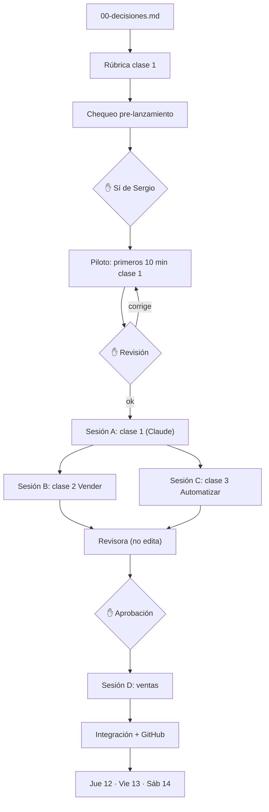

# Plan del workshop (Boss coordina, Codex ejecuta, Sergio aprueba ✋)

- Clase 1 sola primero; B y C en paralelo después; ventas (formulario, VIP) en paralelo al piloto.
- Fechas: piloto 8-9 nov, B+C 10 nov, revisión 11 nov.
- Los pilotos del harness terminaron con autorización de Sergio. El primer lote de análisis de Workshop/Referentes/Conectores también quedó revisado y aceptado; no equivale a producir las clases ni aprobar propuestas comerciales. [Resultados y pendientes](../../04-operacion-agentes/evidencias/analisis-lote1-20261108/INFORME.md).

## Tarea chica antes del jueves (aprobada por Sergio 2026-11-08, falta su sí para lanzar)
ID propuesto: referentes-workshop-20261108 · área marketing · ruta 03-referentes/cerebros/ (solo erik-taveras.md, pedro-buerbaum.md, alex-hormozi.md + carpeta propia)
1. Erik Taveras: una clase o workshop público completo + su página de venta (cursos.eriktaveras.com). Qué tomar para clase 1 y para vender.
2. Cierre por DM / privado de Pedro Buerbaum o Hormozi, aplicado al embudo «comenta NEGOCIO → DM → QR».
Rúbrica: fuentes públicas enlazadas; citas con minuto; separar hecho del referente vs propuesta OnIA; no inventar VIP; entregable de 1 página «qué aplicar en el workshop»; commit en GitHub.
