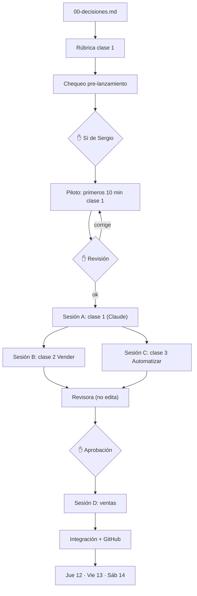

# Plan del workshop (Boss coordina, Codex ejecuta, Sergio aprueba ✋)

- Clase 1 sola primero; B y C en paralelo después; ventas (formulario, VIP) en paralelo al piloto.
- Fechas: piloto 8-9 nov, B+C 10 nov, revisión 11 nov.
- Pendiente: pausar prueba paralela de 3 sesiones de Codex (espera sí de Sergio).
