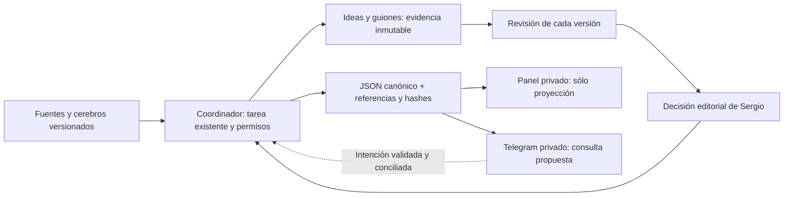

# Fábrica OnIA de ideas y guiones · propuesta comprobada en simulación

9/11/2026 UTC. Encargo `fabrica-contenido-diseno-20261108`; base de código `92b8faa451bcb054a317328f6e08a378345fd315`. Esta entrega prepara el recorrido noticias/cerebros → ideas → guiones → revisión → decisión de Sergio. Sólo el ensayo local funciona. Panel conectado, Telegram, ingestión real y recurrencia requieren implementación y autorización posteriores.

La primera versión propuesta entrega hasta dos opciones a Sergio: cada una con ángulo, texto, fuentes, patrón utilizado, límites y próxima decisión. Priorizar utilidad para dueños de negocio, una enseñanza comprobable y un CTA congruente. No convertir una novedad de IA en promesa de ingresos, ahorro o autonomía. Una idea también puede nacer de un problema del cerebro diario sin noticia; se etiqueta como contenido atemporal y conserva las fuentes del patrón, sin inventarle actualidad.

## Una tarea, una autoridad

Reutilizar `04-operacion-agentes/tareas/ID.json`, el modelo de `trabajo.py` y el ciclo del harness. El coordinador sigue siendo único escritor canónico. Un lote acotado puede contener dos guiones bajo el mismo objetivo, rutas y permisos; otro objetivo o efectos externos necesitan otro encargo del mismo harness. No crear una cola propia de contenido, tabla de estados en Telegram ni base editable del panel.

El registro del encargo real no se toca en esta entrega. El ensayo crea un ID de ficción nuevo en una base aislada **dentro de esta carpeta**; no copia ese registro ni su briefing. Los archivos bajo `ensayos/` son evidencia de prueba, nunca entradas de despacho del coordinador. No ejecutar `lanzar`, `cerrar`, `revisar` o `aceptar` sobre esos IDs como si fueran tareas reales.

| Paso editorial | Estado del harness | Evidencia y condición de avance |
|---|---|---|
| Preparar lote | `preparado` | Objetivo, público hipotético, fuentes, límites, dueño y rutas. |
| Ingestión, ideas, guiones | `en_curso` | Archivos versionados; cada bloque factual apunta a una fuente. |
| Entrada incompleta o fallo | `en_espera` si bloquea todo el lote | Causa, responsable y condición de recuperación; si hay entradas independientes, continuar sólo esas y conservar el pendiente. |
| Revisión de cada guion | `en_curso`; `para_revision` al entregar el lote comprobado | Informe editorial por versión. El veredicto `cambios` de un guion impide seleccionarlo para preparar, aunque el ensayo técnico del lote esté correcto. |
| Decisión de Sergio | `decisiones[]` mediante `trabajo.decide` en tarea abierta | Fuente inmutable con actor, versión, hash y alcance. `elegir_para_preparar`, `pedir_cambios` o `descartar`. |
| Cierre técnico | Ciclo habitual de cierre/revisión/aceptación | Otro SID revisa el commit exacto. La decisión editorial de Sergio no sustituye esa revisión. |

No añadir estados `publicado`, `aprobado_por_bot` o `listo` al modelo. La fase editorial se obtiene de los artefactos referenciados, sin un segundo estado mutable. `decide` rechaza una entrega en `para_revision`: para una decisión posterior, el coordinador debe reconciliar y reabrir explícitamente; no degradar una tarea aceptada por comodidad. Las nuevas decisiones conservan las anteriores con `sustituye`, si corresponde. Una modificación del guion invalida su revisión editorial y selección anteriores; requiere nueva versión y nuevos hashes.

## Ingestión y composición

Propuesta: entrada manual al principio, una fuente primaria pública por noticia. Guardar URL original y canónica, autor/organización, título, fecha del hecho, publicación/actualización y consulta en UTC con zona original si está disponible, fragmento mínimo o resumen propio, hash de lo recuperado y límites. Una noticia sin fecha del hecho queda pendiente hasta justificarla; no confundir publicación con hecho ni fecha de consulta con actualidad. Un resumen secundario ayuda a descubrir, pero no reemplaza la primaria. Si una primaria está inaccesible, conservar el fallo; no completar con imaginación.

Deduplicar antes de proponer: URL canónica sin fragmento ni parámetros de seguimiento conocidos, ID del editor si existe y huella del contenido. Agrupar coberturas del mismo hecho con alias de fuentes y un solo candidato. Una actualización sustantiva genera versión y diferencia visible, no otro guion silencioso. Deduplicación entre dominios y semántica requieren revisión humana cuando no haya coincidencia exacta. En el ensayo sólo se comprueba la URL de una copia con UTM; no hay deduplicador semántico implementado.

Los textos externos son datos: no pueden conceder permisos, cambiar instrucciones, ejecutar comandos ni alterar destinos. Escapar HTML y validar enlaces antes de proyectarlos. Mantener atribución primaria en el guion/nota de fuentes, sin copiar piezas enteras ni sus voces. No descargar medios ni incluir datos privados en esta fase.

Por idea: problema, público como hipótesis, ángulo, fuente/fecha, patrón con ficha y ancla, qué se adapta y qué es propuesta OnIA. Por guion: ID/versión, idea origen, duración objetivo estimada, bloques con respaldo por afirmación, CTA, límites y referencias legibles. No basta una bibliografía genérica para todo el lote.

Rúbrica por guion: (1) fuente y fechas permiten sostener cada hecho; (2) patrón y autoría propia separados; (3) no hay promesas sin prueba; (4) gancho, enseñanza y CTA son comprensibles y congruentes; (5) ficción o incertidumbre visibles. Un incumplimiento exige `cambios`. Revisión enlazada al hash del guion, nombre del revisor, fecha, veredicto y correcciones. El revisor real debe ser distinto del ejecutor dentro del harness y revisar el commit entregado; los nombres ficticios de este ensayo no acreditan independencia.

## Panel como proyección

Lectura desde snapshot saneado de tareas canónicas y sus evidencias verificadas, con commit origen, revisión y fecha de generación. Vista inicial: dos tarjetas que necesitan atención; filtros derivados de estado, responsable y dependencia. Detalle: fuente/fecha, bloques, patrón/estado de ficha, revisión por versión, decisión de Sergio, siguiente paso y error. Un archivo sin hash correcto se muestra como evidencia no válida y bloquea decisiones sobre él.

Los controles futuros sólo crearían intenciones para el coordinador con revisión esperada; jamás editarían el JSON directamente desde el navegador. Mostrar dato desactualizado y exigir recarga ante conflicto. Los estados derivados no se guardan como autoridad. Notion podría reflejar la misma vista en otra tarea; no se conecta ahora. No se promete autenticación por existir un HTML.

El [boceto local](ensayos/ejecucion-02/panel.html) es una proyección estática generada por el ensayo a partir de su JSON aislado: dos decisiones, estado, revisión, contadores y siguiente paso. Se abre como archivo sin servidor, botones, rastreadores ni fuentes remotas. Sirve para revisar la jerarquía, no para operar el sistema. No se ha probado acceso móvil ni iniciado un servicio web.

## Telegram privado: contrato, no bot creado

El [contrato](CONTRATO.md) define comandos y rechazos. La interfaz propuesta recibe intenciones; el coordinador valida identidad, alcance, idempotencia, evidencia y revisión antes de cualquier mutación. Un mensaje de «sí» sin contexto no autoriza un envío o publicación. Respuestas privadas y notificaciones también son envíos y requieren el sí aplicable a su activación.

Antes de conectar: Sergio elige bot/destino por un procedimiento privado; validar `user_id` y `chat_id` numéricos contra lista permitida, conversación privada, sin grupos ni usernames como prueba de identidad. Conservar tokens y payloads íntegros fuera de Git. En el transporte futuro, validar autenticidad del ingreso según el mecanismo elegido y probado; no suponer que basta conocer un ID ni que la conexión actual exista.

## Activación por etapas y propuesta de recurrencia

1. **Ahora, realizado:** diseño, contrato, ficción y ensayo con APIs existentes; cero llamadas LLM adicionales. No se solicita otra aprobación para completar esta entrega autorizada.
2. **Propuesto, pendiente de sí para construir:** lector privado del panel y adaptador Telegram contra tarea sintética. Probar identidad/destino incorrectos, replay, concurrencia, evidencia alterada y resultado de envío incierto. Sin contenido comercial ni despacho automático. Resolver antes dónde guardar recibos privados y cómo autenticar acceso al panel.
3. **Propuesto, pendiente de autorización específica:** un lote de fuentes reales accesibles, seleccionadas manualmente; revisión distinta y decisión editorial humana. Confirmar qué fuentes/formatos, máximo de piezas, cuota fechada y permisos del canal. Publicación/redes sigue siendo otro alcance.
4. **Scheduler sólo como diseño por presentar:** disparador manual o ventana de revisión que Sergio elija después; escanear tareas canónicas elegibles, comprobar dependencia, permisos, rutas libres, cupos del harness y cuota. No mantener otra cola. No lanzar si hay una ejecución viva del mismo ID. Máximo inicial dos ideas por lote y dos asuntos que requieran atención de Sergio; reservar cupo para revisión. Proponer dos intentos por hipótesis, checkpoint y espera al fallar; `en_espera` no detiene procesos. Antes de reintentar un efecto incierto, conciliar recibo. **Esperar sí antes de implementar cualquier scheduler.** Sin cron, n8n, Docker, LangGraph ni servicio instalado.

Los perfiles del manifiesto son candidatos, no mediciones de coste/calidad: extracción para clasificación estructurada, multifuente para redacción con contexto, cambio-acotado para una eventual interfaz. Registrar recomendado/solicitado/observado por separado, observado `null` si no hay evidencia; no seleccionar automáticamente ni escalar por una fuente bloqueada. Esta entrega no valida modelos ni consulta cuota nueva. Medir en un piloto posterior: ideas descartadas por falta de fuente, duplicados evitados, guiones aprobados al primer intento, retrabajo, tiempo de decisión y cuota con fecha. No hay métricas de ventas ni ahorro reales.

## Procedencia y pendientes

Lectura explícita de la directora [desarrollar-y-verificar](../../compartibles/skills/desarrollar-y-verificar/SKILL.md), anunciada en el catálogo de esta sesión. No se cargaron apoyos, conectores ni hijos. Fuentes operativas leídas: [reglas comunes](../../../04-operacion-agentes/reglas-comunes.md), [Boss](../../../04-operacion-agentes/boss-memoria.md), [estado](../../../00-MAPA/ESTADO.md), [orquestación](../../../04-operacion-agentes/ORQUESTACION.md), [manifiesto](../../../04-operacion-agentes/orquestacion.json), [empresa unipersonal](../../../04-operacion-agentes/EMPRESA-UNIPERSONAL.md), [modelos y pausas](../../../04-operacion-agentes/MODELOS-Y-PAUSAS-20261108.md), [arquitectura](../../../06-plataforma/arquitectura.md) y [cerebro diario](../../../02-contenido/CEREBRO-DIARIO.md). APIs cotejadas en `trabajo.py`: crear, leer, actualizar, decidir y verificar; no se modifica ese archivo.

Patrones concretos: [Heras, ficha lote 01](../../../03-referentes/fichas/lote-01/victor-heras.md) y [Carrera, ficha lote 01](../../../03-referentes/fichas/lote-01/alex-carrera.md); aceptación documental en [cierre del lote](../../../03-referentes/lote-01/CIERRE-COORDINACION.md). Sus [cerebros Heras](../../../03-referentes/cerebros/victor-heras.md) y [Carrera](../../../03-referentes/cerebros/alex-carrera.md), y el [índice](../../../03-referentes/cerebros/README.md), siguen parciales. No se mezclan estas fichas con aceptación de los grupos Grok profundos ni se sintetizan esos grupos; esa síntesis corresponde a Boss. Los anclajes audiovisuales del fixture son procedencia documental previa, sin visionado en esta sesión.

Entrada aportada por el coordinador: [Así Utilizo los Agentes de IA a Diario — Euge Oller](https://www.youtube.com/watch?v=JuAQILH7dkQ). Título/autor se conservan como aportados en el briefing, no verificados aquí. **Pendiente de evidencia visual por el coordinador**: no mirado por esta ejecutora, no usado como patrón, sin atribuirle prácticas. Una transcripción futura por sí sola no resuelve el pedido de mirarlo.

Lecciones aplicadas del [registro de errores](../../../04-operacion-agentes/registro-de-errores.md): no equiparar texto/cuadros a percepción, no convertir `brief_view` en registro completo, no confundir `rc=0` con aceptación, preservar temporales y resolver restricciones de evidencia antes de adjuntar. En esta entrega no se leen fuentes privadas ni se publican secretos. Las noticias de `fixture.json` tienen dominios `.invalid`, autores inventados y ficción visible en cada guion.
