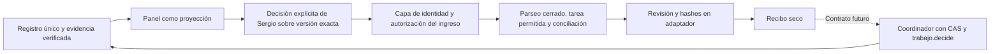

# Panel, decisión y adaptador seco

Versión 1 del 9 de noviembre de 2026 UTC. Extiende el [contrato de fábrica del 8/11](../20261108/CONTRATO.md). El coordinador conserva la escritura del registro único del harness. El adaptador entrega un recibo editorial determinista sobre datos ficticios. Su modo admitido es `fixture`.

## Entrada ejecutable

`node adaptador.cjs < fixture.json` procesa un lote sintético y conserva recibos sólo durante esa invocación. `events` contiene actualizaciones con `update_id`, conversación privada, emisor y texto. `policy` y `snapshot` son dependencias del llamador de confianza. En el fixture ambos vienen del mismo JSON para poder reproducir el ensayo. Sus flags declarativos no acreditan autenticidad de un ingreso externo.

La función exportada `adapt(event, policy, loadSnapshot, receipts)` permite inyectar la dependencia que lee el snapshot. El CLI y el workflow utilizan exclusivamente el snapshot sintético incorporado. El adaptador rechaza `policy.mode` distinto de `fixture` y eventos sin `synthetic=true`.

| Comando de ensayo | Resultado seco |
|---|---|
| `/elegir ID GUION REV HASH` | `elegir_para_preparar`, sólo con revisión editorial buena del hash exacto |
| `/cambios ID GUION REV HASH motivo` | `pedir_cambios` con motivo obligatorio |
| `/descartar ID GUION REV HASH motivo` | `descartar` con motivo obligatorio |

`REV` es la revisión esperada de la tarea. `HASH` es SHA-256 del guion usando JSON UTF-8, indentación de dos espacios y salto final, igual a `encoded()` del ensayo previo. La función JS reproduce esa codificación para los objetos del fixture, cotejados contra `ensayo.sha`. El formato general futuro debe conservar bytes canónicos desde el coordinador para evitar discrepancias de serialización entre lenguajes. La revisión editorial se vincula al hash del guion y el recibo incluye además el hash de esa revisión.

## Orden de validación

1. Exigir modo de simulación y transporte declarado verificado por la política de prueba.
2. Validar conversación privada, identidad numérica permitida y emisor humano del fixture.
3. Validar tipo de `update_id`, sintaxis completa del comando y lista de tareas permitidas.
4. Conciliar recibos de transporte y negocio ya preparados, antes de leer una revisión que pudo avanzar.
5. Leer dependencia y exigir snapshot verificado, ID y revisión exactos y tarea abierta.
6. Comprobar hashes del guion y su revisión. Elegir requiere todos los controles editoriales verdaderos.
7. Devolver `preparado_seco`, `duplicado` con recibo previo, o `rechazado` con código fijo.

El negocio se identifica por tarea, revisión esperada, guion/hash, acción y motivo. El transporte se identifica por alias de bot, conversación y `update_id`. Se calcula SHA-256 sobre tuplas de orden fijo. Mismo transporte y payload diferente produce `REPLAY_CONFLICTIVO`. Una revisión vieja sin recibo previo produce `REVISION_VIEJA`. Una dependencia caída deja los recibos intactos. Los fallos conservan el snapshot byte por byte.

## Frontera del coordinador

El ensayo [ensayo-integracion.py](ensayo-integracion.py) ejecuta este contrato sobre una base nueva dentro de `evidencia/`. Verifica también el registro y los hashes conservados del ensayo del 8/11. La mutación real de prueba utiliza `trabajo.create`, `update`, `decide`, `read_task` y `verify` existentes.

El recibo técnico usa `decision_id=telegram-<sha256 de negocio>`. `trabajo.py` admite hasta 64 caracteres. La traducción validada para el ID del harness es el hash completo de 64 caracteres después de verificar el patrón `telegram-[a-f0-9]{64}`. El recibo conserva el namespace técnico original en su fuente inmutable. El primer intento omitió esa traducción y fue rechazado. La corrección y la comprobación están en [errores de esta entrega](ERRORES.md).

Para una futura conexión real, el coordinador deberá ejecutar la secuencia siguiente bajo su autorización y sus rutas asignadas.

1. Verificar transporte e identidad fuera del JSON del cliente y establecer permisos de tarea y alcance editorial. El panel deberá entregar intención vinculada a sesión autenticada, versión y evidencia verificadas. Un bot exige validar el ingreso y listas privadas de usuario/chat. El fixture presente sólo ejercita esa frontera declarativa.
2. Leer el registro único actual y ejecutar `trabajo.verify`. Buscar la decisión por el ID de negocio normalizado. Si ya existe, leer `decisiones[].fuente`, verificar integridad y comparar íntegramente el recibo. Coincidencia devuelve el anterior. Divergencia requiere conciliación.
3. Construir snapshot desde artefactos inmutables referenciados por el registro. El cliente no puede suministrar una revisión editorial sustituta. Usar una implementación habilitada para ingreso real dentro de ese encargo futuro.
4. Guardar el recibo saneado como evidencia inmutable bajo `04-operacion-agentes/evidencias/ID/` por el coordinador. Este encargo sólo demuestra esa estructura dentro de su base aislada.
5. Llamar `trabajo.decide(base, ID, revision_esperada, decision_id_harness, texto, fuente, autor, actor=responsable)`. El responsable asignado del harness debe coincidir. El autor editorial procede de la identidad autenticada. Reabrir tareas cerradas exige una decisión explícita del coordinador.
6. Releer el registro y verificar su fuente. Si aparece un conflicto CAS, volver a conciliar por ID y fuente. Una intención ajena que adelantó la revisión exige nueva decisión sobre snapshot actualizado.

La conciliación tras reinicio se demuestra recuperando el recibo de `decisiones[].fuente` en la base aislada. La implementación presente mantiene el índice técnico en memoria, por lo que un proceso nuevo vuelve a producir un recibo seco. La persistencia y la exclusión de segundas mutaciones pertenecen al registro único y al CAS del coordinador. Una caída entre guardar evidencia y decidir puede dejar un archivo sin adjuntar. Se conserva y se concilia por ID/hash antes de reintentar. Concurrencia distribuida y recepción de Telegram permanecen pendientes de prueba.

## Permisos y efectos

Las tres acciones son editoriales. La copia n8n contiene únicamente Manual Trigger y dos Code. La respuesta queda en el resultado seco del nodo. Cualquier respuesta Telegram, envío, publicación, LLM, activación, nonce de efecto externo o despacho de sesiones requiere su alcance y autorización aplicables. `/estado`, `/ideas`, `/guion` y `/confirmar` siguen definidos en el contrato previo y pendientes de implementación.

Telegram distingue polling y webhooks como mecanismos mutuamente excluyentes y permite verificar un secreto de cabecera para un webhook configurado. Esas capacidades orientan la conexión futura. La instancia actual conserva su webhook y sólo se consultó mediante REST de n8n. [Telegram Bot API](https://core.telegram.org/bots/api#getting-updates)
