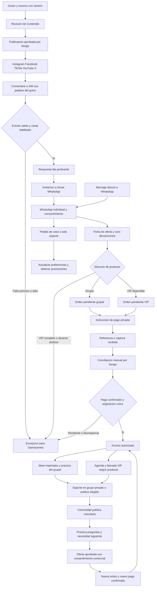

# Redes, funnels y comunidades de OnIA

10 de noviembre de 2026. Encargo `fabrica-automatizaciones-redes-funnels-20261110`. Entrega de análisis y diseño para revisión independiente y decisión de Sergio.

## 1. Base de evidencia y decisiones vigentes

El análisis usa el checkout `2f5cd1fad5cd373670872a44a8a0f61366530764`, rama `codex/ws-fabrica-automatizaciones-redes-funnels-20261110`. El commit del pedido `dd3b7a69cb0a4f2648814ed17c0eb7dc26f18861` es ancestro de esta base. El SHA256 del pedido leído coincide con `013b320217e9a7874dfa30b8f67bcc40cd9b84b2c4ad493b6ef806ba05f64fbf`. El briefing recibido por stdin define el alcance. [Pedido][pedido]

Las tablas distinguen decisiones aprobadas, evidencia documental fechada, propuestas de OnIA y dependencias desconocidas. Los estados del harness citados corresponden a los JSON versionados en este checkout. La situación posterior del coordinador se consulta allí antes de ejecutar otro paso. [Reglas comunes][reglas]

| Tema | Decisión vigente de Sergio y consecuencia para el diseño |
|---|---|
| Oferta | Workshop «Tu negocio con IA: ordena, vende y automatiza», tres clases. Primera clase con Claude. La ficha necesita indicar requisitos de acceso propio y resultados practicables. |
| Grupal | Bs 50, sin límite de cupos fijado para el grupo. La capacidad de soporte se dimensiona por separado. |
| VIP | Bs 150, cinco cupos, llamada privada de 30 minutos sobre el caso del negocio o personal del comprador. Falta precisar comercialmente si incluye el grupal o se contrata aparte. |
| Fechas y canal | 12 y 13 de noviembre a las 21:00, 14 de noviembre a las 14:00, America/La_Paz. Clases en Google Meet. |
| Palabra clave | La automatización responde la palabra del guion en comentarios y DMs. NEGOCIO es la palabra recuperada de G01. Cada guion debe tener su correspondencia exacta con recurso y oferta. |
| Cobro | Sergio confirma manualmente el movimiento real. Una captura mantiene el pago pendiente de comprobación. El QR se administra en privado. |
| Devoluciones | Cero devoluciones. Contenido debe incorporar esa condición en la información comercial previa al pago, con texto que Sergio revise. |
| Continuidad | Al terminar, soporte mediante grupos de WhatsApp privados o públicos y comunidad pública. La continuidad lleva a otro workshop, comunidad u otra oferta que Sergio defina. |
| Responsables | Operaciones lleva ventas, seguimiento del chatbot, inscritos, pagos pendientes y Meet. Contenido tiene la responsabilidad editorial. Boss coordina encargos y reúne decisiones. Sergio aprueba efectos externos y verifica pagos. |

Las decisiones comerciales de las 16:08 y el briefing gobiernan palabra clave, VIP, devoluciones y continuidad. Los datos de precio, cupos, duración, horarios, Meet y Cloud API vienen de las decisiones de la mañana. La oferta histórica y G01 aportan nombre, público y práctica. [Decisiones de Sergio][decisiones], [reparto del 10 de noviembre][reparto], [G01][g01]

### Documentos que requieren conciliación antes del uso comercial

El README del chatbot conserva párrafos con canal por elegir, horario pendiente y VIP fuera de la invitación. El calendario también conserva pendientes ya resueltos. Este análisis aplica las decisiones posteriores. Operaciones y Contenido deben cotejar los mensajes de su entrega contra esas decisiones antes de presentarlos a Sergio. [Chatbot][chatbot], [calendario][calendario], [decisiones vigentes][decisiones]

El modelo de contenido registra una corrección del 9 de noviembre a las 20:30. Los cinco videos salen de una tanda con cinco guiones. El vlog diario se publica entero y sin edición cuando Sergio lo aprueba. Las secciones históricas que proponían recortarlo quedaron sustituidas por esa corrección. [Modelo de contenido][modelo]

## 2. Rol de las seis redes y formatos

La distribución siguiente es una propuesta operativa de OnIA. Las prioridades se basan en la venta orgánica del workshop y en reutilizar las piezas existentes. La elección final de cuentas necesita las URLs de Sergio y sus datos de uso. El análisis de sus bios, publicaciones e Insights sigue pendiente. [Modelo de contenido, análisis de cuentas][modelo]

| Red | Rol propuesto y tipos de contenido | Orientación de trabajo propuesta | Siguiente paso comercial | Prioridad hasta el 14 |
|---|---|---|---|---|
| Instagram | Descubrimiento y conversación. Reels de venta útil, demostración de pantalla con rostro, pregunta/respuesta, error y corrección. Stories para dudas y recordatorio. Carruseles para pasos y requisitos. | Vertical 9×16 para Reels y Stories. Carrusel vertical o cuadrado según legibilidad. | Palabra del guion en comentario o DM → respuesta pertinente → invitación a iniciar WhatsApp. | Principal, condicionada a resolver el acceso a la cuenta y al recorrido de atención. |
| Facebook | Distribución local y explicación a dueños de negocio. Reel adaptado, publicación con información del workshop, preguntas y respuestas. Eventual comunidad temática después de validar demanda. | Vertical para Reels y Stories. Horizontal 16×9 para explicación larga. Tarjeta/carrusel legible para datos de la oferta. | Comentario en publicación propia o mensaje a la página → información → WhatsApp iniciado por la persona. | Reutilización del material aprobado, una vez confirmada la página de Sergio. |
| TikTok | Descubrimiento mediante un problema visible, demostración, contraste o prueba de otro gancho. Evergreen cuando falte noticia comprobada. | Vertical 9×16. Pantallas recortadas para conservar lectura. | Palabra del guion → respuesta por canal habilitado → destino de información y WhatsApp aprobado. | Adaptación de la tanda disponible, con atención verificable antes de usar el CTA. |
| YouTube | Shorts para descubrimiento y videos largos para explicar una práctica o documentar un proceso. El vlog entero conserva su función de diario. | Vertical para Shorts. Horizontal 16×9 propuesto para tutoriales largos. El vlog conserva su orientación original mientras se confirma su canal. | Comentario con palabra → respuesta pública pertinente → destino de información/WhatsApp visible en una superficie habilitada. | Shorts reutilizados si el canal está confirmado. Video largo después del 14 salvo material ya disponible. |
| X | Conversación y criterio profesional. Texto breve, hilo de una decisión con prueba propia, imagen de proceso y clip explicativo. | Texto e imagen. Clip vertical reutilizado o captura horizontal si mejora lectura. | Respuesta con la palabra o DM entrante → información → WhatsApp voluntario. | Secundaria hasta tener evidencia de audiencia y acceso. |
| WhatsApp | Información, inscripción, conciliación, acceso, soporte y continuidad. Conversación individual con respuestas fijas, documentos de práctica y avisos pertinentes. | Texto primero. Tarjeta vertical para resumen. Video horizontal cuando el detalle de pantalla lo necesite, vertical para explicación breve. | Interés → selección de oferta → pendiente → pago confirmado → acceso → soporte → comunidad → nueva compra. | Principal para la conversión y la entrega. |

Las orientaciones son decisiones de producción propuestas. Cada destino requiere revisar encuadre, texto cubierto por interfaz, audio, portada y CTA. La misma pieza distribuida en varias redes conserva un ID de contenido y recibe IDs de publicación por destino. La meta documentada es al menos cinco videos diarios, con aprobación por pieza. El volumen realizado permanece desconocido en este análisis. [Formatos de OnIA][formatos], [modelo de contenido][modelo]

### Tanda editorial reutilizable

1. **Venta útil.** Mostrar una tarea concreta y cerrar con la palabra asociada al workshop. G01 aporta el ejemplo de agenda y NEGOCIO.
2. **Marca seria.** Una decisión real de Sergio al construir OnIA, con evidencia propia y límites.
3. **Noticia o evergreen.** Usar noticia con fuente primaria fechada cuando exista. G02 y el molde de práctica permiten la opción evergreen.
4. **Segunda venta o marca.** Resolver una objeción o enseñar otro caso, con una idea diferenciada.
5. **Reel de prueba.** Variar gancho, pregunta o composición y conservar el dato que se quiere comparar.

Cada pieza necesita objetivo, idea, prueba, guion, formato, una acción final y destino. Las piezas de marca pueden pedir guardar o conversar. La automatización comercial se aplica a las que efectivamente anuncian una palabra clave. Contenido revisa los guiones de Codex hasta el 13 y los escribe desde el 14. Sergio revisa y publica. [Pedido de guiones][pedido-guiones], [modelo de contenido][modelo], [reparto][reparto]

### Capacidad técnica por canal

| Canal de entrada | Evidencia pública consultada el 10 de noviembre | Dependencia para OnIA |
|---|---|---|
| Instagram, comentario | La colección oficial de Meta documenta gestión y respuesta a comentarios de cuentas profesionales. La página específica de respuestas privadas resultó inaccesible en esta consulta. | Confirmar cuenta, modalidad de login, permisos, webhook, condiciones de respuesta pública/privada y ventanas vigentes. La salida a DM desde comentario queda pendiente de esa comprobación. |
| Instagram, DM entrante | La colección oficial de Meta documenta mensajería de cuentas profesionales y permiso de mensajes. | Autorización de la cuenta y prueba de recepción/respuesta con el permiso específico de Sergio. |
| Facebook, comentario y Messenger | La colección oficial de Meta documenta conversaciones de páginas, permisos y acceso avanzado para determinados usuarios. La documentación específica de respuestas privadas devolvió 429. | Confirmar página, propiedad, permisos, alcance aprobado y mecanismo comentario→respuesta. |
| TikTok, comentario y DM | El índice público de TikTok API for Business enumera Business Messaging y respuesta a comentarios propios. Research API documenta consulta de comentarios para investigación. | Elegibilidad, región, producto, permisos y disponibilidad comercial para la cuenta de Sergio desconocidos. Preparar el adaptador cuando esas condiciones estén acreditadas. |
| YouTube, comentario | La API oficial permite listar hilos y responder comentarios. | Cuenta, autorización, cuota y revisión del texto. Diseñar aquí la respuesta pública con el destino de información aprobado. La vía de DM para OnIA queda sin acreditar. |
| X, respuesta y DM | X documenta consulta de eventos de DM. Su ayuda explica las solicitudes de mensajes y configuraciones del destinatario. | Acceso de desarrollador, envío, permisos y coste desconocidos para OnIA. Hasta el 14 se propone atención humana autorizada. |
| WhatsApp individual | La política oficial permite respuesta libre dentro de 24 horas del último mensaje de la persona y requiere plantillas aprobadas fuera de esa ventana. | Número, credenciales, webhook, consentimiento, plantillas aplicables y autorización de uso real. |
| Grupos y comunidades de WhatsApp | La documentación oficial de Groups API devolvió 429. | Elegibilidad y operaciones sobre grupos ordinarios/comunidades desconocidas. La gestión humana de grupos se propone como dependencia separada del bot individual. |

Fuentes primarias para las capacidades descritas. [Instagram de Meta, comentarios][web-ig-comentarios], [Instagram de Meta, mensajes][web-ig-mensajes], [Messenger de Meta][web-messenger], [TikTok API for Business][web-tiktok-business], [TikTok Research][web-tiktok-research], [YouTube Comments][web-youtube], [X DM][web-x-api], [ayuda de X][web-x-help], [política de WhatsApp][web-wa]

El diseño debe adaptar la respuesta a cada superficie. La promesa editorial de automatizar la palabra clave necesita un adaptador probado en esa red. Si un canal carece de integración acreditada, Operaciones puede preparar atención humana con los mismos textos, sujeta a autorización. La activación y la prueba con destinatario real tienen su propio permiso. El pedido de análisis conserva los efectos externos bajo decisión de Sergio. [Pedido][pedido], [especificación de automatizaciones][fabrica3]

## 3. Qué aporta el cerebro aceptado

Los registros versionados de `cerebros-a-20261108`, `cerebros-b-20261108` y `cerebros-c-20261108` están aceptados, actualizados el 9 de noviembre alrededor de las 03:51 UTC. El recibo de cierre vincula commits, revisores distintos y la integración. Las fichas conservan textos históricos de «para revisión» junto a sus límites. [Registro A][registro-a], [registro B][registro-b], [registro C][registro-c], [cierre de retomas][cierre-cerebro]

La matriz resume lo documentado en las fichas. La columna de aplicación contiene propuestas de OnIA. Se conserva el alcance de cada muestra, con precios actuales, cierres privados y resultados pendientes cuando corresponda. Las referencias comerciales de terceros se usan para estudiar estructura.

| Referente | Hecho o inferencia que la ficha documenta | Aplicación propuesta para OnIA y límite | Ficha trazable |
|---|---|---|---|
| Pedro Buerbaum | P1 descompone la oferta en decisiones específicas. P4 distingue oferta, distribución y capacidad. La página comercial presenta materiales y duración. | Precisar para quién es el taller y comprobar la capacidad de acceso/soporte antes de aumentar consultas. Resultados comerciales de sus casos quedan como declaraciones. | [Pedro, P1/P4 y página comercial][ref-pedro] |
| Víctor Heras | P1/P3/P4 conectan explicación o relato con consultoría, mentoría o clase. Viralidad ofrece llamada y formulario de calificación. | Conectar la prueba propia con un siguiente paso concreto. Pedir datos mínimos de encaje para VIP. Su formulario comercial no acredita cierre privado. | [Heras, página comercial y patrón][ref-heras] |
| Erik Taveras | C1 separa requisitos, muestra y compra. P4 presenta casos por función y ofrece recurso por palabra clave. | Entregar información relacionada con la palabra y aclarar herramientas necesarias antes del pago. La ficha conserva la entrega privada sin observar. | [Erik, C1 y patrón][ref-erik] |
| Alex Hormozi | P1–P3 descomponen valor, contenido y petición/destino. La ficha infiere una secuencia de marco, comparación y aplicación. | Revisar correspondencia entre promesa, ejemplo y CTA. Definir métricas por etapa. El desempeño del workshop de OnIA requiere medición propia. | [Hormozi, patrón y página comercial][ref-hormozi] |
| Enrique Rocha | P1 y P4 ofrecen una guía mediante comentario. La ficha también registra cierres explicativos diferentes en P2/P3. | Mapear cada palabra a su recurso exacto y permitir piezas educativas con otro cierre. Entrega por privado, cobro y clase completa siguen sin observarse. | [Rocha, patrón de cuatro clips][ref-rocha] |
| Iman Gadzhi | P1 plantea formación útil dentro de una pieza comercial. Monetise presenta proceso, recursos y lista de espera en el corte de la ficha. | Mostrar una utilidad comprobable y declarar la oferta al invitar. La disponibilidad histórica de su producto no determina la oferta de OnIA. | [Iman, P1 y página comercial][ref-iman] |
| Justin Welsh | Content OS relaciona newsletter y reutilización de contenido escrito. La ficha identifica límites de soporte del producto. | Reutilizar una idea en texto y video y describir claramente el soporte del workshop. Incorporar email requeriría una decisión posterior. La secuencia privada de emails sigue sin observarse. | [Justin, Content OS y patrón][ref-justin] |
| Alex Carrera | P1 y P2 ofrecen entrenamiento mediante CLASE y ENTRENAMIENTO. La página de Exposure se presenta como comunidad privada y dirige el contacto al creador. | Mantener la relación palabra→recurso→destino por versión y explicar qué incluye la continuidad. El vínculo entre entrenamiento y comunidad y la entrega posterior conservan brechas en la ficha. | [Carrera, actualización P1/P2 y página comercial][ref-carrera] |
| San Muñoz | Los tutoriales y el reel analizados terminan en invitación a recurso, soporte o comunidad. La landing conecta formación y membresía. | Articular práctica → dudas → acompañamiento → siguiente oferta. La comunidad paga de OnIA queda como posibilidad por definir. | [San, C1 y patrón][ref-san] |
| Ali Abdaal | La página PTYA presenta destinatario, currículo, objeciones y condiciones declaradas. La ficha infiere pasos para convertir problemas en decisiones. | Explicar requisitos y resolver objeciones del principiante. OnIA mantiene la política de cero devoluciones decidida por Sergio. | [Ali, página comercial y patrón][ref-ali] |
| Bastian Xu | Content Project presenta darse a conocer, conectar y vender, y dirige a consultoría. P2/P3 muestran referencias y presentador superpuesto. | Separar función de descubrimiento, explicación y venta. Usar demostraciones legibles. El CTA temporal de P4 tiene un límite de evidencia en la ficha. | [Bastian, página comercial y patrón][ref-bastian] |
| Cormac Hayden | Halos publica una entrada gratuita y un plan de pago. Las piezas combinan persona, rutinas y productos concretos. | Mostrar el resultado de uso antes de proponer continuidad. La conversión y el acceso efectivo al producto de la ficha quedan sin comprobar. | [Cormac, página comercial y patrón][ref-cormac] |
| Gonzalo Teba | Las cuatro piezas analizadas presentan hábitos, contraste, lista o reto. La web de coaching tuvo un formulario inaccesible. | Proponer una práctica repetible dentro de la comunidad. El puente contenido→registro→venta figura como hipótesis en la ficha. | [Gonzalo, página comercial y patrón][ref-gonzalo] |
| Beltrán Briones | P2/P4 solicitan mensaje. Las superficies comerciales distinguen libro y charlas. | Diferenciar la solicitud de información del grupal y la consulta VIP. Las piezas colaborativas y las predicciones conservan sus límites de atribución. | [Beltrán, P4 y superficies comerciales][ref-beltran] |
| Toto Artuso | Sus piezas documentan trabajo, problemas y decisiones. Portfolio y Marz conducen a producto, precios y acceso/demo. | El vlog aporta continuidad de proceso. La marca seria muestra el aprendizaje que corresponde a la oferta. Ventas atribuibles a ese recorrido desconocidas. | [Toto, página comercial y patrón][ref-toto] |
| Nick Bare | La landing Go One More reúne entrenamiento, recursos y comunidad. El contenido analizado combina jornada, reflexión y archivo. | Organizar continuidad alrededor de una práctica y una revisión periódica del avance. Retención y ventas carecen de medición en su ficha. | [Nick, página comercial y patrón][ref-nick] |
| Jeff Nippard | Sus páginas describen variantes, materiales y respuestas a dudas. La ficha relaciona acción visible, explicación y ajuste en los reels. | Entregar una guía de práctica con indicaciones de uso y una corrección comprobable. La aplicación al workshop de IA es una adaptación propia. | [Jeff, comercial y patrón][ref-jeff] |
| Álvaro Risoglio | Las piezas usan decisiones del negocio en marcha. Voltra documenta selección, carrito, datos/pago y confirmación. | Mostrar el estado de una inscripción y su comprobación humana. La ficha distingue persona y empresa, con formación personal sin localizar en su búsqueda. | [Álvaro, búsqueda comercial y patrón][ref-alvaro] |
| Voltra | Cuatro creativos mantienen el producto visible. La ficha observa demostración → información → carrito, con condiciones contradictorias en la tienda. | Mostrar una salida del workshop y mantener datos comerciales coherentes en todos los mensajes. El pago y la conversión de la marca siguen sin comprobarse. | [Voltra, comercial y patrón][ref-voltra] |

La hipótesis de OnIA es que una demostración útil, un siguiente paso coherente y acompañamiento posterior pueden facilitar continuidad y recompra. Se comprueba con cohortes propias de interesados y compradores. Las fichas aportan patrones públicos y límites, con conversaciones privadas y ventas fuera de su evidencia. [Cierre y alcance del cerebro][cierre-cerebro]

## 4. Funnel completo propuesto

### Etapas y condiciones de paso

| Etapa | Entrada y salida esperadas | Comprobación y responsable |
|---|---|---|
| Preparar | Guion con ID, versión, palabra, recurso/oferta, red y CTA → pieza revisada. | Contenido valida el contenido. Sergio decide publicación. |
| Descubrir | Publicación autorizada → visualización o visita. | Registrar plataforma, cuenta y publicación. Las visualizaciones disponibles se toman de datos reales. |
| Pedir información | Comentario o DM con la palabra del guion → evento de interés registrado. | Adaptador verifica origen y correspondencia con la pieza. Cada canal mantiene su identidad propia. |
| Responder | Evento válido → respuesta fija relacionada con la solicitud, en el canal habilitado. | Evitar duplicados, comprobar permisos y ventana. Una entrega fallida pasa a excepción. |
| Pasar a WhatsApp | Respuesta con invitación → la persona inicia conversación en WhatsApp o autoriza explícitamente ese contacto. | Conservar origen mediante referencia de campaña y confirmar la vinculación entre identidades. |
| Informar | Solicitud → ficha con para quién, resultados, clases, horarios, Meet, requisitos, precios y cero devoluciones. | Contenido revisa la versión. Operaciones registra qué versión recibió la persona. |
| Elegir | Persona interesada → elección grupal o solicitud VIP, con alcance aclarado. | Sergio define relación VIP/grupal y disponibilidad. Operaciones explica las condiciones aprobadas. |
| Inscribir pendiente | Nombre y contacto mínimos autorizados, oferta e importe → orden pendiente con ID privado. | Operaciones lleva el registro. La información de pago se comparte después de mostrar las condiciones. |
| Pagar | Orden pendiente → instrucciones/QR privados → comprobante o referencia recibida. | La captura pasa a conciliación. Registrar discrepancias sin pedir un nuevo pago automáticamente. |
| Confirmar | Sergio contrasta moneda, importe y referencia con movimiento real → pago confirmado y asignado una sola vez. | Aprobación explícita del operador autorizado, con identidad, fecha y orden. |
| Dar acceso | Orden confirmada → acceso de Meet, materiales y grupo correspondientes al producto. | Sergio autoriza el alta. Operaciones comprueba entrega y resuelve errores. |
| Participar | Asistencia y práctica → resultado revisable, dudas y soporte. | Sergio facilita. Operaciones registra incidencias. La grabación y su distribución quedan pendientes de decisión. |
| Entregar VIP | Pago y cupo VIP confirmado → elección de horario → llamada privada de 30 minutos sobre el caso. | Sergio confirma agenda y alcance. Una solicitud de llamada mantiene estado de agenda pendiente hasta la confirmación. |
| Continuar | Final del workshop → soporte y oferta voluntaria de comunidad pública. | Operaciones ofrece acceso según preferencia de grupo privado/público y consentimiento. |
| Recomprar | Necesidad detectada y consentimiento comercial vigente → oferta pertinente aprobada → nueva orden. | Sergio decide producto, precio y fecha. La nueva orden conserva vínculo con la compra anterior. |

La información de VIP debe aclarar qué compra Bs 150 antes de aceptar un pago. También hace falta resolver cambios de modalidad y el tratamiento de un pago recibido cuando los cinco cupos estén ocupados. Esas excepciones se derivan a Sergio. La política comercial sigue en cero devoluciones. [Decisiones][decisiones]

### Diagrama del recorrido diseñado

Las ramas de acceso se resuelven según el producto comprado. La relación comercial VIP/grupal está pendiente. El diagrama representa el contrato propuesto para futuras implementaciones. Su validación operativa necesita las entregas del chatbot, las integraciones por red y una prueba autorizada de extremo a extremo.

## 5. Contrato de palabra clave y seguimiento

### Correspondencia editorial

Cada versión de guion debe registrar `contenido_id`, `version_guion`, `palabra_clave`, `recurso_id`, `oferta_id`, `cuenta_autorizada`, `publicacion_id`, `respuesta_version` y vigencia. Es una propuesta de contrato para reutilizar en las fábricas 1 y 4. G01 usa NEGOCIO para información del workshop. Las otras palabras de la tanda del 11 requieren leer su entrega antes de cargarlas. [G01][g01], [pedido de guiones][pedido-guiones]

Propuesta de reconocimiento exacto de palabra tras normalizar mayúsculas, tildes, espacios y puntuación. «Quiero NEGOCIO» puede coincidir con el token NEGOCIO. «NEGOCIOS» o una frase que rechace la oferta necesitan otra regla o revisión. Una intención de baja tiene precedencia. Un DM sin referencia a publicación se resuelve mediante el mapa de palabras vigente. Si hay varias ofertas compatibles, la respuesta pide elegir. El texto ambiguo pasa a Operaciones.

Cada adaptador conserva plataforma, cuenta, evento, publicación y usuario con su ámbito original. La clave técnica propuesta para duplicados es plataforma + cuenta + ID del evento. Una persona que comenta y luego manda DM puede generar dos eventos válidos. Operaciones necesita un control adicional por conversación y recurso ya entregado para evitar repetir toda la secuencia.

### Estado comercial y estado de entrega

El seguimiento comercial propuesto contiene `interesado`, `informado`, `pendiente_pago`, `en_conciliacion`, `confirmado`, `acceso_pendiente`, `acceso_entregado`, `en_soporte` y `completado`. Una nueva compra crea otra orden. El pago confirmado se conserva al resolver un fallo de entrega de acceso.

La preferencia comercial y la pertenencia a comunidad se registran aparte. Un participante puede solicitar cese de promociones y seguir recibiendo el soporte acordado. Las bajas eliminan los envíos comerciales pendientes. La ficha de preferencias conserva el origen y la fecha del consentimiento o del cese. [Política de WhatsApp][web-wa]

La entrega técnica propone `por_enviar`, `enviado`, `fallido` e `incierto`, con ID del mensaje cuando el proveedor lo devuelva. En timeout después de enviar, primero se concilia el resultado. Los errores transitorios admiten reintentos limitados con espera. Los errores de permisos, destinatario o ventana pasan a intervención humana o a una plantilla aprobada cuando proceda. El destinatario de una alerta interna también requiere autorización.

El registro privado debe impedir que dos ejecuciones asignen la misma referencia de pago a órdenes distintas o confirmen más de cinco VIP. Esa operación necesita persistencia y actualización atómica. Si el sistema carece de esa capacidad probada, Sergio y Operaciones llevan la asignación con un único responsable hasta disponer del control. La reserva temporal de un cupo VIP, su vencimiento y su comunicación al interesado requieren definición comercial.

## 6. Comunidades y grupos

La estructura siguiente aplica la decisión de soporte y continuidad de Sergio. Los nombres y la organización son propuestas. La existencia actual de estos grupos, sus administradores, URLs y miembros permanece desconocida. [Decisiones][decisiones]

| Espacio propuesto | Acceso y función | Contenido y continuidad | Responsable propuesto |
|---|---|---|---|
| WhatsApp individual de ventas | Persona que solicita información. Seguimiento privado de oferta, pago y acceso. | Ficha, preguntas de inscripción y estado de su propia orden. | Operaciones, con conciliación de Sergio. |
| Grupo privado de cohorte | Compradores del grupal que acepten ingresar. | Logística de Meet, práctica, materiales y dudas del workshop. Al terminar, soporte durante el periodo que Sergio defina. | Operaciones administra y Sergio responde lo que requiera su criterio. |
| Grupo público de práctica | Ingreso voluntario, sujeto a reglas y moderación. | Preguntas generales y ejemplos saneados. Puede atender a egresados que prefieran soporte público y a interesados. | Operaciones modera y Contenido prepara recursos. |
| Comunidad pública de OnIA | Espacio continuo que reúne práctica, novedades y encuentros que lleguen a aprobarse. La superficie concreta queda por elegir. | Dar continuidad tras el workshop, reconocer nuevas necesidades y presentar ofertas aprobadas a quienes quieran recibirlas. | Operaciones lleva membresía y soporte. Contenido lleva contenido. Sergio decide ofertas. |
| Atención VIP | Canal privado para agenda y preparación del caso. | Caso mínimo necesario, llamada privada de 30 minutos y seguimiento cuyo alcance se acuerde antes del pago. | Sergio, con logística de Operaciones. |
| Eventual comunidad paga | Producto posterior pendiente de definición. | Acompañamiento recurrente con entregables y precio por aprobar. | Sergio define la oferta y Operaciones prepara el recorrido. |

«Público» describe apertura voluntaria a interesados y reglas visibles. La exposición de número, perfil y mensajes debe explicarse antes de entrar. Sergio debe elegir si la comunidad pública será una Comunidad de WhatsApp con grupos asociados o un espacio distinto ya disponible. Hasta esa decisión, el diseño conserva la función y la gestión manual de membresía.

El grupo privado de la cohorte conserva materiales y logística exclusivos que se hayan prometido. El grupo público sirve para preguntas generales y práctica compartida. La persona elige la vía de soporte ofrecida y recibe información sobre su alcance. Los casos sensibles se trasladan al canal privado. Una publicación de caso o testimonio necesita autorización específica de su autor.

### Incorporación, moderación y retención propuestas

1. Después de la confirmación del pago, ofrecer el espacio correspondiente a la compra y mostrar reglas, propósito, administrador y mecanismo de salida.
2. Al terminar el workshop, resolver la duda abierta y entregar el siguiente ejercicio que realmente exista. Registrar si el participante puede continuar por su cuenta o necesita ayuda.
3. Ofrecer incorporación a la comunidad pública. Registrar la elección de soporte y, por separado, si acepta ofertas futuras.
4. Durante la continuidad, agrupar preguntas frecuentes y compartir una respuesta o práctica revisada. Proponer una revisión semanal después del 14, con frecuencia que Operaciones pueda sostener.
5. Cuando aparezca una necesidad concreta, presentar la siguiente oferta aprobada. Crear una orden nueva y volver al control de pago y acceso.

La moderación propuesta cubre ingreso, convivencia, spam, exposición de datos y derivación de dudas. Operaciones necesita un suplente y horario de atención aprobados. La promesa de soporte debe indicar duración y tipo de respuesta antes de vender. El objetivo es que la comunidad funcione como continuidad constante con capacidad humana definida. [Decisión de continuidad][decisiones]

## 7. Automatizaciones necesarias, estado y dependencias

El estado actual siguiente es documental. El análisis no consultó cuentas autenticadas ni n8n. Las afirmaciones de una entrega histórica conservan su fecha y alcance.

| Automatización o componente | Estado acreditado en el checkout | Dependencias y siguiente comprobación | Responsable y prioridad propuesta |
|---|---|---|---|
| Mapa guion → palabra → recurso | G01 contiene NEGOCIO. `guiones-tanda-20261111` figura `para_revision`, revisión 14, actualizado 10-nov 20:04:13 UTC. Los cinco archivos de esa entrega están ausentes en este checkout. | Recuperar la entrega publicada, cotejar palabra y destino por pieza, recoger revisión técnica y editorial. | Contenido y coordinador, antes de publicar. [G01][g01], [registro guiones][registro-guiones] |
| Recepción y respuesta a comentarios/DMs | Diseño de este análisis. Integración operativa por red desconocida. | Cuenta, permiso, webhook, mapeo y prueba autorizada por adaptador. El conector disponible en una sesión necesita acreditar acceso a la cuenta correcta. | Encargo técnico delimitado y Operaciones, primero canal de venta elegido. [Fábrica 3][fabrica3] |
| WhatsApp de venta con textos fijos | `fabrica-chatbot-whatsapp-20261110` figura `para_revision`, revisión 14, actualizado 10-nov 20:05:01 UTC. Su objetivo exige JSON inactivo y ensayos locales. Los artefactos de entrega están ausentes en este checkout. | Recuperar commit entregado, leer pruebas y contrastar decisiones de las 16:08. Luego validación comercial y técnica. | Coordinador, Operaciones y revisor distinto. [Registro chatbot][registro-chatbot], [pedido chatbot][pedido-chatbot] |
| Conexión WhatsApp Cloud API ↔ n8n | Canal decidido el 10 de noviembre. Número y verificación de Meta pendientes en la fuente. Vigencia de credenciales y recepción real desconocidas. | Sergio completa el paso humano y permisos. Comprobación privada de número, webhook y credenciales en un encargo posterior autorizado. | Sergio y responsable técnico designado, bloqueo de puesta en marcha. [Decisiones][decisiones], [chatbot][chatbot] |
| Pago y asignación de VIP | Confirmación manual por Sergio decidida. Implementación persistente, atomicidad y control de cinco plazas desconocidos. | Referencia única, orden/oferta, señal autenticada de operador, concurrencia y conciliación de errores. Resolver VIP/grupal y reserva. | Sergio y Operaciones, imprescindible antes de cobro real. [Decisiones][decisiones], [pedido chatbot][pedido-chatbot] |
| Acceso a Meet y materiales | Meet decidido. Enlaces, alta, lista de compradores y recepción real desconocidos. | Generar o confirmar enlaces privadamente, permiso de entrega, correspondencia producto/acceso y canal de recuperación. | Operaciones con Sergio, antes de cada clase. [Decisiones][decisiones], [reparto][reparto] |
| Recordatorios de clases y llamada VIP | Diseño propuesto. Agenda y envíos sin acreditar en este análisis. | Horario confirmado, preferencia de contacto, ventana o plantilla pertinente, aprobación del mensaje y del envío. | Operaciones y Sergio. |
| Incorporación a soporte y comunidad | Decisión comercial documentada. Grupos, administración y automatización desconocidos. | Elegir estructura, reglas y duración. Verificar si procede gestión humana o una API elegible. | Sergio define y Operaciones administra, preparar antes del cierre del workshop. [Decisiones][decisiones] |
| Soporte → necesidad → recompra | Diseño propuesto para la continuidad. Historial de ventas y recompra desconocido. | Etiquetas de necesidad, consentimiento por categoría, oferta vigente y próxima orden. | Operaciones y Contenido, después del 14. |
| Métricas del funnel | Diccionario propuesto en este documento. Instrumentación y datos actuales desconocidos. | Registro privado, IDs coherentes, eventos de entrega y revisión de conciliación. | Operaciones, iniciar con los primeros casos reales autorizados. |
| Piloto Telegram y workflows preexistentes | Inventario del 9-nov documenta workflows inactivos y Command Center activo. El piloto propio quedó inactivo. Las pruebas del código fueron locales. | La fecha limita esa evidencia. La lectura actual y cualquier cambio requieren su encargo. | Reutilizar contratos y lecciones del piloto. [Inventario y ensayo Telegram][telegram] |
| Puente Codex → Boss | Registro `conexion-boss-codex-20261110` aceptado, revisión 11, actualizado 10-nov 16:45:25 UTC. Documenta puente y aviso de fin comprobados. | Conservar el aviso de cierre y la revisión vigente del coordinador. Su alcance corresponde al harness. | Boss y coordinador. [Registro conexión][registro-conexion] |
| Producción de contenido y ejecución diaria | Modelo y rutas descritos. La fábrica 3 informa infraestructura parcial. Cinco videos diarios es meta aprobada. Volumen publicado y disparo recurrente efectivo desconocidos aquí. | Materiales, guiones, revisión, scripts y capacidad comprobada por sus propios encargos. | Contenido, Sergio y técnica por PEDIDO. [Modelo][modelo], [fábrica 3][fabrica3] |

### Reutilización y operación desde el 14

La fábrica 4 mantiene la propiedad del chatbot. Este análisis entrega su contrato funcional y dependencias para evitar escritores simultáneos. El piloto Telegram sirve de referencia para idempotencia, revisión y evidencia. Su recepción Telegram y sus destinos tienen comprobaciones específicas pendientes en aquella entrega. [Chatbot][chatbot], [contrato del piloto][telegram]

Las respuestas comerciales deben permanecer fijas y versionadas para que el flujo dependa de reglas comprobadas. Desde el 14, Contenido escribe los guiones, Operaciones atiende la venta y el soporte, y Sergio confirma pagos y publicaciones. Los scripts o flujos que lleguen a autorizarse necesitan procedimiento de fallo, responsable y forma de retomar. La alternativa de otro modelo tiene gasto pendiente de un sí explícito. [Reparto][reparto], [decisiones][decisiones]

La continuidad puede operar con grupos administrados por personas mientras se acreditan integraciones adicionales. La ampliación automática de todas las redes, gestión de grupos y recompra requiere especificaciones y pruebas propias después de asegurar la entrega del workshop.

## 8. Prioridades hasta el 14 de noviembre y después

La secuencia es una propuesta de trabajo con entregables y condiciones de paso. Las fechas describen prioridad, sujetas a las entradas y decisiones de Sergio.

| Ventana | Resultado a conseguir | Responsable | Condición comprobable |
|---|---|---|---|
| 10–11 nov | Conciliar ficha, respuestas y CTA con horarios, Meet, VIP y cero devoluciones. Recuperar guiones y chatbot publicados para revisión. | Coordinador, Contenido y Operaciones. | Cinco guiones con mapa de palabra/recurso, mensajes con versión y dictámenes correspondientes. |
| 10–11 nov | Resolver verificación del número, cuentas de entrada y permisos. Aclarar alcance VIP, reservas, soporte y acceso propio a Claude. | Sergio con Operaciones. | Dependencias registradas como verificadas o pendientes con dueño. QR y datos de cuenta permanecen privados. |
| 11 nov | Revisar el recorrido completo con datos ficticios y decidir el canal realmente atendible. | Responsable técnico del chatbot, revisor distinto y Operaciones. | Pruebas de pago, duplicados, excepciones y acceso sobre el commit exacto. Los permisos reales se comprueban en el encargo que los autorice. |
| Antes de publicar cada pieza | Asegurar respuesta a la palabra por el canal aprobado, ficha correcta y un destino accesible. | Contenido, Operaciones y Sergio. | Correspondencia pieza→respuesta→oferta, más decisión de Sergio sobre publicación y efectos externos. |
| 12 nov antes de las 21:00 | Compradores confirmados reciben instrucciones para la clase 1 en Meet. | Operaciones y Sergio. | Lista privada conciliada, entrega de acceso comprobada y procedimiento para pago/acceso con incidencia. |
| 13 nov antes de las 21:00 | Clase 2, seguimiento de práctica y entrega técnica utilizable desde el 14. | Sergio, Operaciones y responsables de entregas. | Textos, estados y recuperación documentados. Registrar dudas frecuentes reales para Contenido. |
| 14 nov antes de las 14:00 | Clase 3 y acceso correspondiente a compradores confirmados. | Sergio y Operaciones. | Casos pendientes resueltos o asignados. La inscripción tardía sólo usa las condiciones que Sergio defina. |
| 14 nov al cerrar | Entregar soporte, explicar continuidad pública y confirmar agendas VIP. | Sergio y Operaciones. | Cada comprador sabe dónde pedir ayuda y qué alcance recibió. Preferencias de continuidad registradas. |
| Después del 14 | Medir la primera cohorte y corregir fricciones. Definir la oferta siguiente y el soporte sostenible. | Operaciones, Contenido y Sergio. | Métricas con ventana y denominadores, necesidades observadas, oferta aprobada y decisión sobre acompañamiento. |
| Después del 14, según evidencia | Ampliar adaptadores de redes, métricas y comunidad. Considerar gestión automatizada de membresía sólo si se acredita elegibilidad. | Nuevos encargos coordinados por Boss cuando Sergio los autorice. | Cada adaptación tiene contrato, prueba, recuperación y revisión independiente. |

El riesgo de llegar al 12 con Meta pendiente ya aparece en la especificación del chatbot. La contingencia descrita es que Sergio responda manualmente con los mismos textos fijos. Operaciones necesita dejar claras la cobertura y las solicitudes pendientes para esa vía. [Contingencia del chatbot][chatbot]

## 9. Métricas y registro propuestos

Los valores iniciales permanecen desconocidos. El cuadro define qué medir cuando exista actividad real autorizada. Cada informe debe declarar periodo, zona, cohorte, fuente y denominador. Si el denominador es cero, la tasa se marca sin base. Los objetivos de producción se presentan separados de resultados observados.

| Etapa | Métrica y cálculo | Fuente propuesta y uso |
|---|---|---|
| Producción | Guiones entregados, revisados, piezas grabadas, editadas, aprobadas y publicadas, por separado. | IDs y versiones del lote y registro de publicación. Comparar producción real con la meta documentada. |
| Contenido | Alcance, reproducción, tiempo/retención disponible, guardados y visitas de perfil por publicación. | Insights/Studio autorizados de cada cuenta. Mantener las definiciones de cada plataforma. |
| Captación | Solicitantes únicos de palabra y eventos recibidos por pieza/red. | Registro de comentarios/DMs y deduplicación técnica. Una persona multicanal sólo se unifica con vinculación acreditada. |
| Atención | Respuestas entregadas ÷ solicitudes válidas. Latencia entre solicitud y respuesta entregada. | Eventos con fecha e ID de entrega. Separar fallos, inciertos y atención humana. |
| Paso a WhatsApp | Conversaciones iniciadas y vinculadas al origen ÷ solicitantes de ese origen. | Referencia de campaña o confirmación de la persona. Conservar origen desconocido cuando falte. |
| Información | Personas que recibieron la ficha, eligieron oferta y quedaron pendientes de pago. | Registro de conversación y orden. Permite ubicar el abandono sin atribuirlo automáticamente al precio. |
| Pago | Órdenes confirmadas ÷ órdenes pendientes de la misma cohorte. Tiempo hasta conciliación, referencias duplicadas y pagos sin asignar. | Confirmación de Sergio y registro privado de órdenes. |
| Ingreso | Suma de importes efectivamente conciliados en Bs, por producto, periodo y orden única. | Movimiento comprobado y asignación manual. Registrar incidencias y ajustes por separado. |
| Acceso | Accesos entregados ÷ órdenes confirmadas con derecho a ese acceso. Tiempo pago confirmado→acceso entregado. | Registro de entrega y recuperación de fallos. |
| Workshop | Asistencia por clase, prácticas entregadas y prácticas que cumplen el criterio definido. | Lista de participación y ejercicios revisados por Sergio. |
| VIP | Cupos confirmados, agenda pendiente, llamadas realizadas, ausencias y reprogramaciones. | Orden y agenda privada. El tope decidido es cinco. |
| Soporte | Preguntas abiertas/resueltas, tiempo de respuesta y temas frecuentes. | Registro de soporte con mínimo dato personal y casos saneados para aprendizaje. |
| Comunidad | Invitados, incorporaciones voluntarias, participantes activos según definición acordada, salidas y ceses comerciales. | Administración de grupos/comunidad y preferencias. Proponer actividad como una contribución o práctica por periodo. |
| Recompra | Compradores anteriores con nueva orden confirmada ÷ compradores anteriores elegibles observados en la ventana. Tiempo hasta segunda compra e ingreso de esa cohorte. | Historial de órdenes vinculado de forma verificable. Declarar ventana aún abierta cuando corresponda. |
| Operación | Duplicados suprimidos, reintentos, fallos definitivos, entregas inciertas y tiempo humano invertido. | Registro técnico y operativo privado. Permite decidir qué automatizar después. |

### Datos mínimos para unir el recorrido

Propuesta de campos privados, con acceso limitado al responsable designado.

- **Contenido y distribución.** `contenido_id`, versión, cuenta, red, `publicacion_id`, palabra, recurso y fecha.
- **Interés y contacto.** ID interno, identidad por plataforma, canal preferido, origen acreditado o desconocido y preferencias con fecha.
- **Orden y pago.** `orden_id`, producto, versión de condiciones, importe/moneda, estado, referencia privada, operador y fecha de conciliación.
- **Entrega y continuidad.** ID de acceso/entrega, cohorte, asistencia, soporte, elección de comunidad, necesidad siguiente y vínculo con nueva orden.

La identidad de Instagram, Facebook, TikTok, YouTube o X se mantiene separada del contacto de WhatsApp hasta comprobar la vinculación. El repositorio conserva contratos y evidencia saneada. El registro de personas, referencias bancarias, enlaces privados y QR se guarda en el soporte privado que Sergio designe. [Reglas comunes][reglas]

## 10. Riesgos, faltantes y decisiones de Sergio

| Riesgo o entrada faltante | Consecuencia concreta | Quién lo resuelve y siguiente acción | Condición para continuar |
|---|---|---|---|
| Entregas de guiones y chatbot ausentes aquí | Sus contenidos y pruebas no pudieron contrastarse directamente. | Coordinador recupera sus commits y recoge revisión distinta. Operaciones/Contenido cotejan la versión de las 16:08. | Entregas disponibles y dictámenes vigentes. |
| Seguridad o apelación de Instagram y URLs de cuentas pendientes de cotejo actual | La entrada comercial elegida puede carecer de acceso o apuntar a otra cuenta. | Sergio y Operaciones confirman cuentas y resuelven el paso humano. | Cuenta correcta y atención comprobada con permiso aplicable. [Reparto][reparto], [modelo][modelo] |
| Número, Meta, webhook y credenciales sin verificación operativa actual | WhatsApp automático puede quedar indisponible antes del 12. | Sergio completa Meta. El responsable técnico comprueba conexión en el encargo autorizado. Operaciones prepara la contingencia manual. | Evidencia de conexión y decisión de activación, o atención humana autorizada. |
| Promesa de DM universal sin adaptadores acreditados | La persona pide información y queda sin respuesta. | Contenido ajusta el CTA al canal comprobado. Técnica verifica cada adaptador. | Pieza y canal de atención coherentes. |
| VIP/grupal, reserva, vencimiento y sobrecupo pendientes | Pago ambiguo, agenda incompatible o más plazas que las cinco aprobadas. | Sergio define inclusión, criterio de cupo, agenda y tratamiento de excepciones. | Condiciones explícitas y control de asignación antes de ofrecer pago VIP. |
| Política cero devoluciones sin texto final y procedimiento de incidencias | Información comercial incompleta ante cancelación, pago duplicado o problema de entrega. | Sergio aprueba el texto y cómo atender cada incidencia, conservando su decisión de cero devoluciones. | Condiciones comunicadas antes del pago y derivación humana definida. |
| Duración y alcance del soporte pendientes | La comunidad puede acumular solicitudes que nadie tenga capacidad de atender. | Sergio define alcance y Operaciones propone horario, administrador y suplente. | Promesa de soporte y capacidad asignadas. |
| Comunidad pública sin superficie ni reglas elegidas | Ingreso, privacidad y moderación quedan ambiguos. | Sergio elige espacio y estructura. Operaciones prepara reglas y explica visibilidad antes del ingreso. | Administrador, alcance, invitación voluntaria y salida definidos. |
| Meet, materiales, acceso propio a Claude y tratamiento de inscripción tardía pendientes de validación | El comprador puede pagar y encontrar bloqueos para participar. | Sergio ensaya y Operaciones coteja requisitos y acceso antes de enviar la ficha final. | Recorrido practicable, información correcta y recuperación de fallos. |
| Costes de mensajería/API sin medir | La automatización futura puede exigir un gasto adicional. | Sergio decide sobre gastos cuando exista necesidad y cotización verificada. Operaciones identifica ventanas y plantillas. | Coste aplicable conocido y permiso para el efecto correspondiente. |
| Grupos API sin documentación accesible ni elegibilidad acreditada | Se podría diseñar una automatización de membresía incompatible con el espacio elegido. | Mantener gestión humana propuesta y validar API sólo en un encargo posterior. | Capacidad concreta acreditada para la cuenta y tipo de grupo. |
| Próxima oferta sin definir | La continuidad carece de un destino de recompra concreto. | Operaciones resume necesidades observadas. Sergio elige workshop, comunidad u otra oferta y aprueba precio/entrega. | Producto definido y mensajes revisados. |
| Cuota y runtime efectivo sin medición accesible | La reserva del 10% y el modelo/esfuerzo de este intento no pueden acreditarse desde este recibo. | Coordinador coteja evidencia fechada del lanzamiento y de cierre. | Antes de cualquier lanzamiento posterior, muestra vigente que cumpla la reserva y autorización aplicable. |

La preparación documental puede revisarse con estos faltantes explícitos. La puesta en marcha depende de accesos, decisiones comerciales, entregas disponibles y autorizaciones de Sergio.

## 11. Comprobación y límites de esta entrega

La comprobación local incluye rutas de los enlaces internos, presencia de las seis redes, cobertura de los 19 referentes, decisiones comerciales, etapas del recorrido y estados documentados. Se cotejaron los JSON versionados de los referentes, guiones, chatbot y conexión únicamente en lectura. El pedido conserva su SHA256.

Resultados del control local del 10 de noviembre, con corte de reloj a las 20:30:11 UTC.

- 39 enlaces internos resuelven a archivos existentes y todas las referencias usadas tienen definición.
- La matriz contiene 19 fichas distintas. Las seis redes y las 12 secciones del análisis están presentes.
- Se cotejaron seis estados del harness y el SHA256 del pedido coincidió con el briefing.
- El diagrama tiene 29 nodos y 33 aristas con extremos definidos. Su revisión sintáctica fue estructural. El render visual queda pendiente, con renderer Mermaid ausente en el entorno comprobado.
- El ensayo sintético breve del verificador documental pasó tres casos en memoria. Detectó el enlace ficticio inexistente y la retirada de una ficha de la matriz, además de aprobar el documento completo.
- El escaneo por patrones de credenciales e IPs quedó sin coincidencias. El entregable contiene únicamente Markdown.

### Casos sintéticos para revisar el contrato

Se propone este ensayo de mesa sobre el diseño. La futura prueba del chatbot debe ejecutar estos casos contra su implementación y conservar esperado/observado.

| Caso ficticio | Resultado exigido por el diseño | Estado de validación funcional |
|---|---|---|
| Comentario NEGOCIO en una pieza vinculada al workshop | Respuesta de información y destino permitido del canal. | Pendiente sobre el adaptador real. |
| DM con la misma palabra y evento repetido | Atender el interés y suprimir el duplicado técnico. | Pendiente sobre implementación. |
| Palabra desconocida o dos ofertas coincidentes | Pedir aclaración o derivar a Operaciones. | Pendiente sobre implementación. |
| Captura de pago sin confirmación de Sergio | Conservar estado en conciliación. | Pendiente sobre implementación. |
| Referencia asignada previamente a otra orden | Excepción y revisión humana, conservando la primera asignación. | Pendiente sobre implementación. |
| Dos confirmaciones simultáneas para la última plaza VIP | Una asignación válida y la otra en excepción. | Pendiente sobre persistencia y concurrencia. |
| Timeout de envío del acceso después de confirmar el pago | Pago confirmado conservado y entrega incierta por conciliar. | Pendiente sobre implementación. |
| Mensaje comercial fuera de ventana o pedido de cese | Aplicar plantilla aprobada cuando proceda o detener el envío por cese. | Pendiente sobre integración y preferencias. |
| Egresado que acepta comunidad y rechaza promociones | Acceso voluntario a comunidad y soporte según alcance, preferencias comerciales respetadas. | Pendiente sobre operación. |
| Egresado que compra otro workshop | Orden nueva vinculada, nueva conciliación y acceso correspondiente. | Pendiente sobre implementación. |

La consulta pública de documentación acreditó capacidades generales de Instagram/Messenger en la colección oficial de Meta, comentarios de YouTube, documentación de X y política de WhatsApp. TikTok aportó un índice público de capacidades, con la página directa inaccesible al abrirla. [Instagram][web-ig-mensajes], [YouTube][web-youtube], [X][web-x-api], [WhatsApp][web-wa], [índice de TikTok][web-tiktok-business]

Las páginas específicas de Meta para respuestas privadas y grupos fallaron con acceso inaccesible/429. Esas brechas quedan registradas en las dependencias. [Instagram Private Replies, acceso pendiente][web-ig-private], [Messenger Private Replies, acceso pendiente][web-fb-private], [WhatsApp Groups, acceso pendiente][web-wa-groups]

Los controles de archivo verifican la entrega documental. La revisión de casos queda en diseño. Las pruebas de recepción real, envío, cobro, acceso y comunidad necesitan el permiso y la evidencia de su encargo correspondiente.

## 12. Recibo de la ejecutora

| Campo | Dato |
|---|---|
| ID | `fabrica-automatizaciones-redes-funnels-20261110` |
| Resultado | Análisis preparado para revisión independiente. Aceptación técnica y decisión de Sergio pendientes. |
| Directora | `desarrollar-y-verificar`, anunciada en el catálogo de esta sesión y leída desde su fuente canónica. Selección de desarrollo cotejada en `orquestacion.json`. |
| Apoyos | Lectura de fuentes del cerebro y documentación primaria pertinente. |
| Modelo/esfuerzo solicitado | `gpt-6.1-sol`, `high`, según briefing. |
| Modelo/esfuerzo observado | Desconocidos. El log de eventos propio consultado expone eventos de hilo y herramientas, sin `turn_context` o metadatos del modelo. |
| Cuota inicial | Desconocida para este intento. Los porcentajes históricos del repo carecen de valor como muestra de lanzamiento actual. |
| Cuota final | Desconocida para este intento. Corte del recibo y comprobación local, 2026-11-10 20:30:11 UTC. |
| Reserva de cuota | El briefing exige conservar al menos 10% semanal. Su cumplimiento requiere evidencia fechada del coordinador. |
| Intentos | Un intento ejecutor visible en esta sesión. El permiso total contempla ejecutora y revisora. El historial global de intentos queda en el coordinador. |
| Retrabajo | Ajustes de redacción y comprobación dentro del mismo intento. |
| Comprobaciones | 39 enlaces internos, 19 fichas, seis redes, seis estados cotejados, SHA256 coincidente y tres fixtures documentales aprobados. Diagrama revisado estructuralmente, render visual pendiente. |
| Base Git | `2f5cd1fad5cd373670872a44a8a0f61366530764`, inicio limpio. |
| Commit de entrega | El commit que incorpora este archivo, identificable con `git log -1 --format=%H -- <ruta de ANALISIS.md>`. El hash y cotejo remoto se informan al entregar. |
| Publicación autorizada | Rama `origin codex/ws-fabrica-automatizaciones-redes-funnels-20261110`, push explícito sin force. |
| Alcance escrito | Únicamente `ANALISIS.md` dentro de la ruta exclusiva del encargo. |
| Efectos externos de la sesión | Consultas públicas de documentación y publicación Git de la entrega según el mandato del encargo. |
| Límites de validación | Documental y local. Integraciones, actividad de cuentas, pagos, ventas y resultados de comunidad permanecen desconocidos o pendientes según las tablas. |
| Próximo paso | El coordinador cierra la entrega publicada y obtiene revisión independiente del commit exacto. Operaciones y Contenido cotejan mensajes. Sergio decide los pasos comerciales y efectos reales. |

## Fuentes

Los enlaces internos se resuelven desde este archivo hacia la base operativa del mismo checkout. Las fichas del cerebro aportan las observaciones históricas y sus propias fuentes. La documentación externa se consultó públicamente el 10 de noviembre de 2026. Las rutas de Meta que devolvieron error figuran como pendientes de comprobación.

[pedido]: ../../../../../04-operacion-agentes/pendientes/PEDIDO-REGISTRO-fabrica-automatizaciones-redes-funnels-20261110.md
[reglas]: ../../../../../04-operacion-agentes/reglas-comunes.md
[decisiones]: ../../../DECISIONES-SERGIO-20261110.md
[reparto]: ../../../../../04-operacion-agentes/REPARTO-AGENTES-GROK-20261110.md
[g01]: ../../../../../01-negocio/workshop-20261108/noche-20261109/GUION-01-WORKSHOP.md
[chatbot]: ../../../4-chatbot-whatsapp/README.md
[calendario]: ../../../1-guiones-calendario/CALENDARIO-SEMANA-20261110-14.md
[modelo]: ../../../../../04-operacion-agentes/ONE-MAN-COMPANY-FABRICA-CONTENIDO-20261109.md
[formatos]: ../../../../../02-contenido/formatos-onia.md
[fabrica3]: ../../README.md
[pedido-guiones]: ../../../../../04-operacion-agentes/pendientes/PEDIDO-REGISTRO-guiones-tanda-20261111.md
[pedido-chatbot]: ../../../../../04-operacion-agentes/pendientes/PEDIDO-REGISTRO-fabrica-chatbot-whatsapp-20261110.md
[registro-a]: ../../../../../04-operacion-agentes/tareas/cerebros-a-20261108.json
[registro-b]: ../../../../../04-operacion-agentes/tareas/cerebros-b-20261108.json
[registro-c]: ../../../../../04-operacion-agentes/tareas/cerebros-c-20261108.json
[registro-guiones]: ../../../../../04-operacion-agentes/tareas/guiones-tanda-20261111.json
[registro-chatbot]: ../../../../../04-operacion-agentes/tareas/fabrica-chatbot-whatsapp-20261110.json
[registro-conexion]: ../../../../../04-operacion-agentes/tareas/conexion-boss-codex-20261110.json
[cierre-cerebro]: ../../../../../04-operacion-agentes/evidencias/cerebros-profundos-20261108/CIERRE-RETOMAS.md
[telegram]: ../../../../fabrica-contenido/20261109-telegram/README.md
[ref-pedro]: ../../../../../03-referentes/cerebros-profundos/a/pedro-buerbaum.md
[ref-heras]: ../../../../../03-referentes/cerebros-profundos/a/victor-heras.md
[ref-erik]: ../../../../../03-referentes/cerebros-profundos/b/erik-taveras.md
[ref-hormozi]: ../../../../../03-referentes/cerebros-profundos/a/alex-hormozi.md
[ref-rocha]: ../../../../../03-referentes/cerebros-profundos/b/enrique-rocha.md
[ref-iman]: ../../../../../03-referentes/cerebros-profundos/a/iman-gadzhi.md
[ref-justin]: ../../../../../03-referentes/cerebros-profundos/a/justin-welsh.md
[ref-carrera]: ../../../../../03-referentes/cerebros-profundos/a/alex-carrera.md
[ref-san]: ../../../../../03-referentes/cerebros-profundos/b/san-munoz.md
[ref-ali]: ../../../../../03-referentes/cerebros-profundos/b/ali-abdaal.md
[ref-bastian]: ../../../../../03-referentes/cerebros-profundos/b/bastian-xu.md
[ref-cormac]: ../../../../../03-referentes/cerebros-profundos/b/cormac-hayden.md
[ref-gonzalo]: ../../../../../03-referentes/cerebros-profundos/c/gonzalo-teba.md
[ref-beltran]: ../../../../../03-referentes/cerebros-profundos/c/beltran-briones.md
[ref-toto]: ../../../../../03-referentes/cerebros-profundos/c/toto-artuso.md
[ref-nick]: ../../../../../03-referentes/cerebros-profundos/c/nick-bare.md
[ref-jeff]: ../../../../../03-referentes/cerebros-profundos/c/jeff-nippard.md
[ref-alvaro]: ../../../../../03-referentes/cerebros-profundos/c/alvaro-risoglio.md
[ref-voltra]: ../../../../../03-referentes/cerebros-profundos/c/voltra.md
[web-ig-comentarios]: https://www.postman.com/meta/instagram/documentation/6yqw8pt/instagram-api?entity=request-23987686-af579d08-121e-4897-8f45-5fd41ace49df
[web-ig-mensajes]: https://www.postman.com/meta/instagram/documentation/6yqw8pt/instagram-api?entity=request-23987686-1ff01566-3509-48bd-a0f4-8571a91ccfdf
[web-messenger]: https://www.postman.com/meta/messenger-platform-api/folder/22794852-255610cd-47f5-4f4d-b3fa-71aec360be9a
[web-tiktok-business]: https://ads.tiktok.com/gateway/docs/index?doc_id=1737174886619138&language=ENGLISH
[web-tiktok-research]: https://developers.tiktok.com/docs/en/about-research-api
[web-youtube]: https://developers.google.com/youtube/data/guides/implementation/comments
[web-x-api]: https://docs.x.com/x-api/direct-messages/lookup/introduction
[web-x-help]: https://help.x.com/en/using-x/direct-messages
[web-wa]: https://whatsappbusiness.com/policy/
[web-ig-private]: https://developers.facebook.com/docs/instagram-platform/instagram-api-with-instagram-login/messaging-api/private-replies
[web-fb-private]: https://developers.facebook.com/docs/messenger-platform/discovery/private-replies/
[web-wa-groups]: https://developers.facebook.com/documentation/business-messaging/whatsapp/groups
