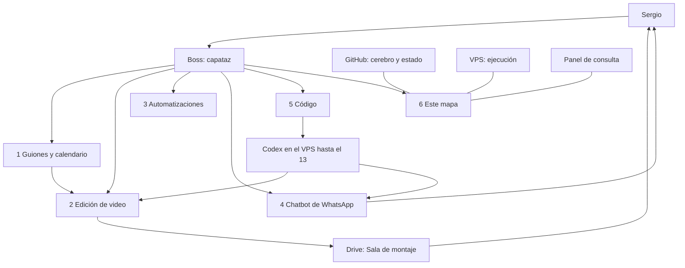

# 6 · Plataforma

Mapa de dónde vive la fábrica de OnIA. No es Clonify y no es el producto «ONIA Platform» (ese tiene su propia carpeta y su propio repo). Boss documenta el mapa; no se rehace el panel ni el harness en este frente.

## Qué hace

Deja claro qué sistema guarda el cerebro, cuál ejecuta, cuál intercambia archivos con Sergio y cuál muestra el estado. Evita que cada fábrica invente otro tablero o otro servidor.

## Cómo lo hace Euge

- Video 1, [15:00–15:20](https://www.youtube.com/watch?v=JuAQILH7dkQ&t=900s): su Grok Bot tiene un ordenador virtual (navegador, archivos, bases chicas). Eso es persistencia ligera del asistente, distinta de la máquina de fábricas.
- Video 1, [19:08–19:30](https://www.youtube.com/watch?v=JuAQILH7dkQ&t=1148s) y [28:31–29:20](https://www.youtube.com/watch?v=JuAQILH7dkQ&t=1711s): las fábricas viven en otro ordenador persistente y más capaz. Él las pone en la nube para que también entren los Grok Bot de su equipo, aporten entradas y revisen juntos. Dice que podrían vivir en el PC propio.
- Video 1, [0:16–0:51](https://www.youtube.com/watch?v=JuAQILH7dkQ&t=16s) y el cierre: cuando dice «plataforma» en esos tramos habla de su producto (Clonify) para gestionar un negocio online. No es un modelo a instalar aquí.
- Video 1, [24:08–25:55](https://www.youtube.com/watch?v=JuAQILH7dkQ&t=1448s): el tablero muestra entradas, etapas, revisión, destino y, en la sala de montaje, una línea de tiempo con comentarios.

Video 2 insiste en guardar el arnés en una carpeta persistente, no sólo en la memoria del chat ([14:04–18:58](https://youtu.be/xPJbP9yZE1I?t=844)).

## Cómo lo hacemos en OnIA

| Pieza | Dónde vive | Para qué |
|---|---|---|
| Cerebro y estado | GitHub `oninteligenciaartificial/onia`, rama `master`, bajo `_investigacion-onia/base-operativa/` | Reglas, evidencia, tareas, esta especificación |
| Ejecución pesada | VPS, usuario `onia-codex-worker`, repo `~/repos/onia-coordinador` | Codex hasta el 13, FFmpeg, transcripción por CPU, n8n |
| Entrada y salida con Sergio | Drive Fábrica OnIA `1TGezto0pbmnijtWm3rPEEnt-gX-Hs42I` (1 Entrada, 2 B-roll, 3 Sala, 4 Ejemplos) | Crudos y cortes; Boss mueve Drive ↔ VPS |
| Panel de consulta | [20261109-lector-panel](../../fabrica-contenido/20261109-lector-panel/README.md) | HTML autónomo que proyecta lecturas y G01/G02; no escribe aprobaciones |
| Capataz y especialistas | Grok Bot: Boss, Contenido, Operaciones, Calendario | Pedidos, revisión editorial, horarios, operaciones de solo lectura salvo sí |
| Producto aparte | [06-plataforma/](../../../06-plataforma/arquitectura.md) | ONIA Platform; no se mezcla con estas fábricas |

El ordenador ligero del capataz (archivos y navegador de Boss) no sustituye al VPS. El homelab de la PC de casa es una máquina persistente prevista en el plan fijado; esta semana la ejecución de edición es el VPS. La laptop que ese plan deja fuera sigue fuera.

**Veredicto infra OnIA: parcial.** Los lugares existen y alcanzan para operar. No hay una sala de montaje con línea de tiempo ni un panel que escriba aprobaciones, como el que muestra Euge.

## Entra / sale

| Entra | Dónde | Sale | Dónde |
|---|---|---|---|
| Documentos, IDs y evidencia | GitHub | Estado visible y recuperable | `master` |
| Crudos y B-roll | Drive 1 y 2 | Cortes para revisar | Drive 3 |
| Snapshot de lecturas o guiones | Lector/panel | HTML de consulta | Archivo local del repo; no es un sitio público |
| Pedido técnico | Harness | Implementación en el VPS | Rutas del ID |

## Quién la hace

- **Boss:** mantiene este mapa y mueve Drive ↔ VPS.
- **Codex:** no rehace el panel ni el harness en este frente.
- **Sergio:** dueño de las cuentas, de Drive y de lo que se publica.
- **Contenido, Operaciones, Calendario:** usan el mapa; no inventan otro tablero.

## Criterio de «bueno»

- Se sabe, para cada entrega, si vive en GitHub, en el VPS, en Drive o en el panel.
- El panel no se presenta como sitio autenticado ni como sala de aprobación.
- ONIA Platform y Clonify no se mezclan con esta fábrica.
- No hay IPs, secretos ni QR en el repo.

## Cómo se mide

Al final: si una persona encuentra el crudo, el guion, el corte y la tarea sin preguntar por un chat perdido. Se anotan los extravíos reales (archivo que no estaba en Drive 3, tarea sin ID). No se inventa un «porcentaje de adopción» del panel.

## Qué existe y qué falta

Ya está el repo, el VPS, las cuatro carpetas de Drive, el panel de consulta y los compañeros del capataz. Hay un plan aparte para extender el panel: [evidencias/cerebro-panel-usable-20261109/PLAN.md](../../../04-operacion-agentes/evidencias/cerebro-panel-usable-20261109/PLAN.md). No se lanza aquí.

Falta: que el panel muestre el paso de edición (recibe / escucha / cortar / montar) cuando exista el script; que la sala de Drive se use de verdad con una tanda; confirmar handles de las cuentas.

## Las seis fábricas y el capataz

## Desde el 14 sin Codex

Siguen GitHub, Drive, el panel de consulta, el VPS con FFmpeg y la transcripción por CPU, y Boss con los especialistas. Lo que no haya quedado como script con tests deja de implementarse solo.

## Pedido para Codex

No despachar trabajo de plataforma esta semana.

- **ID sugerido:** ninguno. No crear `fabrica-plataforma-20261110`.
- **Rutas exclusivas:** no aplica.
- **Qué construir:** nada. No rehacer el panel, el harness ni un tablero tipo sala de montaje de Euge.
- **Criterio de aceptación:** este mapa permanece como documentación.
- **Tests:** no aplica.
- **Qué no tocar:** [20261109-lector-panel](../../fabrica-contenido/20261109-lector-panel/), [harness.py](../../scripts/harness.py), [06-plataforma/](../../../06-plataforma/), Drive, n8n, el plan fijado.
