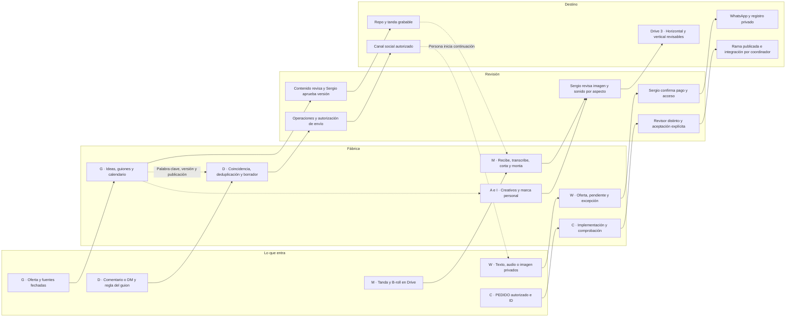

# Mapa de fábricas OnIA

10 de noviembre de 2026 · Encargo `fabrica-plataforma-mapa-20261110` · Diseño propuesto para decisión de Sergio.

## Base de la propuesta

Boss coordina las fábricas y las decisiones entre áreas. Contenido conserva la responsabilidad editorial. Operaciones lleva venta y seguimiento. Codex realiza los encargos técnicos autorizados por el harness y entrega a un revisor distinto. Sergio decide qué construir, aprueba las piezas y confirma cada pago. El reparto aprobado del 10 de noviembre rige también para este diseño. [Reparto vigente][reparto]

El esquema de Euge aporta cuatro columnas y un ciclo de correcciones por ejemplo antes/después. La adaptación usa GitHub, el VPS, Drive y el lector ya existentes. Cada fábrica tendrá una entrada identificable, pasos pequeños, revisión y destino. La infraestructura pagada que aparece en sus videos queda fuera del presupuesto de este diseño. La lectura utilizada es documental y conserva los límites audiovisuales de su fuente. [Lectura de Boss][euge] · [Especificación de fábrica 6][f6]

Este documento propone cadenas y contratos. Las etiquetas de capacidad proceden del snapshot local en HEAD `14651f86b901678542249b3aff6e82e002ea09ee`. Los estados de tareas se citan desde sus registros canónicos con revisión y fecha. La operación externa actual queda desconocida cuando falta una prueba pertinente. El coordinador conserva la escritura de esos registros. [Reglas de evidencia][reglas]

### Decisiones vigentes que resuelven contradicciones

| Tema | Criterio aplicado en este diseño | Procedencia |
|---|---|---|
| Canal de venta | WhatsApp Cloud API de Meta con n8n, pendiente de verificación humana del número | Decisión del 10-nov 07:58. [Decisiones][decisiones] |
| Oferta del workshop | Bs 50 grupal, grupo sin límite. VIP Bs 150, cinco cupos, llamada de 30 minutos | Sustituye las restricciones antiguas sobre VIP y cupos. [Decisiones][decisiones] |
| Clases | Google Meet, 12 y 13 a las 21:00, 14 a las 14:00, America/La_Paz | Resuelve la hora del jueves que sigue pendiente en documentos anteriores. Enlaces reales de Meet desconocidos en este encargo. [Decisiones][decisiones] |
| Autoría de guiones | Hasta el 13 Codex prepara cinco borradores diarios y Contenido revisa. Desde el 14 escribe Contenido. Sergio aprueba | Excepción posterior al README de fábrica 1. [Decisiones][decisiones] · [Reparto][reparto] |
| Puente técnico | Conexión aceptada en el registro r11 y piloto aceptado r22. La habilitación de cada nuevo ID se comprueba por separado | Actualiza los README que todavía describen el adaptador en curso. [Registro conexión][tpuente] · [Registro piloto][tpiloto] · [Cierre documentado][puente] |
| Panel | Lector aceptado, con proyección HTML y consultas manuales. La aprobación editorial y los comentarios sobre cortes requieren diseño e implementación posterior | Registro r39 frente al README histórico de entrega. [Registro lector][tlector] · [Contrato del lector][lector] |
| Disponibilidad desde el 14 | Planificar la operación con personas y scripts fijos que hayan quedado probados al 13 | El plan informa fin de la suscripción. Una renovación o modelo alternativo necesita decisión y presupuesto de Sergio. [Plan al 13][plan13] |

## Tabla de fábricas

Los códigos de la primera columna identifican cadenas propuestas dentro de las seis carpetas existentes. Las subdivisiones permiten mostrar DMs, anuncios y marca personal sin crear nuevas áreas ni agentes.

| Fábrica y encaje | Lo que entra | Pasos de fabricación propuestos | Revisión | Destino propuesto | Dueño | Estado real al corte y fuente | Dependencias |
|---|---|---|---|---|---|---|---|
| **G · Guiones y calendario**, fábrica 1 | Objetivo, oferta vigente, referentes, fuentes de noticias, tipo de pieza, formato y canal | Seleccionar candidatos → crítico editorial → cinco paquetes → calendario → tomas, CTA y palabra clave cuando aplique | Contenido revisa hechos, variedad, promesas y CTA. Sergio aprueba versión grabable | Guiones en repo, calendario como proyección, tanda grabada en Drive 1 | Contenido. Codex redacta hasta el 13 dentro del encargo de guiones | G01/G02 existen como borradores. Diseño anterior aceptado r43. `guiones-tanda-20261111` figura en_curso r8 al 10-nov 19:14 UTC, sin aceptación. Lote aprobado de cinco desconocido. [Fábrica 1][f1] · [Registro diseño][tdiseno] · [Registro tanda][ttanda] | Oferta coherente, fuentes por noticia, aprobación editorial. Venta entrega la palabra clave a D |
| **M · Sala de montaje horizontal y vertical**, fábrica 2 | Guion aprobado, grabación por tanda, B-roll autorizado, intervalos y relación de aspecto | Recibe → transcripción CPU → cortes propuestos → B-roll → montaje y subtítulos → versiones 16:9 y 9:16 solicitadas | Contenido verifica sentido y correspondencia con guion. Sergio revisa imagen, sonido, encuadre y subtítulos de cada versión | Medios en Drive 3, ejemplo corregido en Drive 4. Recibos y manifiestos saneados en Git | Boss coordina transferencia. Ejecutor técnico del ID implementa. Sergio aprueba | Ingesta ffprobe y piloto ASR documentados. Registro de edición preparado r3 al 10-nov 18:06 UTC. Script integral, prueba con tanda real y salida horizontal desconocidos. [Fábrica 2][f2] · [Registro edición][tedicion] · [ASR][asr] | Guion y permisos de medios, crudos disponibles, intervalos válidos, capacidad CPU. Vlog diario completo fuera de esta cadena |
| **D · Comentarios y DMs IG/Facebook**, fábrica 3 | Comentario o DM, cuenta/canal y publicación identificados, palabra clave de la versión del guion | Validar evento → buscar regla de esa publicación → deduplicar → preparar respuesta pública o privada según ruta → revisión → registro de resultado | Contenido revisa texto. Operaciones verifica destino y cese. Sergio autoriza prueba y envío real cuando corresponda | Respuesta en canal autorizado. Derivación voluntaria a WhatsApp. Recibo privado por evento | Operaciones opera. Contenido define copy. Codex implementaría con ID | El pedido exige esta cadena. G01 usa NEGOCIO. Implementación IG/Facebook, acceso vigente y recepción real desconocidos. La automatización existente es parcial. [Pedido][pedido] · [G01][g01] · [Fábrica 3][f3] | G entrega palabra clave + publicación + versión. Cuenta y permisos por canal, posibilidad de responder comprobada y responsable de atención. WhatsApp requiere continuación del usuario |
| **W · Venta del curso/workshop**, fábrica 4 | Texto, audio o imagen recibidos en WhatsApp, oferta elegida, consentimiento para seguir el recorrido | Clasificar entrada → extraer intención o derivar duda → ficha fija → inscripción pendiente → pago pendiente de verificación → Sergio confirma → acceso | Contenido revisa mensajes. Operaciones sigue excepciones. Sergio verifica pago en fuente bancaria y autoriza acceso | Conversación WhatsApp, registro privado de venta y acceso aprobado a Meet | Operaciones. Codex implementa flujo. Sergio controla número y pagos | Cloud API + n8n elegidos. Tarea chatbot en_curso r8 al 10-nov 19:21 UTC, sin cierre ni aceptación. Flujo operativo y procesamiento de audio/imagen desconocidos. [Decisiones][decisiones] · [Registro chatbot][tchatbot] · [Fábrica 4][f4] | Verificación Meta, textos actualizados, medios privados accesibles, revisión humana de audio/imagen dudosos. Pago confirmado por Sergio |
| **WP · Venta de ONIA Platform**, variante de fábrica 4 | Consulta de texto, audio o imagen con intención de producto | Separar del workshop → recuperar ficha comercial vigente → aclarar necesidad → propuesta revisada → derivación humana | Contenido revisa promesas. Sergio valida precio, prestaciones vendibles y condiciones | WhatsApp y seguimiento comercial privado. Derivación al responsable del producto | Operaciones, con Sergio como dueño de oferta | El pedido solicita esta variante. Precio, ficha de venta aprobada, disponibilidad comercial y bot específico desconocidos. El producto tiene arquitectura y repo separados. [Pedido][pedido] · [Arquitectura][arquitectura] | Ficha de producto verificable y aprobada. Capacidad de WhatsApp de W. La inscripción al workshop conserva su recorrido propio |
| **A · Creatividades Meta Ads**, rama de fábricas 1 y 2 | Oferta aprobada, audiencia, hipótesis, formato, evidencia y activos con derechos | Brief → variantes de arte, UGC, ugly ad o talking head → guion/copy → diseño o montaje → paquete para revisión | Contenido evalúa gancho, afirmaciones y CTA. Sergio aprueba creativo y cualquier paso posterior de campaña | Paquete de borradores en repo y medios en Drive 3. Destino posterior propuesto Ads Manager con autorización específica | Contenido dirige. Boss coordina técnica. Sergio decide campaña | Los cuatro formatos están pedidos. Biblioteca propia de anuncios revisados, activos UGC, acceso publicitario vigente y campañas operativas desconocidos. [Pedido][pedido] · [Formatos existentes][formatos] | Oferta estable, ruta D/W comprobable, activos disponibles y decisión posterior sobre presupuesto y publicación |
| **I · Contenido con IA para marca personal**, rama de fábricas 1 y 2 | Idea real de Sergio, guion, clips propios, pantallas o ejemplos de IA con procedencia | Preparar demostración → storyboard → combinar material disponible → montar → marcar elementos sintéticos → revisión | Contenido contrasta hechos y coherencia de marca. Sergio aprueba uso de su imagen y versión final | Guion en repo y borrador audiovisual en Drive 3 | Contenido. Ejecutor técnico por ID cuando haga falta | Hay recetas de marca personal y diseño de contenido. Cadena de generación IA aplicada a una pieza real de marca desconocida. Higgsfield requiere sí por pieza y está excluido de este encargo. [Formatos][formatos] · [Decisiones][decisiones] · [Pedido][pedido] | Medios propios y ejemplos verificables. Técnicas ya disponibles. Generación adicional espera herramienta, condiciones y autorización verificadas |
| **C · Código**, fábrica 5 | PEDIDO aprobado, ID, rutas, criterio y fuentes | Recuperar → implementar → comprobar → commit/push rama → revisión distinta → aceptación e integración por coordinador | Revisor técnico distinto sobre commit exacto. Sergio conserva decisiones de alcance | Repo onia o repo del producto según encargo, evidencia y estado en harness | Codex ejecuta. Boss coordina. Coordinador integra | Harness y puente documentados, conexión aceptada r11 y piloto r22. Habilitación operativa de IDs distintos del piloto desconocida aquí. [Fábrica 5][f5] · [Registros conexión][tpuente] · [Piloto][tpiloto] · [Cierre][puente] | Cuota fechada, aprobación aplicable, ruta exclusiva, máximo tres sesiones contando revisión. Este intento tiene cero hijos |
| **P · Mapa y consulta**, fábrica 6 | Referencias canónicas de tareas, documentos, recibos y medios | Leer/verificar → proyectar columnas → señalar faltantes y antigüedad → consulta por ID | Boss coteja fuentes. Revisor distinto revisa cambios técnicos | HTML de consulta y este diseño en Git, enlaces a Drive | Boss mantiene mapa. Sergio decide extensiones | GitHub, Drive y lector documentados. Lector aceptado r39. Tablero completo de fábricas, timeline y escritura de aprobaciones pendientes. [Fábrica 6][f6] · [Lector][lector] · [Registro lector][tlector] | Datos verificables y proyección saneada. Vista desactualizada se rotula con fecha. Ampliación del panel espera decisión de Sergio |

### Contrato de guiones y calendario

Cada paquete propuesto separa `tipo` —noticia IA, evergreen, personal o venta— de `formato` —talking head, B-roll con voz, B-roll con texto, pantalla u otro aprobado— y de `aspecto` —9:16, 16:9 o ambos—. B-roll se registra además como material. El calendario añade día, canal, slot, versión y responsable. Esta separación reutiliza la clasificación vigente. [Formatos][formatos]

Se conservan cinco slots por día, venta, marca seria, noticia o evergreen, segunda venta o marca y reel de prueba. Cada paquete lleva fuente y fecha del hecho si contiene una noticia, criterio de calidad, lista de tomas, CTA y destino. La meta sigue siendo cinco videos. El resultado diario depende de la revisión y del material realmente disponible. Una noticia sin fuente pertinente se devuelve a Contenido o se sustituye por evergreen. [Modelo de contenido][modelo] · [Calendario existente][calendario]

### Contrato de palabra clave y conversación

G entrega a D una regla propuesta con `pieza_id`, `guion_version`, `canal`, `publicacion_id`, `palabra_clave`, `oferta_id`, `respuesta_version`, `vigencia` y `responsable`. Hasta que exista publicación real, esa asociación queda pendiente. NEGOCIO procede de G01. Las palabras clave futuras las decide Contenido por guion. [Guion G01][g01]

D distingue comentario público y mensaje privado. Un comentario coincidente prepara la respuesta prevista para esa publicación. Un DM entrante puede continuar la conversación según su propia regla. La clave de deduplicación propuesta combina canal, cuenta, ID de evento y versión de regla. La normalización de mayúsculas, espacios y acentos debe ser explícita y ensayada con coincidencias y falsos positivos. Un evento repetido conserva el resultado registrado. Un timeout de envío queda incierto hasta conciliarlo. Son requisitos de construcción pendientes.

La continuidad IG/Facebook → WhatsApp requiere que la persona abra el destino e inicie o autorice la conversación prevista. Un identificador social se conserva dentro de su canal. La asociación entre identidades requiere evidencia privada. Antes de implementar, el responsable técnico verificará documentación primaria y permisos vigentes de Meta para comentarios, mensajes y medios por cada cuenta. Las ventanas, límites, costos y elegibilidad quedan desconocidos en esta entrega.

### Contrato multimodal de WhatsApp y venta

| Entrada | Tratamiento propuesto | Salida revisable y condición de avance |
|---|---|---|
| Texto | Reglas de intención y respuestas fijas para oferta elegida, ayuda o cese | Respuesta versionada. Ambigüedad a Operaciones |
| Audio | Si un futuro encargo acredita recepción y lectura privada, transcripción CPU con el ASR existente. Conservar referencia al medio y dudas | Texto de trabajo pendiente de verificación. Si falla, pedir texto o derivar a humano por canal autorizado |
| Imagen general | Recepción privada y clasificación humana inicialmente. Descripción/OCR automatizados quedan pendientes de capacidad y prueba | Pregunta aclaratoria o intervención de Operaciones |
| Imagen de comprobante | Adjuntar referencia privada a venta pendiente | Sergio verifica importe, moneda y movimiento. Sólo su confirmación habilita pago confirmado |
| Consulta de ONIA Platform | Seleccionar oferta distinta y usar su ficha aprobada | Ante precio o prestación desconocidos, derivar a Sergio antes de emitir propuesta |

La máquina comercial propuesta usa interesado → información entregada → inscripción pendiente → pago en revisión → pago confirmado por Sergio → acceso entregado. Cese, excepción y envío incierto conservan trazabilidad. Cada transición guarda versión, actor, fecha y referencia privada. Una confirmación humana repetida debe producir un solo acceso. La captura y el ASR se conservan como entradas para revisión. El QR y las conversaciones permanecen en almacenamiento privado. [Decisiones comerciales][decisiones] · [Especificación WhatsApp][f4]

### Contrato de montaje y variantes de anuncios

Cada render propuesto se identifica por pieza, versión de guion, hash del crudo, intervalos y aspecto. Horizontal y vertical comparten guion y mantienen revisión individual de encuadre y subtítulos. Comentarios como «corregir texto en 00:12» se vinculan al hash de la versión revisada. Una corrección crea otra versión y conserva la anterior. La aceptación audiovisual requiere revisión humana de sonido e imagen. El ASR aporta transcripción para ese trabajo. [Montaje existente][f2]

| Variante de anuncio pedida | Entrega propuesta | Criterio de revisión |
|---|---|---|
| Artes | Imagen o carrusel y copy por oferta | Jerarquía, legibilidad móvil, precio y CTA coherentes |
| UGC | Guion, tomas y montaje de material de participante autorizado | Procedencia, consentimiento y afirmaciones respaldadas. Disponibilidad de material desconocida |
| Ugly ads | Pieza deliberadamente simple con una promesa acotada | Mensaje comprensible, contraste y correspondencia con oferta |
| Talking head | Guion a cámara, evidencia de apoyo, subtítulos y variantes de gancho | Claridad, prueba visible y continuidad del discurso |

Las cuatro variantes reutilizan G y M. Se prepara un paquete con oferta, hipótesis, variante, versión y destino de prueba. El responsable de campaña verificará formatos admitidos y acceso antes de cargarlo. Los resultados publicitarios se registrarán cuando exista campaña autorizada y datos reales. [Pedido de formatos][pedido]

## Reutilización de componentes

| Componente existente | Evidencia disponible | Reutilización propuesta | Brecha que requiere otro encargo |
|---|---|---|---|
| Harness y Git privado por sesión | Procedimiento de rutas, publicación propia y revisor distinto. Puente y piloto aceptados en registros consultados. [Orquestación][orquestacion] · [Cierre puente][puente] | Un ID por trabajo autorizado, mismo estado canónico y evidencia por versión. Aviso de fin sólo para IDs habilitados | Verificar permiso y cuota por nuevo ID. El coordinador conserva cierre, revisión, aceptación e integración |
| Panel lector | HTML autónomo y snapshot saneado. Registro lector aceptado r39. [Lector][lector] · [Registro][tlector] | Extender su proyección con tarjetas de fábrica y fecha de observación después de aprobación | Fuentes para nuevos IDs, manifiesto de medios, comentarios por versión y persistencia de decisiones humanas |
| n8n | Inventario del 9-nov con mayoría inactiva, Command Center observado activo, piloto Telegram almacenado inactivo y pruebas locales. [Inventario documentado][telegram] | Reusar método de inventario saneado y contratos de idempotencia. Diseñar flujos separados por canal y oferta | Estado actual, identidad de cuentas, credenciales válidas, runner y recepción real desconocidos. Cualquier JSON futuro de este alcance tendría `active=false` y quedaría como archivo |
| Drive Fábrica OnIA | Cuatro carpetas documentadas por Boss. [Mapa de Drive][fabricas] | 1 Entrada para crudos, 2 B-roll, 3 Sala de montaje para versiones, 4 Ejemplos para correcciones. Boss transfiere por el canal autorizado | Confirmar con una tanda real transferencia completa y acceso de Sergio. Este diseño toma la existencia de carpetas como evidencia documental |
| VPS, FFmpeg y ASR CPU | FFmpeg y Python de ASR encontrados en este entorno, paquete faster_whisper localizable. Piloto histórico en ASR. [ASR][asr] | Herramientas existentes para corte, variantes y transcripción, bajo los encargos de implementación | La prueba sintética de esta entrega cubre sólo escalado/render básico. ASR, subtítulos y montaje real conservan su prueba pendiente |
| Cerebro, G01/G02 y formatos | Diseño aceptado r43, documentos y recetas disponibles. [Registro diseño][tdiseno] · [Fábrica 1][f1] · [Formatos][formatos] | Recuperar patrones y fuentes pertinentes, corregir oferta por las decisiones del 10-nov y redactar borradores | Dictamen editorial y aprobación por pieza y versión |

La ejecución prevista hasta el 13 usa el VPS. La disponibilidad de un worker homelab para estas cadenas permanece desconocida en este encargo. Una extensión debe recuperar su aceptación específica antes de asignarle medios o trabajo. [Mapa de ejecución][f6]

## Maqueta del panel

Propuesta estática en Mermaid. Las cuatro columnas muestran el flujo de una pieza. Las tarjetas representan contratos y faltantes, con IDs de fábrica. El lector actual sirve como base para una futura implementación aprobada.

Cada tarjeta futura mostrará fábrica, tarea canónica, pieza/versión, responsable, etapa, estado observado, fuente/fecha, próximo paso y dependencia. Los medios privados se abrirán mediante el acceso de Drive correspondiente. Los datos de contacto y pagos permanecerán en la superficie privada operativa.

La vista tendrá filtros por fábrica, oferta, tipo, formato, día, aspecto y responsable. En móvil se apilarán las cuatro columnas. Un estado sin evidencia aparecerá como desconocido. Un fallo de verificación mostrará la referencia y la última observación fechada. La actualización inicial será manual, coherente con el lector existente. [Contrato del lector][lector]

La sala ampliada propone una lista de versiones, preview privado y comentarios con tiempo, autor y referencia al medio. Una decisión se vinculará al hash y versión exactos. La interfaz futura necesitará autenticar al decisor, registrar el recibo y detectar cambios concurrentes. La revisión técnica, el dictamen editorial, la autorización de envío y la confirmación de pago se mostrarán como decisiones separadas. La maqueta conserva estos controles como requisitos pendientes de implementación.

## Nuevas cadenas propuestas y justificación

| Propuesta | Por qué conviene | Entrada → pasos → revisión → destino | Dueño propuesto y medición | Momento y dependencia |
|---|---|---|---|---|
| **N1 · Consistencia de oferta y CTA** | Los README y calendario conservan precio, VIP y horarios sustituidos. Eso puede generar mensajes contradictorios | Decisiones vigentes y borrador → cotejar hechos y palabra clave → Contenido resuelve divergencias → paquete coherente para G/D/W/A | Contenido. Contar contradicciones detectadas y corregidas por versión | Primero revisión manual antes del 14. Automatizar sólo si Sergio lo elige. Se apoya en la divergencia documental observada. [Decisiones][decisiones] · [Calendario][calendario] |
| **N2 · Excepciones de venta y conciliación humana** | Audio, imagen, duplicados y referencias repetidas necesitan un único lugar de atención dentro del recorrido | Evento privado → clasificar duda/duplicado/cese → Operaciones atiende y Sergio confirma pago → respuesta o acceso autorizado | Operaciones. Medir pendientes por antigüedad, pagos efectivamente confirmados y excepciones resueltas | Diseñar junto con W esta semana. Usar el registro privado de venta que se defina para W. [Especificación WhatsApp][f4] |
| **N3 · Entrega de clases y soporte de inscritos** | La venta debe terminar en acceso correcto a las tres clases | Pago confirmado y clase → preparar acceso y checklist → Operaciones verifica y Sergio autoriza entrega → participante por canal privado | Operaciones y Calendario. Medir accesos autorizados entregados y casos de soporte reales | 12–14 si Sergio lo prioriza. Requiere enlaces Meet y registro privado. [Decisiones][decisiones] |
| **N4 · Correcciones y aprendizaje por pieza** | Drive 4 ya tiene una función definida. Los cambios concretos pueden orientar próximos guiones y montajes | Antes/después y comentario humano → describir regla acotada → Contenido valida y revisor técnico comprueba si cambia código → regla enlazada a la fuente | Contenido y Boss. Medir devoluciones y retrabajo por causa, con denominador de piezas revisadas | Después del 14, usando ejemplos disponibles y autorización aplicable. [Fábrica 2][f2] · [Modelo][modelo] |
| **N5 · Cierre de resultados por lote** | Permite elegir formatos con resultados observados | URLs publicadas y métricas aportadas → asociar versión/CTA/ventana → Contenido y Operaciones revisan atribución → siguiente lote | Contenido y Operaciones. Publicados, comentarios únicos, consultas, pagos confirmados y retrabajo, cada uno con ventana y fuente | Después del 14. Datos y acceso a métricas desconocidos. Primera versión puede ser manual. [Medición de fábrica 1][f1] |

Todas son propuestas para selección de Sergio. Su existencia en esta tabla conserva el diseño pendiente de registro e implementación.

## Prioridad hasta el 14 y después

| Tramo | Resultado propuesto y orden | Responsable y comprobación | Condición para avanzar |
|---|---|---|---|
| 10-nov, P0 | Cotejar oferta y CTA en los borradores. Recuperar estado del chatbot y de G01 antes de agregar trabajo | Contenido revisa textos. Operaciones comprueba quién atiende. Boss consulta registros del harness | Versión coherente y responsable identificado. Los estados locales se actualizan consultando al coordinador |
| 11-nov, P0 | Cerrar preparación de W y cinco borradores de G en sus IDs existentes. Preparar regla de NEGOCIO vinculada al guion y destino | Ejecutores de chatbot y guiones entregan evidencia a revisores distintos. Contenido revisa. Sergio graba | Meta y medios disponibles condicionan la prueba real posterior. Mantener atención humana autorizada si la integración espera |
| 12-nov, P0 | Venta y acceso a primera clase de las 21:00. Probar M con la tanda disponible dentro de su encargo | Operaciones verifica destinatarios y enlaces. Sergio revisa y confirma pagos. Ejecutor de edición conserva dudas | Efectos reales requieren el sí aplicable de Sergio. Una prueba sintética sólo habilita revisión técnica |
| 13-nov, P1 | Entregar scripts probados y manuales operables por Boss/Operaciones, cerrar revisiones técnicas y revisar siguiente clase | Coordinador integra únicamente entregas aceptadas y verifica origin/master. Boss comprueba uso previsto | Reserva semanal mínima del 10%. Revisor incluido en el presupuesto de intentos. Recortar ampliaciones para conservar venta y revisión |
| 14-nov, P0 operación | Contenido escribe, Operaciones atiende venta/soporte, Sergio revisa y dicta clase a las 14:00 | Personas y scripts que hayan quedado comprobados al 13 | Toda función pendiente conserva atención humana y su estado real |
| Después del 14, P1 | Comprobar D por canal, ampliar M a horizontal si falta, recoger ejemplos N4/N5 y definir ficha comercial de WP | Sergio elige un frente y Boss prepara alcance con evidencia de disponibilidad | Capacidad de ejecución y presupuesto actualizados. Ficha del producto aprobada antes de vender WP |
| Después del 14, P2 | Elegir variantes A e I y extensión del panel de revisión | Contenido prepara briefs. Sergio decide construcción y eventual campaña | Material disponible, contratos probados, gastos y publicación autorizados por separado |

El pedido actual cubre este mapa. La secuencia propone resultados para los otros responsables y conserva sus IDs y reservas. Los frentes de anuncios, generación IA y panel completo esperan la selección de Sergio. El plan al 13 y las decisiones del 10 sirven de base para este orden. [Plan al 13][plan13] · [Pedido actual][pedido]

La muestra de cuota actual de este intento es desconocida. La referencia al 80% usado del cierre del puente pertenece a otra operación y fecha de observación. El coordinador debe aportar la muestra fechada de lanzamiento y reservar al menos el 10% antes de una sesión adicional, incluida revisión. Este intento utiliza una ejecutora, cero hijos y deja al coordinador la revisión independiente prevista como segundo intento. [Cierre previo][puente] · [Memoria, recibos y límites][boss]

## Propuesta de orden de documentos y repos

Las rutas de esta tabla son relativas a base-operativa salvo las que nombran repos o Drive. Todos los movimientos quedan sugeridos. La estructura de ocho carpetas y las fuentes únicas vigentes guían el destino. [Guía de estructura][estructura]

| Origen actual comprobado | Destino sugerido | Operación propuesta | Motivo y condición previa | Dueño propuesto |
|---|---|---|---|---|
| `05-herramientas/fabrica-onia/README.md` y seis README | Mismas rutas | Actualizar enlaces y estados documentales por referencia al harness | Un índice único de fábricas. Sustituir contradicciones de oferta/roles con aprobación de su dueño | Boss |
| `05-herramientas/fabrica-onia/DECISIONES-SERGIO-20261110.md` | Misma ruta, enlazada desde cada especificación comercial | Conservar fuente y referenciarla | Evitar duplicar precio, horarios y VIP en documentos mutables | Sergio decide, Boss mantiene referencias |
| `05-herramientas/fabrica-contenido/20261108/` | Misma ruta histórica | Conservar y enlazar contrato desde fábrica 1 y 6 | Diseño aceptado y ensayos conservan procedencia y enlaces | Coordinador |
| `05-herramientas/fabrica-contenido/20261109-lector-panel/` | Misma ruta para código y evidencias. Entrada documental futura desde `02-contenido/` | Enlazar desde índice existente antes de evaluar traslado | Protege hashes y pruebas aceptadas. Toda mudanza posterior exige revisar importaciones, consumidores y enlaces | Boss y responsable del panel |
| Calendario en `05-herramientas/fabrica-onia/1-guiones-calendario/CALENDARIO-SEMANA-20261110-14.md` | Futuro contenido vigente en `02-contenido/fabrica-diaria/` | Para nuevo trabajo, guardar lotes y calendario editorial en el área de contenido. Evaluar traslado del calendario vigente tras acabar la semana | La guía asigna piezas y calendarios a `02-contenido`. Mantener en la fábrica su especificación técnica y enlaces. La carpeta futura conserva condición de propuesta | Contenido y Boss |
| G01/G02 y oferta en `01-negocio/workshop-20261108/noche-20261109/` | Mismas rutas | Conservar originales y enlazar desde nuevos lotes | Entregas técnicas previas conservan versiones. Revisión editorial nueva debe identificar sus cambios | Contenido |
| Entregas por ID bajo `fabrica-onia/*/trabajos/` y tanda bajo fábrica 1 | Sus rutas asignadas actuales | Conservar evidencia y enlazar desde índice de fábrica | Un escritor por ruta y revisión del commit exacto. Nuevos medios van a Drive o privado | Coordinador |
| Tareas, briefings y evidencias en `04-operacion-agentes/` | Mismas rutas canónicas | Conservar autoridad y proyectar campos saneados al panel | El registro de estados conserva dueño único | Coordinador |
| Herramientas de `05-herramientas/scripts/` y fuentes de skills compartibles | Mismas rutas | Reutilizar por referencia | Cambios requieren su propio alcance y validación de consumidores | Responsable técnico autorizado |
| Drive 1/2/3/4 | Mismas cuatro carpetas, subcarpetas futuras por lote y versión si hacen falta | Añadir organización por fecha/pieza preservando originales tras autorización | Encontrar crudo, apoyo, revisión y antes/después sin duplicar medios en Git. Nombres/estructura final a cotejar en Drive | Boss con permiso de Sergio |
| Repo privado `oninteligenciaartificial/onia` | Mismo repo operativo | Mantener documentación, harness, scripts y evidencia compartible | El volumen actual del mapa se organiza mediante índices y contratos | Coordinador |
| Repo de producto ONIA Platform y documentación `06-plataforma/` | Mantener separación del repo operativo | Enlazar ficha comercial aprobada y arquitectura pertinente | Nombre remoto y checkout del producto desconocidos aquí. Verificarlos antes de proponer un traslado de código | Responsable del producto y Sergio |
| Repo `onia-harness`, citado como referencia conservada | Mantener como referencia | Registrar enlace desde la fuente operativa | Estado de conservación documentado. Cualquier cambio de archivo requiere inventario y autorización específicos | Coordinador. [Estado vigente][estado] |
| Material superado cuya sustitución esté comprobada | Ruta futura bajo `99-archivo/` por fecha y tema | Evaluar `git mv` sólo en otro encargo con inventario aprobado | Verificar enlaces entrantes, hashes, propietario, permisos y recuperación antes de mover. Mantener contenido íntegro | Boss propone, coordinador ejecuta con alcance aprobado |

La ejecución futura del orden comienza con índices y enlaces. Para un traslado aprobado, preparar inventario origen/destino y hashes, revisar consumidores, realizar el movimiento acotado, comprobar enlaces e integridad y someter el commit a revisión distinta. La reversión se planifica sobre ese commit conservando correcciones posteriores. El diseño permite recuperar cada fuente mientras se decide la ubicación definitiva.

## Faltantes y condiciones de retoma

| Falta observada | Por qué importa | Quién resuelve | Condición para retomar construcción |
|---|---|---|---|
| Muestra fechada de cuota y modelo/esfuerzo observados de esta sesión | Completar recibo y verificar reserva de revisión | Coordinador desde metadatos del mismo intento | Aportar evidencia de runtime y cuota. Valores desconocidos hasta entonces |
| Prueba vigente de permisos y recepción IG/Facebook | Define qué eventos y respuestas se pueden conectar realmente | Operaciones releva, Sergio completa pasos humanos, ejecutor técnico verifica en alcance autorizado | Cuenta identificada y ensayo autorizado por canal |
| Verificación del número Meta y medios entrantes de WhatsApp | Condiciona W y el tratamiento de audio/imagen | Sergio y responsable del chatbot | Prueba autorizada de recepción, con almacenamiento privado y dudas visibles |
| Ficha comercial aprobada de ONIA Platform | Define precio y prestaciones prometibles en WP | Sergio y responsable del producto | Ficha fechada, revisada y enlazada |
| Guiones revisados, crudo real y variantes solicitadas | Condiciona montaje y prueba humana | Contenido revisa, Sergio graba, Boss transfiere | Paquete identificable disponible para el ID de edición |
| Enlaces Meet, registro privado de ventas y activos de pago | Condiciona entrega del acceso | Operaciones y Sergio | Configuración privada y confirmación de cada pago |
| Material UGC, ejemplos IA y datos de resultados | Condiciona A/I/N4/N5 | Contenido y Sergio | Material autorizado, procedencia y revisión pertinente |
| Revisión distinta de este commit y decisión de Sergio | Condiciona aceptación y selección de construcción | Coordinador y Sergio | Veredicto bueno vigente, aceptación explícita y selección de alcance |

## Comprobación y recibo de la ejecutora

| Campo | Evidencia o límite |
|---|---|
| ID | `fabrica-plataforma-mapa-20261110` |
| Base de trabajo | `14651f86b901678542249b3aff6e82e002ea09ee`, rama `codex/ws-fabrica-plataforma-mapa-20261110`, checkout inicialmente limpio |
| Integridad del pedido | SHA256 `1d692851eb75654a9a585ad9e729abe0d67b542e06107795c4d72d8480819470`, coincidente con briefing |
| Skill | desarrollar-y-verificar anunciada en catálogo y leída desde su fuente canónica. Apoyos adicionales cargados, cero |
| Modelo y esfuerzo solicitados | Sol6.1 high según briefing. Registro local sólo tiene recomendado gpt-6.1-sol/high, con solicitado y observado nulos |
| Modelo y esfuerzo observados | Desconocidos. Los metadatos efectivos del mismo SID quedan pendientes del coordinador |
| Cuota inicial y final | Desconocidas al corte de esta entrega. La comprobación lleva fecha UTC. Reserva mínima requerida, 10% semanal |
| Intentos | Una ejecutora en esta entrega, cero hijos y cero sesiones nuevas lanzadas por ella. Segundo intento reservado a revisión distinta del coordinador |
| Resultado | Diseño documentado para revisión. Aceptación e integración pendientes del coordinador. Sergio decide qué cadenas construir |
| Verificación documental | Enlaces locales, fuentes de estados, cobertura, ruta exclusiva y ausencia de patrones sensibles comprobados en `COMPROBACION.json` |
| Prueba sintética breve | FFmpeg existente procesa una fuente lavfi de un segundo hacia salida null en 160×90 y 90×160. ASR Python y localización de faster_whisper comprobados. Resultado detallado en `COMPROBACION.json` |
| Límite de validación | Prueba de herramienta y geometría sintética. Audio real, ASR de habla, OCR, subtítulos, calidad audiovisual y recorridos de servicios reales quedan pendientes |
| Commits | Base arriba. El commit que contiene esta entrega se identifica con `git log -1 --format=%H -- <ruta de DISENO.md>` y se informa tras el push a la rama asignada |
| Retrabajo | Ajustes documentales de la misma ejecutora previos a entrega. Revisión independiente todavía pendiente |

## Referencias locales

Todas las fuentes se consultaron en el HEAD de base indicado. Los registros enlazados conservan su autoridad canónica.

[reparto]: ../../../../../04-operacion-agentes/REPARTO-AGENTES-GROK-20261110.md
[euge]: ../../../../../04-operacion-agentes/EUGE-VIDEO-BOSS-20261109.md
[f6]: ../../README.md
[reglas]: ../../../../../04-operacion-agentes/reglas-comunes.md
[decisiones]: ../../../DECISIONES-SERGIO-20261110.md
[plan13]: ../../../../../04-operacion-agentes/PLAN-LISTO-AL-13-20261110.md
[puente]: ../../../../../04-operacion-agentes/evidencias/conexion-boss-codex-20261110/CIERRE-PUENTE-v1.md
[lector]: ../../../../fabrica-contenido/20261109-lector-panel/README.md
[f1]: ../../../1-guiones-calendario/README.md
[f2]: ../../../2-edicion-video/README.md
[f3]: ../../../3-automatizaciones/README.md
[f4]: ../../../4-chatbot-whatsapp/README.md
[f5]: ../../../5-codigo/README.md
[asr]: ../../../../asr-local/README.md
[pedido]: ../../../../../04-operacion-agentes/pendientes/PEDIDO-REGISTRO-fabrica-plataforma-mapa-20261110.md
[g01]: ../../../../../01-negocio/workshop-20261108/noche-20261109/GUION-01-WORKSHOP.md
[arquitectura]: ../../../../../06-plataforma/arquitectura.md
[formatos]: ../../../../../02-contenido/formatos-onia.md
[fabricas]: ../../../README.md
[telegram]: ../../../../fabrica-contenido/20261109-telegram/README.md
[modelo]: ../../../../../04-operacion-agentes/ONE-MAN-COMPANY-FABRICA-CONTENIDO-20261109.md
[calendario]: ../../../1-guiones-calendario/CALENDARIO-SEMANA-20261110-14.md
[orquestacion]: ../../../../../04-operacion-agentes/ORQUESTACION.md
[boss]: ../../../../../04-operacion-agentes/boss-memoria.md
[estructura]: ../../../../../00-MAPA/ESTRUCTURA.md
[estado]: ../../../../../00-MAPA/ESTADO.md
[tpuente]: ../../../../../04-operacion-agentes/tareas/conexion-boss-codex-20261110.json
[tpiloto]: ../../../../../04-operacion-agentes/tareas/conexion-boss-piloto-20261110.json
[tlector]: ../../../../../04-operacion-agentes/tareas/fabrica-lector-panel-20261109.json
[tdiseno]: ../../../../../04-operacion-agentes/tareas/fabrica-contenido-diseno-20261108.json
[ttanda]: ../../../../../04-operacion-agentes/tareas/guiones-tanda-20261111.json
[tedicion]: ../../../../../04-operacion-agentes/tareas/fabrica-edicion-video-20261110.json
[tchatbot]: ../../../../../04-operacion-agentes/tareas/fabrica-chatbot-whatsapp-20261110.json
