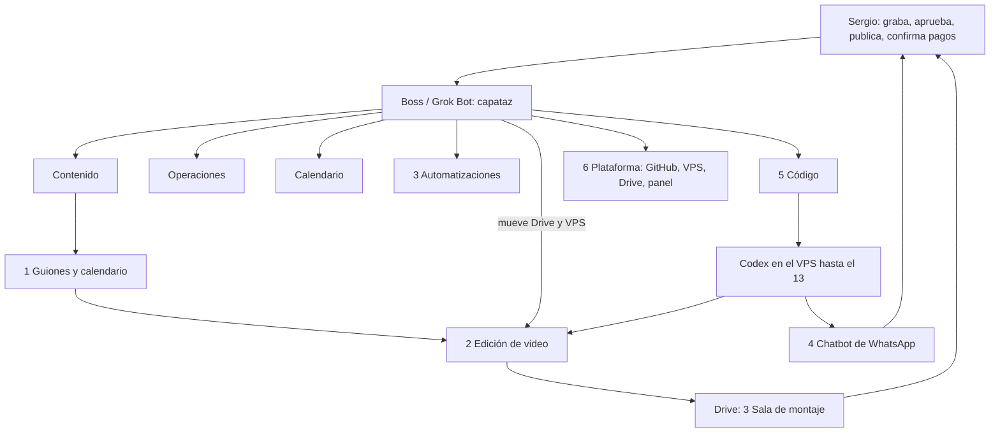

# Fábricas de OnIA

10 nov 2026 · America/La_Paz · especificación armada por Boss a pedido de Sergio. **No cambia** el modelo fijado ([ONE-MAN-COMPANY-FABRICA-CONTENIDO-20261109.md](../../04-operacion-agentes/ONE-MAN-COMPANY-FABRICA-CONTENIDO-20261109.md)). Prioridades de esta semana: [PLAN-LISTO-AL-13-20261110.md](../../04-operacion-agentes/PLAN-LISTO-AL-13-20261110.md).

Actualización 11 nov UTC: la especificación inicial ya tiene entregas integradas y pruebas locales. El estado operativo y las entradas que faltan están en [CIERRE-VENTA-20261111.md](CIERRE-VENTA-20261111.md). Integrar código no activa canales ni acredita ventas. Boss coordina y Codex implementa dentro de las rutas autorizadas.

Euge organiza su empresa como una máquina de fábricas: un capataz (su Grok Bot) y cadenas separadas, cada una con entrada, pasos, criterio de calidad, ejemplos antes/después y medición al final. En OnIA el capataz es Boss. Las seis carpetas de abajo son las que pidió Sergio; no son una copia de la infra de Euge.

## Regla de infraestructura

No se mezcla la infra de Euge (servidor cloud pago, Opus, Clonify, ElevenLabs, Buffer/Metricool) con la de OnIA (Boss en Grok Bot, Codex en el VPS hasta el 14 de noviembre, homelab sin GPU, FFmpeg, transcripción por CPU, Higgsfield pago para elementos de IA solo con créditos y el sí de Sergio, gasto cero adicional). Publicar, cobrar, activar n8n o rutinas y tocar la PC también necesitan su sí.

## Quién hace qué

| Rol | Qué hace | Qué no hace |
|---|---|---|
| **Contenido** | Dueño editorial de ideas, guiones, CTA y criterio de «bueno» de cada pieza. | No implementa scripts del VPS ni activa n8n. |
| **Boss** | Capataz: arma la especificación, reparte, revisa y mueve archivos Drive ↔ VPS. | No configura ni implementa fábricas. |
| **Codex** | Configura e implementa en repo y VPS hasta el 13 de noviembre, con ID, tests y revisor distinto. | No es dueño editorial ni publica. |
| **Sergio** | Graba, aprueba, publica y confirma cada pago a mano. | No tiene que pegar prompts ni recortar el vlog para sacar los cinco videos. |
| **Operaciones** | Coordina requisitos del chatbot, registro y acceso; localiza QR y Meet en privado. Sergio verifica pagos. | No activa n8n sin sí. |
| **Calendario** | Horarios y avisos de las clases. | Coteja los horarios confirmados en DECISIONES-SERGIO. |

El vlog diario se graba y se publica entero, sin edición de esta fábrica.

## Drive de la fábrica

Carpeta [Fábrica OnIA](https://drive.google.com/drive/folders/1TGezto0pbmnijtWm3rPEEnt-gX-Hs42I) (`1TGezto0pbmnijtWm3rPEEnt-gX-Hs42I`):

| Subcarpeta | ID | Uso |
|---|---|---|
| 1 Entrada | `1OWW5GGfF1GQrXFer7HmLEoIf9sQRGrWp` | Sergio deja la tanda grabada. |
| 2 B-roll | `1ogk1iwL3rgr_OKpBV70PdzgSmwAIClot` | Clips de apoyo de Sergio. |
| 3 Sala de montaje | `1bZs-7y3BkPm3qDC7vUxqVAt_s5GLbGmA` | Cortes 9:16 y 16:9 para revisión humana. |
| 4 Ejemplos antes/después | `1-2dzLYGFGk_zNnii7-Qz2VI__p0JvtHf` | Piezas corregidas a mano que enseñan el criterio. |

Nada de eso va a Git. En el VPS la cola privada de edición vive, según el plan fijado, en `~/operacion/fabrica/entrada/` del usuario `onia-codex-worker` (repo `~/repos/onia-coordinador`). Sin IPs en este documento.

## Las seis fábricas

Prioridad hasta el 14: **venta del workshop y contenido**. Se reutiliza la infraestructura actual; homelab y ampliar sesiones quedan pendientes.

| # | Fábrica | Dueño editorial u operativo | Estado hoy | Veredicto infra OnIA | Prioridad |
|---|---|---|---|---|---|
| 1 | [Guiones y calendario](1-guiones-calendario/README.md) | Contenido | T01–T05 v2 integrados en la consulta existente; falta ensayo y aprobación editorial del lote | Parcial | 2 · G01 publicable |
| 2 | [Edición de video](2-edicion-video/README.md) | Codex implementa; Boss mueve; Sergio revisa | Editor y lote de dos formatos probados en VPS con material sintético; falta grabación real | Parcial | 3 · script en el VPS |
| 3 | [Automatizaciones](3-automatizaciones/README.md) | Codex implementa con sí; Sergio activa | Parcial: n8n y harness existen; la mayoría de workflows están inactivos | Parcial | Apoyo (sin activar nada) |
| 4 | [Chatbot de WhatsApp](4-chatbot-whatsapp/README.md) | Contenido (textos); Codex (flujo); Sergio (QR y pagos) | Adaptador local y despacho n8n inactivo preparados; falta configuración privada y prueba real | Parcial | **1 · venta** |
| 5 | [Código](5-codigo/README.md) | Codex + revisor distinto; Boss pide por ID | Puente restringido y retorno existentes; este cierre tiene acuse de Boss. Scripts sin Codex pendientes de probar desde su acceso | Parcial | 4 · conexión mínima |
| 6 | [Plataforma](6-plataforma/README.md) | Capataz coordina; no se rehace el panel | Existen GitHub, VPS, Drive y el panel de consulta | Parcial | Mapa; no es trabajo nuevo de Codex |

Cada fábrica tiene `entrada/`, `salida/`, `ejemplos-antes-despues/` y `reglas/` (las reglas aprendidas se escriben ahí como texto, después de un antes/después real).

## Cómo se conectan

Desde el sábado 14 no queda Codex como ejecutor. Siguen GitHub, el SSH, FFmpeg, la transcripción por CPU y lo que haya quedado como script con tests. Lo que dependa de un modelo de Codex tiene que estar cerrado el viernes 13.

## Lecturas de Euge (sin copiar su infra)

- [Video 1, lectura de Boss](../../04-operacion-agentes/EUGE-VIDEO-BOSS-20261109.md) · [Así Utilizo los Agentes de IA a Diario](https://www.youtube.com/watch?v=JuAQILH7dkQ)
- [Video 2, lectura de Boss](../../04-operacion-agentes/EUGE-VIDEO2-BOSS-20261109.md) · [Dame 25 minutos y nunca volverás a usar la IA igual](https://youtu.be/xPJbP9yZE1I)
- [Análisis propio de ambos](../../04-operacion-agentes/evidencias/euge-dos-videos-20261110/ANALISIS.md)
- [Resolución de reproducción](../video-euge-20261108/RESOLUCION-20261109.md)
