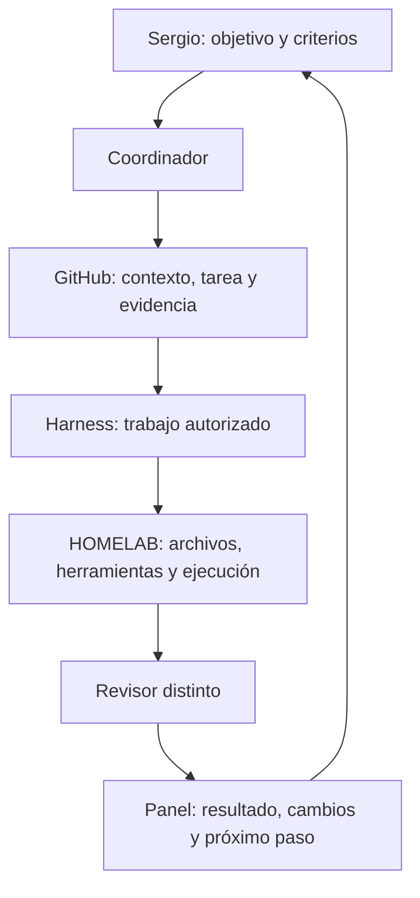

# Euge: contexto completo del video y qué significa para HOMELAB

9 noviembre 2026 · America/La_Paz · análisis solicitado por Sergio. Fuente: [Euge Oller, JuAQILH7dkQ, 30:02](https://www.youtube.com/watch?v=JuAQILH7dkQ). ID de análisis `homelab-enfoque-euge-20261109`.

## Qué se volvió a revisar

Se recuperó la captura previamente verificada de 0:00–30:02: sus dos ASR alineados, con 379 fragmentos retenidos, y el índice de 34 muestras visuales. En esta relectura se inspeccionaron directamente diez imágenes del reproductor (9:30, 13:18, 15:47, 18:01, 22:36, 23:41, 24:46, 26:19, 28:45 y 29:37). Los dos JSON alineados coinciden con los hashes del dictamen aceptado. No se volvió a reproducir ni transcribir el video, no se instalaron herramientas ni se operó el navegador de cuentas.

La consulta nueva de la URL por la herramienta web devolvió Cache miss; el análisis se apoya en los archivos preservados y cotejados, no en contenido recuperado por esa consulta fallida. La página capturada mostraba «final v4 animated»; se identifica por ID y autor, sin inventar un título alternativo.

**Límite:** imágenes muestreadas y texto ASR con tiempos aproximados; no escucha directa ni percepción visual continua. Los nombres mal reconocidos por ASR no se convierten en hechos. Se parafrasea el contenido, sin publicar transcripción, capturas de cuenta, medios ni datos personales. [Cobertura previa y revisión](../RESOLUCION-20261109.md) · [dictamen](../revision/DICTAMEN.md).

## Qué enseña, de principio a fin

| Tiempo aproximado | Contenido del video y demostración |
| --- | --- |
| [0:00–1:03](https://www.youtube.com/watch?v=JuAQILH7dkQ&t=0s) | Presenta su uso diario de agentes, fábricas de contenido/código y Clonify para operar un negocio online. La exposición mezcla enseñanza, ejemplos propios y promoción de su plataforma. |
| [1:03–4:11](https://www.youtube.com/watch?v=JuAQILH7dkQ&t=63s) | Su explicación inicial distingue el modelo que responde en chat del que puede utilizar herramientas, como búsqueda web. La ampliación importante es que el agente puede obtener información y actuar mediante esas herramientas. No se toma su cronología informal como historia técnica verificada. |
| [4:11–7:21](https://www.youtube.com/watch?v=JuAQILH7dkQ&t=251s) | Añade razonamiento antes de responder/actuar y conectores MCP. Usa APIs y aplicaciones como Gmail y Clonify para ilustrar acceso a funciones con contexto. Aclara que la clasificación de generaciones es su esquema didáctico. |
| [7:21–11:18](https://www.youtube.com/watch?v=JuAQILH7dkQ&t=441s) | Explica el salto al agente con ordenador: archivos, navegador y herramientas dentro de un entorno propio. Menciona iniciativas de código abierto, ordenadores dedicados y ofertas alojadas por proveedores. La lámina de 9:30 añade ordenador propio a MCP/herramientas. No ofrece una guía de instalación de HOMELAB ni prueba de aislamiento. |
| [11:18–12:38](https://www.youtube.com/watch?v=JuAQILH7dkQ&t=678s) | Proactividad: avisar de una salida para llegar a tiempo, detectar reuniones superpuestas, preparar información de un contacto y sugerir acciones por contexto. Son ejemplos de un agente con acceso y rutinas; estar conectado por SSH no implementa esas capacidades. |
| [12:38–16:14](https://www.youtube.com/watch?v=JuAQILH7dkQ&t=758s) | Propone hablar con un coordinador que delega cuando conviene. Muestra el chat de Star/GrokBOT y acceso al tablero; relata una rutina diaria de cinco propuestas para shorts. Describe conectores de correo, calendario, reuniones/transcripciones, Clonify y herramientas de publicación. El ordenador virtual conserva archivos y pequeñas bases de datos. |
| [16:14–17:48](https://www.youtube.com/watch?v=JuAQILH7dkQ&t=974s) | Su regla central es dividir el trabajo hasta obtener resultados evaluables: idea, guion, edición y miniatura. Para cada uno hay que explicar qué lo hace bueno. Un encargo demasiado amplio, como pedir un video ganador, oculta decisiones y criterios. La lámina de 18:01 separa idea, guion y miniatura. |
| [18:00–20:34](https://www.youtube.com/watch?v=JuAQILH7dkQ&t=1080s) | Sostiene que distintos modelos sirven mejor para distintas tareas y muestra edición/motion graphics atribuida a Claude/Opus. En pantalla figura Opus5.5. Describe una máquina de nube más capaz para las fábricas y render, con Hetzner como ejemplo, además del ordenador del asistente. Recomienda que la propia IA ayude a preparar el sistema. Las afirmaciones de rendimiento son del autor; no un benchmark nuestro ni recomendación de contratar ese modelo. |
| [20:34–23:34](https://www.youtube.com/watch?v=JuAQILH7dkQ&t=1234s) | Define una fábrica como entradas → pasos → resultado. Para ideas, las entradas pueden ser referencias que realmente usa el creador; propone seleccionar candidatos, simular miembros de la audiencia y usar críticos. Cada ejecución debe permitir medir, aprender y mejorar. Esas simulaciones filtran hipótesis; no prueban aceptación del público o ventas. |
| [23:34–25:55](https://www.youtube.com/watch?v=JuAQILH7dkQ&t=1414s) | La fábrica de código recibe una necesidad y entrega un PR para revisión. Muestra un tablero con carriles, estados de espera/marcha, revisión y destinos. La sala de montaje permite ver planos, tiempos, comentar y generar otra versión. La interfaz de 24:46 tiene una línea temporal real visible; no es solamente un listado de tareas. También muestra el avance de un montaje por pasos. |
| [26:09–27:12](https://www.youtube.com/watch?v=JuAQILH7dkQ&t=1569s) | Explica cómo enseñar preferencias de edición mediante una entrada y un resultado corregido a mano. La discrepancia se usa para investigar qué criterio falló. Propone conservar feedback en el proceso. La pantalla de 26:19 muestra aprobación/cambios y comentarios asociados al tiempo. Guardar ejemplos e instrucciones no demuestra entrenamiento de los pesos del modelo. |
| [27:12–28:31](https://www.youtube.com/watch?v=JuAQILH7dkQ&t=1632s) | Describe un experimento de Leader Summaries: elegir un libro de una cola, generar piezas con imágenes/voz, subirlas y dirigir a una oferta. Menciona servicios de imágenes y ElevenLabs. Dice que ese flujo publica sin revisión y reconoce pocas visitas. No presenta esta automatización como prueba de éxito comercial ni autoriza replicar esos envíos en OnIA. |
| [28:31–29:23](https://www.youtube.com/watch?v=JuAQILH7dkQ&t=1711s) | Explica por qué compartir las fábricas: distintos agentes y miembros de su equipo pueden aportar entradas y revisar resultados en un ordenador persistente. Dice que podría estar en el ordenador propio; él usa nube para el funcionamiento compartido. Esta es la referencia más directa para el HOMELAB que pide Sergio. |
| [29:23–30:02](https://www.youtube.com/watch?v=JuAQILH7dkQ&t=1763s) | Cierra el tutorial e invita a una demo comercial de Clonify para negocios de formación. La portada visual agrupa módulos de negocio alrededor del asistente. La promoción no demuestra qué partes del backend están implementadas ni qué resultados tendrán otros negocios. |

## Su arquitectura y la lección operativa

En el diagrama se distinguen: la persona; el agente coordinador; su ordenador virtual; conectores a aplicaciones; y otro entorno donde viven las fábricas y los modelos elegidos para cada trabajo. El tablero expone entrada, producción, revisión y destino. En su ejemplo, agentes distintos comparten el mismo espacio persistente y pueden revisar trabajo iniciado por otra persona.

El método consiste en especificar un resultado pequeño, darle insumos adecuados, definir los pasos y la calidad esperada, ejecutar, revisar y corregir. Después se conserva lo aprendido en el procedimiento. El objetivo no se mide por cuántos agentes hay abiertos, sino por la calidad y utilidad del resultado que sale de cada proceso.

Tres precisiones que preservan el contexto:

- Un panel visible no acredita por sí solo el funcionamiento interno o el éxito de una empresa; aquí se observan interfaces y se recoge la explicación del autor.
- La máquina de trabajo no sustituye al proveedor del LLM. El video describe acceder a modelos con una cuenta y operar/renderizar en otra máquina; no demuestra que sus pesos se ejecuten localmente ni que añadir hardware elimine cuotas.
- El servidor de nube, los proveedores/modelos mencionados y las salidas automáticas son ejemplos del autor. El video no exige Tailscale, Windows, WSL, una GPU concreta o cambiar todo nuestro stack. El precio que recuerda de su servidor no es una cotización verificada para OnIA.

## Traducción propuesta a OnIA y HOMELAB

La explicación anterior de Codex se concentró demasiado en descargar CPU/memoria del VPS. **El propósito completo solicitado es un lugar persistente de trabajo para las fábricas de OnIA**, con materiales, herramientas, resultados, estados y continuidad entre sesiones. La potencia es una parte de ese propósito.

Este diagrama expresa el destino propuesto; no declara un circuito automático ya funcionando. En nuestro caso, el VPS conservaría coordinación y Git; la PC de casa sería el worker persistente. Los secretos y medios privados permanecen fuera del repo. Esta separación VPS↔PC es una adaptación nuestra, no una receta literal de Euge.

| Componente del enfoque | Qué hay en OnIA | Qué falta para su uso previsto |
| --- | --- | --- |
| Coordinador y contexto | Reglas, tarea canónica, Git, evidencia y retoma en el harness. | Consolidar la entrada usable y el estado; no hay coordinación permanente autónoma. |
| Cerebro para dar insumos y criterio | Corpus aceptado de19referentes/79piezas; catálogo consultable de23patrones. | Integrarlo en el uso cotidiano del panel, conservando fuentes y límites. |
| Fábrica de ideas/guiones | Dos guiones, lector manual de tres URLs y panel HTML de consulta. | Flujo cómodo desde objetivo hasta borrador revisado; recepción de feedback y nuevas versiones. No hay ingesta/generación/publicación recurrentes. |
| Máquina persistente | VPS operativo; Tailscale de PC y VPS conectado. | Usuario `onia-worker`, aislamiento de Windows, SSH verificado, continuidad WSL y prueba de una ejecución. El diseño posterior del worker/leases sigue separado. |
| Revisión y tablero | Revisión distinta y aceptación en harness; HTML con estados proyectados. | Panel operativo con revisión/feedback cuando se autorice. El HTML aceptado no escribe aprobaciones. |
| Avisos y salidas | Contrato/adaptador Telegram probado con datos sintéticos; n8n inactivo. | Prueba real autorizada, canal y permisos concretos. No activar publicaciones, envíos ni producción por este análisis. |

La identidad fija es **DESKTOP-0GGGNMF**, nodo `desktop-0gggnmf`, WSL2 `Ubuntu` predeterminada. **DESKTOP-ENV6SDA queda excluida**; no es un worker alternativo. [Estado y límites del HOMELAB](../../../04-operacion-agentes/homelab/README.md).

## Qué haríamos primero y qué no se está autorizando

1. Completar únicamente la base de HOMELAB ya pedida: conexión, usuario aislado y continuidad. No convertir nodo online en aceptación de la PC. Falta la consulta local de bwrap/sshd/huella para preparar el alta segura.
2. Con el sí pendiente al [plan de cerebro+panel](../../../04-operacion-agentes/evidencias/cerebro-panel-usable-20261109/PLAN.md), hacer una primera fábrica manual de ideas/guiones para vender el workshop: fuentes y patrón → idea → guion → revisión → panel → decisión de Sergio. Reutilizar el material aceptado y el kit de ensayo.
3. Registrar la corrección de Sergio y probar su efecto en la siguiente versión. Para esta etapa importa entregar material usable y ensayar, antes que aumentar sesiones.
4. Scheduler, rutinas, Telegram real, más áreas y HOMELAB etapa1 mantienen su nuevo sí posterior. La petición de entender el video no activa ninguno de esos componentes, no aumenta cupos ni aprueba gastos o salidas externas.

No hubo instalación, reproducción nueva, ASR nuevo, benchmark, conexión a la laptop, configuración de PC, cambio de producción ni envío. El análisis y sus fuentes se guardan en Git; los originales audiovisuales quedan privados.
