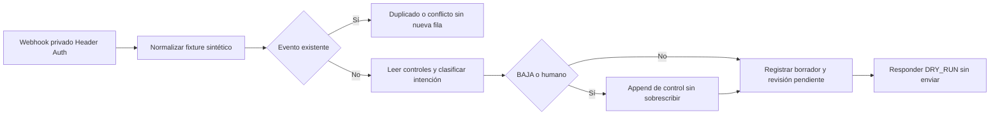
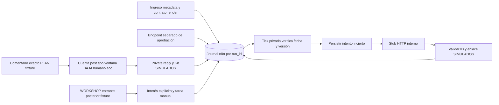

# Archivo documental: Instagram mensajes n8n DRY RUN

> Consolidado por autorización de Sergio. Fuente: [Page original](https://chatgpt.com/space/page_d43d9736e728819191c34648bd68dc75), secuencia **3**, actualizada 2026-11-04T20:33:21.706716Z. Este archivo conserva evidencia y borradores de esa fecha; **no es un segundo plan activo**. Las decisiones vigentes están en [PLAN](../../../01-negocio/PLAN.md) y los resultados en [ESTADO](../../../00-MAPA/ESTADO.md). El texto histórico que diga «vigente», «STOP» o «no modificar Git» describe su momento original y no reemplaza la consolidación autorizada.

Los enlaces a medios/descargas se abren en la Page de origen; esos binarios permanecen en cloud. Esta copia no los incorpora ni vuelve a ejecutar sus pruebas. Se omitieron las secciones de configuración runtime privada y JSON operativos; se preservan resultados, diseño y propuesta transaccional.

---

Workflow real importado y comprobado en n8n para mensajes sintéticos: recepción autenticada → normalización → deduplicación secuencial → clasificación determinista → borrador → cola de revisión humana. **DRY_RUN obligatorio; no contiene nodos de envío ni conexiones Meta. Estado final inactivo, confirmado por API.**

Exportación JSON configurada, sin valores secretos: [Instagram mensajes n8n DRY RUN workflow.json](https://chatgpt.com/space/page_d43d9736e728819191c34648bd68dc75)

Workflow final inactivo. La descarga no activa ni conecta Meta.

[Workflow n8n: ONIA · Instagram mensajes · DRY_RUN revision humana](https://n8n-sergio-n8n.hqdqgh.easypanel.host/workflow/PGgAHAwZVr9TQEvp).

# Resultado real y recursos

23 casos secuenciales aprobados dentro de n8n, más2 escenarios concurrentes reales y4 aserciones locales de la frontera HMAC/challenge con secretos efímeros ficticios. Estas últimas NO son pruebas de webhook Meta. Se importó una sola implementación y hubo una revisión independiente, con corrección del control concurrente antes de pruebas. No se repitió la investigación histórica de Instagram.

Recursos privados nuevos, conservados para continuidad:

| Recurso | ID |
|---|---|
| Workflow de17 nodos | PGgAHAwZVr9TQEvp |
| Tabla ONIA_IG_DRYRUN_events | DKTipScx8gOdcpV8 |
| Tabla ONIA_IG_DRYRUN_controls | EDvHtIIjLtOXK4Ql |
| Credencial Header Auth de prueba | unLLUfQXnAXEwIzA |

API discover?include=schemas respondió200. Create Data Table201, credencial200, workflow200. Se reutilizaron infraestructura, esquemas de nodos y componentes del ensayo previo; no se alteró el workflow anterior ni sus tablas. No se instaló software/base/servicio nuevo ni se modificó Supabase/ONIA, VPS global, repo, skills o reglas.

Primer intento: la primera petición autenticada recibió404 tras activar. Se desactivó en finally. Sobre los MISMOS recursos se rotó la misma credencial sintética y se comprobó disponibilidad con petición de autenticación incorrecta403 antes de los casos; el pase real completó la suite y desactivó en finally. No se creó otra copia. No se registraron callbacks existentes ni se leyó ninguna conversación real.

Guardado de ejecuciones verificado ANTES de activar: saveDataSuccessExecution:none, saveDataErrorExecution:none, saveManualExecutions:false, saveExecutionProgress:false. Ningún header o valor de credencial se exporta. El valor criptográfico se generó en proceso, quedó exclusivamente en Credentials y se borró localmente al terminar. La exportación sólo conserva su referencia. Estado final GET active:false, incluso después de alinear metadata de oferta.

# Diagrama del circuito



Las ramas de error responden400/503 sin afirmar éxito. No hay nodo HTTP externo, Facebook Trigger, DM sender, publicación, LLM ni scheduler. En todos los resultados auto_send_allowed:false y sent:false. El estado de revisión pendiente es una fila de cola, no una aprobación ya concedida ni una notificación humana.

# Configuración de oferta e intenciones

Keyword principal **PLAN por DM**, sin comentarios. Destino futuro @sergiourcullo, OnIA Social API con Instagram Login y graph.instagram.com; aún no hay token IG ni App Secret disponibles para este flujo. La entrada actual sólo admite account IG_TEST_SYMBOLIC, synthetic:true y IDs SYNTH_. El consumidor no puede cambiar la configuración de oferta desde el payload.

Propuesta neutral interna: «Tu primer sistema personal con IA: organizá tu semana y delegá una tarea». approved:false. Bs50 es sólo propuesta; condiciones, requisitos y horario permanecen null hasta confirmación. No se adoptó una oferta de Luma/guiones ni se confirmó precio. El ajuste final añadió únicamente título propuesto, keyword PLAN y canal DM a la configuración, sin cambiar lógica ni activar de nuevo.

INFO, PLAN, WORKSHOP, PRECIO, REQUISITOS y HORARIO generan borrador marcado para revisión: no revelan un precio como confirmado, no inventan requisitos/fecha/condiciones. Pregunta desconocida y adjunto no soportado quedan para revisión sin respuesta inventada; no se descarga el adjunto. ECO se registra como IGNORED_NO_SEND/IGNORED_ECHO, sin borrador. BAJA y petición humana bloquean borradores posteriores de esa conversación. La ventana conservadora es menor de24h, sin excepción automática de7 días. El timestamp del fixture no acredita la hora de una conversación Meta real.

La normalización exige event_id separado de conversation_id; campos sintéticos, fecha finita no futura, texto hasta500 caracteres y1000 bytes UTF-8, hasta3 adjuntos cuyo contenido se descarta. No se almacenan headers, tokens ni ofertas impuestas por quien llama. La tabla de eventos guarda sólo event_id,conversation_id,payload_json,intent,draft,review_state. La tabla de controles guarda conversation_id y STOP/HUMAN; su ID interno lo aporta n8n.

# Pruebas reales ejecutadas

| Caso | Evidencia observada |
|---|---|
| INFO, PLAN y WORKSHOP | 201, clasificación correcta, borrador para revisión |
| PRECIO | 201, Bs50 no aparece como precio confirmado en borrador |
| REQUISITOS y HORARIO | 201, dato no confirmado, revisión obligatoria |
| Oferta approved:true enviada por cliente | Ignorada; configuración interna sigue false |
| Pregunta desconocida | DESCONOCIDA, sin respuesta inventada |
| Adjunto sintético | ADJUNTO_NO_SOPORTADO, sin descarga |
| Eco/mensaje propio | IGNORED_ECHO, draft vacío |
| Petición humana y siguiente evento | HUMANO → HUMANO_PENDIENTE |
| BAJA y siguientes eventos | BAJA → BLOQUEADO_BAJA, persistido entre ejecuciones |
| Más de24h | FUERA_DE_VENTANA, sin borrador de envío |
| Datos faltantes/texto excesivo | 400 INVALID, sin insertar evento |
| Header incorrecto | 403 antes del circuito |
| Reentrega mismo ID/payload | 200 DUPLICATE, sin nueva fila |
| Mismo ID con contenido distinto | 409 EVENT_CONFLICT, sin nueva fila |

El archivo real-results.json detalla23 aserciones HTTP aprobadas. Al terminar:22 filas de eventos y4 controles, todos sintéticos, incluidas las carreras descritas abajo. Se comprobó almacenamiento entre ejecuciones leyendo las MISMAS tablas; no se reinició n8n/VPS/VM. No hubo envíos a terceros o llamadas Meta reales.

# Concurrencia y bloqueo concreto de envío automático

Dos peticiones simultáneas del mismo event_id atravesaron Get+Insert; ambas respondieron201 y se observaron DOS filas para ese evento. El fixture autorizado race_fixture:true añadió700ms entre la lectura y la escritura para exponer el intercalado; no es una simulación de la base: la carrera ocurrió en el workflow real y las filas se leyeron por API. Por tanto, esta deduplicación NO garantiza atomicidad ni exactly-once.

Solución aplicada para este alcance: bloqueo estructural de envío (cero sendnodes) y auto_send_allowed:false; revisión humana en tabla. Antes de usar la cola, el operador debe agrupar por event_id y revisar una sola pieza; no hay un mecanismo automático que apruebe o envíe duplicados. Para automatizar en el futuro hace falta un mecanismo transaccional aprobado con clave única (cuenta,event_id) y claim de salida, o un ejecutor único cuya serialización esté acreditada. No se instala ni altera esa infraestructura ahora ni se afirma que Data Table Upsert lo resuelva.

La solución implementable ya queda especificada en el parche PostgreSQL `onia_automation` al final de esta misma entrega: reserva única inbox/outbox, claim con token y finalización condicionada. Es especificación no aplicada/no verificada con motor, no una capacidad ya desplegada.

La revisión detectó además que Upsert de conversación podía dejar que HUMANO sobrescribiera BAJA. Se reemplazó por controles append-only y lectura de todos los controles: STOP domina a HUMAN y nunca se sobrescribe con éste. Carrera real HUMANO/BAJA: se conservaron ambas filas; otra ejecución respondió BLOQUEADO_BAJA. Esto prueba ese caso, no una transacción atómica entre tabla de controles y tabla de eventos ni recuperación de cada punto de crash. Si falla una dependencia se devuelve503 incierto y no se habilita envío o reintento ciego. Reentregar puede duplicar control append-only, pero no quitar STOP.

# Entrada Meta preparada pero bloqueada

meta_boundary.py verifica challenge y HMAC-SHA256 sobre bytes crudos con comparación constante; sus4 aserciones usaron secretos aleatorios ficticios, no guardados ni exportados. No está desplegado como receptor n8n/Meta y no contiene App Secret real.

Revisión primaria aportada por coordinación: Facebook Trigger n8n master a79aac7f, typeVersion1, admite instagram/messages y challenge, pero verifica SHA-1/x-hub-signature y fija graph.facebook.com/v23.0. Esto NO acredita X-Hub-Signature-256 ni Instagram Login; no se usó ese nodo como solución. No colocar App Secret en Code, Crypto o JSON. El Header Auth de este ensayo tampoco sustituye la firma Meta.

Pasos mínimos para conectar después, fuera de este ensayo:

1. Sergio autoriza @sergiourcullo en OnIA Social API/Instagram Login. Guardar token IG en el consumidor adecuado para graph.instagram.com y verificar identidad, permisos instagram_business_basic/instagram_business_manage_messages y expiración; no reutilizar Ads ni otra cuenta.

2. Configurar un verificador seguro de challenge y SHA256/raw body con App Secret bajo custodia de credencial, conforme al contrato de Instagram Login. La opción segura todavía debe acreditarse; no conectar un callback real mientras falte. No se instala otro servicio aquí.

3. Suscribir messages al endpoint real verificado y probar un DM iniciado por un destinatario autorizado. Reemplazar el normalizador sintético por contrato real sólo en copia autorizada, con eco, event_id y ventana basados en evidencia auténtica.

4. Confirmar oferta/FAQ y responsable de revisión. Resolver la atomicidad antes de habilitar cualquier envío automático; envío real exige autorización concreta y message ID verificado. Este workflow se conserva DRY_RUN e inactivo.

No hace falta otra cuenta ni otra n8n key para lo ya construido. No hay autorización o ejecución de DMs/publicaciones en este encargo.

# Fuentes, ejecución y recuperación

Se leyeron AGENTS.md, reglas-comunes.md, ESTADO.md, ORQUESTACION.md y automatizar-n8n desde master por el conector GitHub (último commit informado58ea79da), sin cambiar el checkout antiguo9a3d4ce. Fuentes de nodos oficiales ya consultadas y contrato vivo discover?include=schemas permitieron reutilizar nodeVersion DataTable1, Code2, Webhook2, IF2 y RespondToWebhook1.4; ejecución real comprobó sus caminos usados. No se afirma una versión de instancia que la API pública no expuso.

Artefactos en /tmp/instagram-messages-dryrun. workflow.json es la exportación ACTUAL de n8n con active:false y referencias reales de tabla/credencial, sin valor secreto. run_n8n.py reproduce una creación aislada en carpeta nueva sólo con autorización de recursos: no ejecutarlo en la carpeta actual para crear más copias. El archivo resources.json actúa como guardia. continue_n8n.py registra cómo se retomó sobre los mismos recursos tras404, no es un scheduler ni un paso pendiente. La credencial de prueba existente puede rotarse en una futura ejecución autorizada, sin recuperarla desde esta biblioteca.

Mantener la exportación y resultados en biblioteca privada; no usar Notion para este informe técnico, no push ni cambios compartidos. La UI de la tabla es la cola para revisión humana; no se creó un panel ni se notificó a Sergio automáticamente. Esta prueba acredita el circuito sintético EN N8N, no integración Meta, entrega comercial o recepción de conversaciones reales.

# Parche mínimo de almacenamiento transaccional propuesto

transactional-outbox.sql contiene30 líneas para PostgreSQL13+. **Especificación no aplicada ni verificada con un motor PostgreSQL.** No había cliente/servidor PG disponible y el daemon Docker no era accesible. Se hizo revisión estática; no se instaló nada ni se repitió la suite. El workflow actual sigue DRY_RUN e inactivo.

Contrato mínimo:

- `reserve(account,event_id,payload)` crea inbox y outbox atómicamente; devuelve el mismo ID ante duplicado idéntico y rechaza payload distinto. Debe COMMIT antes de responder recepción. Estado inicial REVIEW_PENDING: no habilita envío. Funciona en READ COMMITTED; errores de serialización se reintentan sólo en la reserva, con la misma clave.

- Tras revisión y autorización de pieza, una operación restringida puede pasar REVIEW_PENDING→READY. No hay aprobación automática ni función que envíe. `claim()` reclama sólo READY con SKIP LOCKED y token nuevo; hacer COMMIT antes de cualquier efecto externo.

- Si hay timeout/crash, cambiar CLAIMED→UNCERTAIN condicionado al ID, token y estado actuales. No reciclar claims vencidos automáticamente. Consultar proveedor antes de reintentar; si se verifica ID externo, `complete(id,token,provider_id)` finaliza. Si se acredita ausencia, una revisión autorizada puede invalidar el token y volver a READY. `complete` no verifica al proveedor: esa comprobación corresponde al adaptador. No se garantiza exactly-once externo.

- Permisos: funciones SECURITY INVOKER por defecto. Antes de aplicar, revisar ownership, revocar EXECUTE de PUBLIC y conceder sólo permisos mínimos de schema/tablas/secuencias/funciones según rol, sin DDL/DELETE ni acceso a otros esquemas. READY, recuperación y GRANT concretos requieren el destino/roles autorizados; no se inventan aquí.

Pasos para implementación real, sólo cuando se autoricen destino y acceso:

1. Elegir destino PostgreSQL autorizado y conectar credencial DB restringida en Credentials n8n; sin valores en JSON. No aplicar a Supabase/ONIA ni crear servidor.

2. Revisar y aplicar migración sólo en esquema exclusivo `onia_automation`; comprobar permisos y que se revierte ante conflicto. No migrar datos del producto.

3. Reemplazar Get+Insert por llamada parametrizada a `reserve`; sustituir el futuro envío por claim/estado/token y finalización, manteniendo la revisión y DRY_RUN. No crear workers ahora.

4. Repetir carrera: varias reservas de la misma clave deben dejar una inbox/outbox; payload distinto debe fallar. Probar claims distintos y caída tras claim/tras escritura: UNCERTAIN y conciliación, nunca reenvío ciego ni finalización con token obsoleto.

5. Sólo después de esas pruebas, configurar/verificar acceso y firma Meta y autorizar un envío concreto. El parche no activa Meta, automatismos o el workflow actual.

Archivo SQL descargable: [onia\_automation transactional-outbox.sql especificación no aplicada](https://chatgpt.com/space/page_d43d9736e728819191c34648bd68dc75)

## transactional-outbox.sql

SHA-256: 2ff539a27337335b2dae2647ae3170f8d0c140e2b7bec9bbb708f198557d08c0

```sql
-- PostgreSQL >=13; especificación NO aplicada ni verificada con motor PostgreSQL.
CREATE SCHEMA IF NOT EXISTS onia_automation;
CREATE TABLE onia_automation.inbox (
 id bigint GENERATED ALWAYS AS IDENTITY PRIMARY KEY, account text NOT NULL CHECK (btrim(account)<>''),
 event_id text NOT NULL CHECK (btrim(event_id)<>''), payload jsonb NOT NULL CHECK (jsonb_typeof(payload)='object'), UNIQUE(account,event_id));
CREATE TABLE onia_automation.outbox (
 inbox_id bigint PRIMARY KEY REFERENCES onia_automation.inbox(id), state text NOT NULL DEFAULT 'REVIEW_PENDING'
 CHECK (state IN ('REVIEW_PENDING','READY','CLAIMED','UNCERTAIN','DELIVERED','FAILED')),
 claim_token uuid, claimed_at timestamptz, attempts integer NOT NULL DEFAULT 0, provider_id text,
 CHECK (state<>'DELIVERED' OR NULLIF(btrim(provider_id),'') IS NOT NULL));
CREATE FUNCTION onia_automation.reserve(a text,e text,p jsonb) RETURNS bigint LANGUAGE plpgsql AS $$
DECLARE k bigint; prior jsonb;
BEGIN
 INSERT INTO onia_automation.inbox(account,event_id,payload) VALUES(a,e,p) ON CONFLICT(account,event_id) DO NOTHING RETURNING id INTO k;
 IF k IS NULL THEN
  SELECT id,payload INTO k,prior FROM onia_automation.inbox WHERE account=a AND event_id=e FOR UPDATE;
  IF prior IS DISTINCT FROM p THEN RAISE EXCEPTION 'event_payload_conflict'; END IF;
 END IF;
 INSERT INTO onia_automation.outbox(inbox_id) VALUES(k) ON CONFLICT DO NOTHING;
 RETURN k;
END $$;
CREATE FUNCTION onia_automation.claim() RETURNS SETOF onia_automation.outbox LANGUAGE sql AS $$
 WITH next AS (SELECT inbox_id FROM onia_automation.outbox WHERE state='READY' ORDER BY inbox_id LIMIT 1 FOR UPDATE SKIP LOCKED)
 UPDATE onia_automation.outbox o SET state='CLAIMED',claim_token=gen_random_uuid(),claimed_at=clock_timestamp(),attempts=o.attempts+1
 FROM next WHERE o.inbox_id=next.inbox_id RETURNING o.*;
$$;
CREATE FUNCTION onia_automation.complete(k bigint,t uuid,p text) RETURNS boolean LANGUAGE sql AS $$
 WITH done AS (UPDATE onia_automation.outbox SET state='DELIVERED',provider_id=p WHERE inbox_id=k AND claim_token=t
 AND state IN ('CLAIMED','UNCERTAIN') AND NULLIF(btrim(p),'') IS NOT NULL RETURNING 1) SELECT EXISTS(SELECT 1 FROM done);
$$;
```

# Piloto integrado 4 de noviembre

Copia recuperable del cierre integrado para coordinación, añadida sin alterar el historial. Esta sección incorpora el resultado completo, IDs, matriz esperado/observado, backlog y actualización de QA SQL. Sólo se trasladó evidencia ya existente: no se tocaron workflows ni se repitieron pruebas.

## Descargas propias de esta página

- [Reporte JSON piloto integrado 4 noviembre](https://chatgpt.com/space/page_d43d9736e728819191c34648bd68dc75)

- [Workflow A contenido aprobación JSON](https://chatgpt.com/space/page_d43d9736e728819191c34648bd68dc75)

- [Workflow B comentario PLAN lead JSON](https://chatgpt.com/space/page_d43d9736e728819191c34648bd68dc75)

- [Workflow stub simulador JSON](https://chatgpt.com/space/page_d43d9736e728819191c34648bd68dc75)

- [SQL transaccional onia\_automation](https://chatgpt.com/space/page_d43d9736e728819191c34648bd68dc75)

- [QA PostgreSQL aislado resultados JSON](https://chatgpt.com/space/page_d43d9736e728819191c34648bd68dc75)

- [Paquete completo piloto integrado ZIP](https://chatgpt.com/space/page_d43d9736e728819191c34648bd68dc75)

Los siete archivos se cargaron de nuevo en el destino Files canónico de ESTA página (`page_d43d9736e728819191c34648bd68dc75`), con `file_access_confirmed:true` y `page_id` coincidente. No dependen de abrir la página que devolvió `page_read_forbidden`. No se hizo público nada ni se modificaron permisos. La confirmación de acceso corresponde a esta sesión y a este destino; no sustituye la comprobación desde otra identidad.

Referencia exacta del reporte JSON:

```text
library-file:fde1_bGliZmlsZV9qcHNSa05icW9mTVVyRkpmNUllQzN3_FileDrive_c5cf4a3148bc8191b81950bcb352a773
```

Piloto integrado **ejecutado en n8n real**, con adaptadores exclusivamente simulados: pieza → revisión → aprobación por credencial separada → programación → publicación stub confirmada → comentario PLAN → Kit privado simulado → lead → interés explícito de workshop. Los tres workflows quedaron inactivos. No funciona todavía contra Instagram real ni habilita ventas, DMs, publicaciones o cobros autónomos.

## Workflows y cierre

- [A Contenido y aprobación](https://n8n-sergio-n8n.hqdqgh.easypanel.host/workflow/m0wEy7YRDbGWVDKU):19nodos,active:false.

- [B Comentario PLAN y lead](https://n8n-sergio-n8n.hqdqgh.easypanel.host/workflow/e2UbFNNSnaLA6JlU):12nodos,active:false.

- [Adaptador stub interno](https://n8n-sergio-n8n.hqdqgh.easypanel.host/workflow/WQvAV1z9f3XqCyQf):13nodos,active:false.

No hay nodos con URLMeta. El único HTTP Request llama una ruta fija del simulador en esta misma instancia, con credencial propia; nunca graph.instagram.com o graph.facebook.com. No hay LLM, envío real, scheduler/ScheduleTrigger o instalaciones en VPS. No se alteró el workflow anterior PGgAHAwZVr9TQEvp, callbacks o cuentas existentes. Reglas/ESTADO/skill se leyeron desde master; no hubo cambios Git o Supabase/ONIA.

API/discovery y esquema de Header Auth reales comprobados. Credenciales inspeccionadas sólo como metadata, sin valores. La configuración pública no expuso versión de instancia: no se inventa. Los typeVersion de nodos sí se aceptaron y ejecutaron. Almacén único de este piloto: Data Table nativa X9sEmwRFeaUeU0Bo, con run_id,event_id,kind,payload_json,result_json. No se agregó una base persistente. Se encontraron2referencias Postgres sólo por metadata; no se acreditó que correspondieran a un destino aislado autorizado y no se usaron ni se leyeron sus valores.

Tres credenciales aleatorias distintas protegen ingreso, aprobación y stub. `approved:true` del ingreso externo no autoriza; la aprobación exige endpoint/credencial diferente y scope exacto asset_id,version_hash,destino y revision_key ligado a archivo/hash,caption,guion,licencia,consentimiento y origen. Se verifica persistencia del intento antes de llamar al stub. Los valores aleatorios sólo existen en Credentials; se borraron localmente, sin exportarlos. Guardado exitoso/fallido/manual/progreso de ejecuciones deshabilitado antes de activar. Evidencia saneada por respuestas y tabla, no logs/headers.

## Un run_id y la misma persistencia

Run: SYNTH_BRAND_3a7d612c52fb. Lectura final de58filas del mismo journal:

| Hito | Observado | Naturaleza |
|---|---|---|
| Archivo fuente | MP4negro sintético1s,16×16,1fps, generado por ffmpeg en VM; SHA256 enmanifest | Archivo real de prueba, NOpieza editorial |
| Render_request | Registro job_id; no despacho a Codex | Contrato real guardado, integración NOimplementada |
| Media_artifact | Hash y origen MANUAL_CLOUD_HANDOFF | Traspaso manual de fixture, no retorno automático |
| Ingestión/revisión | BORRADOR→REVISAR | n8n+tabla reales |
| Aprobación | APROBADO con scope exacto y credencial diferente | Aprobación FICTICIA del ensayo, no comercial |
| Trigger técnico | PROGRAMADO→TICK: fechaISO-04:00 y versión comprobadas | Webhook técnico bajo demanda; no cron autónomo |
| Publicación | SIMULADO, mediaIDyURLexample.invalid confirmados | HTTPreal entre workflows, proveedorSTUB |
| ComentarioPLAN | Propia cuenta/post simulados en allowlist | n8nreal; eventoMeta ficticio |
| Kit/lead principal | Un recibo RESOURCE_DELIVERED_SIMULATED y lead | Simulación persistida; nadie recibió recurso |
| Interésworkshop | EXPLICIT_SIMULATED después de DM_INBOUND WORKSHOP distinto | Consentimiento ficticio separado del comentario/click |
| Pago/acceso | PENDIENTE_MANUAL/PENDIENTE_MANUAL | No hay cobro conciliado ni entrega real |

No se usan enlaces privados para prospectos. La página fuente PLANv2/Kit se recuperó en lectura; la respuesta privada contiene sólo https://example.invalid/kit-plan-v2, marcada SIMULACIÓN y sin aprobación pública. La propuesta neutral Bs50/55min no está elegida; no se introduce precio, fecha o acceso como confirmados. Para C se eligió ficha y tarea manual, no pago falso conciliado.

## Diagrama



## Qué se probó

60verificaciones HTTP aprobadas en los workflows reales (matriz completa abajo/adjunta), una carrera concurrente adicional y15checks de SQL aislado. Los60 incluyen pasos repetidos de preparación por escenario, no60funcionalidades distintas. El pase principal completó lo aprobado sin repetición completa; una rama de error se corrigió y se reprobó de forma acotada con el MISMO run_id/recursos. Los tres workflows se desactivaron en finally en ambos pases; GETfinal confirmó active:false.

Casos: aprobación externa/credencial ajena rechazadas, scope de revisión y cambio de archivo/caption que invalida aprobación, no aprobación, fecha sin offset inválida, fecha futura no ejecutada,PLAN trim+uppercase exacto (PLANES/miPLAN ignorados), un private reply por comment_id secuencial, event_id duplicado/conflictivo,cuenta/actor/post ajenos,STOP/humano/eco,noLive,comentario>7d,DM>24h y clickKit sin permisoDM.

La ventana7d se calcula desde comment_created_at, no horaWebhook; workshop sólo se simula tras DM_INBOUND de la persona en24h. Estos tiempos y la identidad provienen de fixtures autenticados, no de Meta real. No se cambió una cadencia real de DM.

Timeout: el HTTP Request real al stub venció a2s después de que éste guardara recibo; la demora del stub fue5s. A conservó PUBLICACION_INCIERTA. TICKposterior rechazó UNCERTAIN_NO_BLIND_RETRY. RECONCILE hizo LOOKUP, verificó el recibo y confirmó SIMULADO sin otra publicación: se conservó un recibo para ese intento. No se reintenta a ciegas. El token vencido fue una condición SIMULADA; journalERROR, respuesta controlada422, ninguna consulta OAuthreal.

## Gates de activación

| Criterio | Resultado | Consecuencia |
|---|---|---|
| Circuito sintético n8n de punta a punta | APROBADO | Puede revisarse este piloto inactivo |
| Atomicidad concurrente n8n | FALLIDO | Cero salida real; no exactly-once |
| SQL transaccional en PGtemporal | APROBADO aislado | No se hereda en n8n hasta conectarlo y revalidar |
| Cuenta/permisos/firma Meta | NOprobados/BLOQUEADOS | No conectar callbacks o tráfico real |
| Oferta/KitURL pública/medio público | Pendientes de aprobación | No publicar ni vender como elegidos |
| n8n→Codex para render | NOimplementado | Handoff manual, sin prometer integración |

Carrera real: dos comentarios simultáneos con el mismo event_id, ventana de intercalado de700ms explícita de fixture, produjeron DOS filas yHTTP201/201. El bloqueo de salida real es estructural: el adaptador sólo admite simulación y apunta al stub interno. Retirar ese bloqueo exige reserva/claim atómicos y ensayo desde n8n, no sólo un cambio de flag.

Se validó el SQL previo sin modificar en PostgreSQL17.11 temporal de esta VM:15checks, ocho reservas simultáneas→una inbox/outbox, payload conflictivo, rollback,SKIPLOCKED,claim token,recoveryUNCERTAIN ytoken viejo. Paquetes oficiales Debian extraídos en /tmp:18.75MB descargados, sin instalación global; sólo socket Unix privado, motor detenido en finally. No se conectó n8n ni se aplicó a producto. No se acreditó entrega externa exactamente una vez. El detalle/limitaciones están en atomicity-report.md y pg-qa/results.json.

## Frontera Meta y pasos mínimos posteriores

Contrato suministrado por coordinación desde la colección oficial fbsamples commit6bf8eb274e9abec224c1951aaf894603e0f1d1a3, consultada4nov2026, con último cambio indicado10dic2025 y docs actuales429: requiere revalidación con la cuenta antes de producción. No se repitió la investigación.

- InstagramLogin: graph.instagram.com/{GRAPH_API_VERSION}, versión configurada/confirmada, no asumir latest. Destino futuro @sergiourcullo/OnIA Social API, todavía sin tokenIG ni AppSecret. No Ads ni credenciales de otra cuenta.

- Permisos: instagram_business_basic; manage_comments para comentarios/private reply; manage_messages para posterior DM; content_publish para publicar. Manage_comments es un requisito adicional respecto del piloto DM anterior.

- Private reply: POST/{ig_user_id}/messages con recipient.comment_id, message.text; una respuesta dentro7d de crear comentario, noLive. Nuestro PLAN exacto tras trim+uppercase es decisión de normalización propia. ClickKit o respuesta privada saliente no abre ventanaDM. WORKSHOP entrante marca interés explícito, no pago.

- Publicación real: crear contenedorReels con video_url pública/caption, polling acotado (recomendación1min hasta5min; no ejecutar esa espera en tests), FINISHED separado de media_publish, validar media_product_type/ID/permalink. Consultar content_publishing_limit; no hardcode50/100. Esto no está conectado al stub como APIreal.

- Firma SHA256/rawbody con AppSecret seguro pendiente. Facebook Trigger revisado por coordinación usa SHA1/x-hub-signature y graph.facebook.com/v23.0: no se usa como solución Instagram Login. No colocar AppSecret en Code/Crypto/JSON ni confundir HeaderAuth privado con firmaMeta.

Orden para avanzar: destinoDBaislado/credencialrestringida autorizados→integrar reserve/claim y recovery en n8n→resolverfirma segura→autorización personal IG/permisos→URLpública de Kit y medio aprobados→una prueba real autorizada. Hasta entonces workflowsinactivos y Meta cerrado. No hace falta usuario en PC para inspeccionar este paquete; sólo el consentimiento personal OAuth no puede suplirse con fixtures.

## P2 v2 de Video recibido al cierre

Video informó una entrega real independiente en video-y-audio.md : MP4silencioso48s,1080×1920,H264; sha2569006d472830be0d3412d68c67b1e07638d75c92364197507d9b9ec1aa23591ff; job_id2026-11-05-P2-03bbf2bc53f11ba974a3. Privado/revisión pendiente; CLI manual,17checks ycache reutilizado sin nuevo render, según esa entrega. NO se usó como asset de este run, no se convirtió en URLpública ni prueba de n8n→Codex. El run conserva su fixture sintético1s claramente identificado. Siguiente paso de Video/Marketing: revisar la pieza y aprobar destino público antes de cualquier uso Meta.

## Matriz esperado observado

| Caso | Esperado | Observado | Resultado |
|---|---|---|---|
| render_request_contract | 201 RENDER_REQUEST_RECORDED_NOT_DISPATCHED | 201 RENDER_REQUEST_RECORDED_NOT_DISPATCHED | APROBADO |
| manual_media_artifact_contract | 201 MANUAL_ARTIFACT_RECORDED | 201 MANUAL_ARTIFACT_RECORDED | APROBADO |
| e2e_ingest | 201 BORRADOR | 201 BORRADOR | APROBADO |
| e2e_review | 201 REVISAR | 201 REVISAR | APROBADO |
| external_cannot_approve | 403 CHANNEL_NOT_AUTHORIZED | 403 CHANNEL_NOT_AUTHORIZED | APROBADO |
| ingress_secret_cannot_call_approval | 403 AUTH_REJECTED | 403 AUTH_REJECTED | APROBADO |
| e2e_separate_approval | 201 APROBADO | 201 APROBADO | APROBADO |
| date_without_offset_rejected | 400 DATE_REQUIRED | 400 DATE_REQUIRED | APROBADO |
| e2e_schedule | 201 PROGRAMADO | 201 PROGRAMADO | APROBADO |
| e2e_publication_stub_confirmed | 201 SIMULADO | 201 SIMULADO | APROBADO |
| e2e_comment_resource_lead | 201 RESOURCE_DELIVERED_SIMULATED | 201 RESOURCE_DELIVERED_SIMULATED | APROBADO |
| kit_click_no_DM_permission | 201 KIT_CLICK_SIMULATED_NO_DM_PERMISSION | 201 KIT_CLICK_SIMULATED_NO_DM_PERMISSION | APROBADO |
| followup_blocked_without_inbound | 201 BLOCKED_NO_INBOUND | 201 BLOCKED_NO_INBOUND | APROBADO |
| e2e_workshop_interest_consent | 201 WORKSHOP_INTEREST_SIMULATED | 201 WORKSHOP_INTEREST_SIMULATED | APROBADO |
| sequential_duplicate | 200 DUPLICATE | 200 DUPLICATE | APROBADO |
| same_comment_only_one_private_reply | 201 COMMENT_ALREADY_HANDLED | 201 COMMENT_ALREADY_HANDLED | APROBADO |
| same_event_conflict | 409 EVENT_CONFLICT | 409 EVENT_CONFLICT | APROBADO |
| exact_keyword_PLANES | 201 IGNORED_NO_MATCH | 201 IGNORED_NO_MATCH | APROBADO |
| exact_keyword_miPLAN | 201 IGNORED_NO_MATCH | 201 IGNORED_NO_MATCH | APROBADO |
| comment_outside_7days | 201 BLOCKED_COMMENT_WINDOW | 201 BLOCKED_COMMENT_WINDOW | APROBADO |
| live_excluded | 201 BLOCKED_LIVE | 201 BLOCKED_LIVE | APROBADO |
| echo_blocked | 201 IGNORED_ECHO | 201 IGNORED_ECHO | APROBADO |
| alien_account | 403 ACCOUNT_REJECTED | 403 ACCOUNT_REJECTED | APROBADO |
| alien_actor | 403 ACTOR_REJECTED | 403 ACTOR_REJECTED | APROBADO |
| alien_post_owner | 403 POST_NOT_ALLOWLISTED | 403 POST_NOT_ALLOWLISTED | APROBADO |
| stop_control | 201 STOP | 201 STOP | APROBADO |
| stop_blocks_private_reply | 201 BLOCKED_STOP | 201 BLOCKED_STOP | APROBADO |
| human_control | 201 HUMAN | 201 HUMAN | APROBADO |
| human_blocks_private_reply | 201 BLOCKED_HUMAN | 201 BLOCKED_HUMAN | APROBADO |
| DM_outside_24h | 201 BLOCKED_DM_WINDOW | 201 BLOCKED_DM_WINDOW | APROBADO |
| followup_outside_24h | 201 BLOCKED_DM_WINDOW | 201 BLOCKED_DM_WINDOW | APROBADO |
| unapproved_ingest | 201 BORRADOR | 201 BORRADOR | APROBADO |
| publish_without_approval | 403 APPROVAL_REQUIRED | 403 APPROVAL_REQUIRED | APROBADO |
| CHANGED_ingest | 201 BORRADOR | 201 BORRADOR | APROBADO |
| CHANGED_review | 201 REVISAR | 201 REVISAR | APROBADO |
| CHANGED_approve | 201 APROBADO | 201 APROBADO | APROBADO |
| CHANGED_schedule | 201 PROGRAMADO | 201 PROGRAMADO | APROBADO |
| changed_asset_invalidates_approval | 201 BORRADOR | 201 BORRADOR | APROBADO |
| changed_version_cannot_publish | 403 APPROVAL_REQUIRED | 403 APPROVAL_REQUIRED | APROBADO |
| FUTURE_ingest | 201 BORRADOR | 201 BORRADOR | APROBADO |
| FUTURE_review | 201 REVISAR | 201 REVISAR | APROBADO |
| FUTURE_approve | 201 APROBADO | 201 APROBADO | APROBADO |
| FUTURE_schedule | 201 PROGRAMADO | 201 PROGRAMADO | APROBADO |
| technical_tick_not_due | 409 NOT_DUE | 409 NOT_DUE | APROBADO |
| TIMEOUT_ingest | 201 BORRADOR | 201 BORRADOR | APROBADO |
| TIMEOUT_review | 201 REVISAR | 201 REVISAR | APROBADO |
| TIMEOUT_approve | 201 APROBADO | 201 APROBADO | APROBADO |
| TIMEOUT_schedule | 201 PROGRAMADO | 201 PROGRAMADO | APROBADO |
| publication_timeout_uncertain | 503 PUBLICACION_INCIERTA | 503 PUBLICACION_INCIERTA | APROBADO |
| timeout_no_blind_retry | 409 UNCERTAIN_NO_BLIND_RETRY | 409 UNCERTAIN_NO_BLIND_RETRY | APROBADO |
| reconcile_before_retry | 201 SIMULADO | 201 SIMULADO | APROBADO |
| EXPIRED_ingest | 201 BORRADOR | 201 BORRADOR | APROBADO |
| EXPIRED_review | 201 REVISAR | 201 REVISAR | APROBADO |
| EXPIRED_approve | 201 APROBADO | 201 APROBADO | APROBADO |
| EXPIRED_schedule | 201 PROGRAMADO | 201 PROGRAMADO | APROBADO |
| EXPIRED_CONTROLLED_ingest | 201 BORRADOR | 201 BORRADOR | APROBADO |
| EXPIRED_CONTROLLED_review | 201 REVISAR | 201 REVISAR | APROBADO |
| EXPIRED_CONTROLLED_approve | 201 APROBADO | 201 APROBADO | APROBADO |
| EXPIRED_CONTROLLED_schedule | 201 PROGRAMADO | 201 PROGRAMADO | APROBADO |
| expired_token_controlled_reply | 422 TOKEN_EXPIRED_SIMULATED | 422 TOKEN_EXPIRED_SIMULATED | APROBADO |

| Criterio adicional | Observado | Aceptación |
|---|---|---|
| Carrera evento concurrente en n8n | 2 filas, HTTP201/201 | FALLIDO para activar salida real |
| Misma persistencia run_id | 58 filas, principal SIMULADO/recurso1/interés explícito | APROBADO sintético |
| SQL PostgreSQL17 temporal | 15 checks, reserva8conexiones→1inbox/outbox, motor detenido | APROBADO componente aislado, NO n8n |
| Meta/cuenta real | Sin token/permisos/verificador seguro | NO PROBADO/BLOQUEADO |
| Render n8n→Codex | Contrato registrado; artifact por traspaso manual VM | NO IMPLEMENTADO |

## Backlog por áreas

| Prioridad | Área y responsable | Tarea/solución concreta | Dependencia | Done verificable |
|---|---|---|---|---|
| P0 | Automatizaciones | Sustituir Get+Insert por reserve/claim/outbox del esquema onia_automation en destino aislado autorizado. Mantener cero salida real hasta entonces. | Destino, rol y credencial DB restringida autorizados; migración revisada | Desde n8n: carrera→una inbox/outbox, conflicto rechazado, recovery/token viejo bloqueado y sin repetir efecto. PG local por sí solo no cumple. |
| P0 | Desarrollo/seguridad + Sergio | Conectar @sergiourcullo en OnIA Social API mediante Instagram Login y preparar verificador seguro raw-body SHA256. | Autorización personal de Sergio, token/App Secret en almacén adecuado | Identidad, scopes, vencimiento y firma inválida rechazados sin secretos en nodos/logs. manage_comments para comentario/private reply; manage_messages para DM; content_publish para publicar; basic común. No usar Ads. |
| P0 | Automatizaciones | Revalidar contrato de private reply7d/noLive, DM posterior24h y límites de publicación con cuenta real. | Cuenta/permisos y documentación disponible | Lecturas autorizadas confirman versión configurada y content_publishing_limit; no hardcode50/100. Prueba real requiere autorización de una pieza/un destinatario. |
| P0 | Marketing + Sergio | Elegir y aprobar oferta, Kit URL pública y consentimiento opcional workshop. | Revisión humana de Kit PLANv2 y propuesta | URL aprobada/pública validada sin compartir biblioteca privada; precio/55min/fecha/condiciones elegidos explícitamente. Bs50/55min siguen propuestas. |
| P1 | Organización + Sergio | Operar cola de revisión y aprobación exacta pieza/versión/destino. | Pieza revisable con licencia/consentimiento | Registro de aprobación y rechazo de versión anterior. Revisar duplicados por event_id; no notificar personas automáticamente. |
| P1 | Video | Revisar P2v2 ya entregado por Video y su manifest; aprobar un destino público cuando corresponda. | P2v2 privado existente (sha9006d472…), revisión humana y criterio editorial | Pieza aprobada, hash/origen/licencia/consentimiento cotejados y URLpública autorizada para Meta. P2v2 ya existe; no renderizar otra vez. El MP4negro1s de este run sigue siendo sólo fixture. |
| P1 | Desarrollo/cloud | Probar despacho Render_request n8n→Codex→media_artifact mediante interfaz oficial soportada. | CLI/API experimental aceptada, acceso y contrato seguro | Job real correlacionado y artefacto durable recuperado desde otra ejecución. Hoy sólo traspaso manual; no hay disparador acreditado. |
| P1 | Automatizaciones | Habilitar programación sólo después de gatesP0. | Atomicidad, aprobación y accesos resueltos | Un único disparo de prueba, fecha/versión revisadas, timeout incierto conciliado, finally inactivo. No cron perpetuo por defecto. |
| P2 | Ventas/operación + Sergio | Gestionar lead/interés, cobro y acceso manuales. | Consentimiento explícito y oferta aprobada | Conciliación real por fuente autorizada y acceso comprobado. Un comentario/click/comprobante no significa pago. Sin tocar Supabase/ONIA ahora. |

## Errores encontrados y cierre

| Error | Solución / siguiente acción | Responsable | Estado |
|---|---|---|---|
| Hora sin offset podía adelantarse4h | SCHEDULE exige ISO-04:00 y fecha válida; caso400 comprobado | Automatizaciones | CORREGIDO |
| Token fixture vencido produjo HTTP502 sin JSON legible en el trayecto | Journal confirmó ERROR; respuesta controlada cambiada a422. Se repitió sólo la rama afectada con los mismos recursos/run_id | Automatizaciones | CORREGIDO; evidencia histórica conservada |
| Dos comentarios concurrentes del mismo evento generaron dos filas | Gate de activación real FALLIDO; integrar transacción probada antes de retirar bloqueo | Automatizaciones / destinoDB autorizado | ABIERTO P0 |
| No hay DB aislada autorizada conectada a n8n | Se inspeccionó metadata sin valores; SQL probado sólo en motor temporal VM. Preparar credencial host/DB/rol/TLS del destino aprobado, schemaonia_automation, permisos mínimos sobre objetos/funciones, sin DDL/DELETE del runtime ni acceso a producto | Automatizaciones + propietario de infraestructura | BLOQUEADO por destino/acceso, no por otra n8n key |
| No hay firma Meta segura ni tokenIG | Mantener callbacks reales desconectados; completar autorización y verificador, sin App Secret en Code/Crypto/JSON | Desarrollo + Sergio para login | BLOQUEADO P0 |
| Kit/video no tienen URL pública aprobada | Mantener URLfixture example.invalid; publicar recurso sólo cuando Sergio apruebe destino/acceso | Marketing/Video + Sergio | PENDIENTE |
| n8n→Codex no probado | Mantener render_request/media_artifact como contrato y traspaso manual explícito | Desarrollo/cloud | PENDIENTE |

## Atomicidad — comprobación PostgreSQL temporal

**APROBADO para el SQL aislado en PostgreSQL 17.11. NO acreditado / FALLIDO como criterio de atomicidad del workflow real n8n actual.** No se conectó n8n a este motor ni se cambió producción.

Se extrajeron dos paquetes oficiales Debian13 (`postgresql-17`, `postgresql-client-17`, versión17.11-0+deb13u1), 18.749.536 bytes descargados, exclusivamente en `/tmp/brand-pilot/pg-qa`. No hubo `apt install`, instalación global, contenedores, VPS ni credenciales externas. Las dependencias ya estaban presentes. El presupuesto de descarga menor a30MB se cumplió; el tamaño extraído y del cluster es mayor al comprimido.

Servidor temporal del usuario no privilegiado, `listen_addresses=''`: sólo socket Unix en directorio privado modo0700 dentro de `/tmp`. El servidor fue detenido en `finally`; `results.json` registra `server_stopped:true`. No queda un PostgreSQL activo de esta prueba. La autenticación trust quedó limitada al cluster temporal y su socket privado, con usuario ficticio `synthetic_owner`.

Fuente aplicada sin editar: `/tmp/instagram-messages-dryrun/transactional-outbox.sql`.
SHA256: `2ff539a27337335b2dae2647ae3170f8d0c140e2b7bec9bbb708f198557d08c0`.

### Evidencia ejecutada

15 comprobaciones pasaron; detalle ejecutable y salidas en `pg-qa/run.py`, `pg-qa/results.json`, `pg-qa/apply.log` y `pg-qa/postgres.log`.

- Reserva inicial crea outbox `REVIEW_PENDING`; ese estado no es reclamable.

- Ocho conexiones concurrentes reservando misma cuenta/evento/payload devuelven el mismo ID: una fila inbox y una outbox.

- Mismo evento con payload distinto genera `event_payload_conflict` sin crear otra outbox.

- Rollback de reserva revierte inbox y outbox conjuntamente.

- Dos conexiones concurrentes con transacciones superpuestas reclaman dos filas READY distintas mediante `FOR UPDATE SKIP LOCKED`; dos tokens diferentes y un intento por fila.

- Token incorrecto no completa. `UNCERTAIN` no se vuelve a reclamar automáticamente.

- Conciliación explícita de UNCERTAIN con el mismo token permite completar; completar una fila DELIVERED de nuevo falla.

- Recuperación manual simulada y reclamo posterior rotan token. El worker viejo queda bloqueado; el token nuevo completa.

- Referencia de proveedor vacía no completa (la comprobación ejecutada ocurrió sobre fila ya entregada, por lo que no aísla por sí sola la condición del proveedor; esa condición adicional está presente en SQL y su CHECK).

La recuperación fue una transición SQL explícita de ensayo (`CLAIMED→UNCERTAIN`, condicionada al token, y `UNCERTAIN→READY` tras decisión simulada), no un worker/scheduler implementado ni una conciliación real. No hubo envío, publicación ni consulta a proveedor.

### Alcance y siguiente integración

Esto demuestra el comportamiento del SQL en un motor PostgreSQL17 real local; reemplaza el estado anterior de especificación sin motor para este componente. No acredita ejecución PostgreSQL13, conectividad n8n, credenciales, permisos de producción, migración aplicada ni instalación de PostgreSQL en el VPS.

El workflow de DataTable con Get+Insert sigue sin transacción común y **no hereda** estas garantías: su criterio de atomicidad real sigue FALLIDO/no implementado hasta que invoque una reserva transaccional durable autorizada y se pruebe desde n8n. La prueba de hoy no añade base persistente al producto.

Antes de efecto externo: confirmar commit del reclamo; marcar stale CLAIMED como UNCERTAIN usando estado y token actuales; consultar proveedor antes de reintentar. Un token sólo protege la finalización local: **no garantiza entrega externa exactamente una vez**. `READY`, aprobación comercial, lease/recovery automático, políticas de privilegios y conciliación externa requieren implementación separada. Estado predeterminado REVIEW_PENDING no envía nada.

