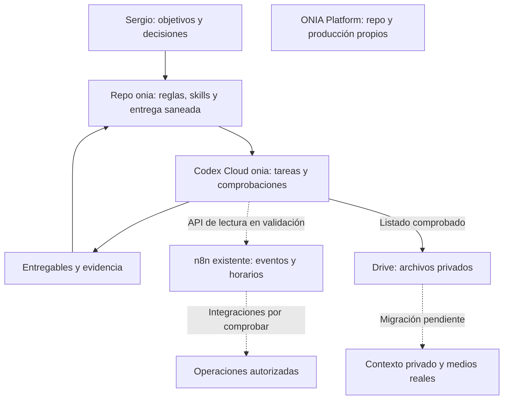

# Arquitectura vigente de ONIA

3 de noviembre de 2026, America/Caracas. Esta versión ordena las decisiones actuales de Sergio. Las [reglas comunes](reglas-comunes.md) son la fuente de permisos y prioridades; [ESTADO.md](ESTADO.md) conserva la entrega vigente. Los errores y decisiones sustituidas permanecen en el [registro de errores](registro-de-errores.md), no como alternativas operativas de este documento.

## Distribución del trabajo

El harness vive en el repositorio privado [oninteligenciaartificial/onia](https://github.com/oninteligenciaartificial/onia) y usa el entorno limpio **onia**. La decisión más reciente de Sergio es trabajar **sólo con Codex por ahora**, aprovechando n8n existente. ONIA Platform conserva su repositorio de producto y su producción. El VPS existente aloja la startup y n8n; no se le asignan navegadores, render de video, modelos locales ni workers de agentes.

Las líneas punteadas son conexiones pendientes. n8n no tiene acreditada una conexión que despache tareas a Codex Cloud; no existe un scheduler de agentes habilitado por este esquema.

| Componente y ubicación | Estado observado | Próxima comprobación |
|---|---|---|
| Reglas, código y skills en el repo privado `onia` | Repo creado; siete fuentes de skills versionadas. | Integrar los cambios preparados en la tarea cloud y actualizar la entrega vigente. |
| Setup reutilizable de Codex Cloud `onia` | Entorno ejecutable y repo correcto. Los cambios de preparación hechos dentro de la tarea aún no acreditan un setup republicado. | Publicar la preparación y verificar una tarea nueva. |
| Desarrollo y pruebas en Codex Cloud | Doce tests aprobados: siete bootstrap y cinco continuidad. | Retomar un encargo desde otra tarea con fuentes y resultado verificables. |
| Skills en Codex Cloud | Siete enlaces creados; no aparecían en el catálogo inicial de la tarea. | Comprobar descubrimiento y uso en una tarea nueva. |
| Playwright en Codex Cloud | Una prueba sintética interactiva aprobó con Chromium del sistema. La descarga del navegador fijado fue bloqueada por red. | Verificar instalación reproducible con la política de red del entorno. |
| HyperFrames en Codex Cloud | Prueba de render local existente; no acredita instalación ni render cloud. | Preparar dependencias y renderizar una pieza técnica allí; después validar grabación y audio reales. |
| n8n en el VPS existente | Sergio confirmó secreto guardado. La instancia cloud aún usa revisión 1 sin secreto ni host permitido; helper exit 2, sin autenticación. | Aplicar/publicar configuración y probar GET desde una tarea nueva. |
| Archivos en Drive | Carpeta ONIA archivos creada; la tarea onia cloud leyó sus cuatro hijos directos. Referencia y permisos en accesos.md. | Descargar una entrada real y recuperar una salida desde otra tarea; contexto privado aún no migrado. |
| Cuenta de investigación y navegador remoto | Cuenta no creada; navegador interactivo con sesión persistente no acreditado. | Resolver una superficie cloud compatible y completar registro con intervención de Sergio. |
| Meta, calendario y otras aplicaciones | Acceso local o herramientas presentes en este chat no prueban acceso desde `onia`. | Inventariar capacidades dentro de Cloud y probar la lectura necesaria por servicio. |
| ONIA Platform | Producto separado del harness. | Cotejar instrucciones y estado del producto al recibir un encargo específico. |

## Persistencia y contexto

`operacion/` y `privado/` están excluidos de Git. Los registros locales de tareas, evidencia y contexto personal no llegan a nuevas tareas cloud por subir el repo. La solución inicial es mantener una **entrega mínima saneada y versionada en ESTADO.md**: objetivo, estado comprobado, archivos, evidencia accesible y siguiente paso. Drive ya tiene lectura de metadatos comprobada desde Cloud; todavía deben probarse descarga/entrega de archivos y migración del contexto necesario.

Cada tarea debe guardar sus cambios útiles en el repo o exportar sus entregables al almacén elegido antes de descartarse. No existe sincronización automática de esos registros privados. La documentación de Codex distingue el estado de cada tarea de la preparación publicada para tareas nuevas; las skills personales locales tampoco se sincronizan automáticamente. [Entornos cloud](https://learn.chatgpt.com/docs/environments/cloud-environments).

El CLI `scripts/trabajo.py` guarda y recupera registros; no ejecuta agentes ni programa trabajo. Su continuidad entre procesos está probada. La continuidad entre tareas con acceso al mismo estado persistente todavía requiere la comprobación indicada arriba.

## Navegador, cuentas y conexiones

La documentación actual de Codex Cloud no incluye uso interactivo de computadora/navegador. La prueba de Playwright por código demuestra ejecución de un test; no demuestra un navegador con inicio de sesión, handoff o persistencia de cuentas. [Limitaciones de Codex Cloud](https://learn.chatgpt.com/docs/environments/cloud-environments#current-limitations).

La cuenta de investigación y su uso interactivo en nube quedan pendientes de resolver esta limitación dentro del alcance elegido. No se conectan Work Cloud, dots ni otros ejecutores ahora. Grok Bot queda como opción futura: Sergio confirma que no tiene cuota y dará acceso después. No hay integración Codex–Grok ni rutina acreditada. El estado del registro y los accesos se mantiene en [accesos.md](accesos.md).

Un MCP es una posible interfaz, no un requisito por cada servicio. Para el piloto n8n alcanza la API de lectura preparada. Antes de incorporar otro MCP se comprobarán sus herramientas, autenticación y necesidad real. Los plugins disponibles en este chat no se consideran automáticamente disponibles en Cloud.

## Skills, sesiones y mejora

Las siete skills actuales y las ocho capacidades pendientes están descritas en [selección y recorrido](seleccion-y-recorrido.md); sus fuentes editables viven en `compartibles/skills/`. El setup crea los enlaces de descubrimiento. Cada capacidad nueva se desarrolla con un caso de trabajo real y una prueba de aceptación, siguiendo las reglas comunes.

Este chat coordina. Marketing y ventas, desarrollo/infraestructura y ONIA Platform reciben encargos delimitados cuando haya entradas y entregables; no se abre un chat por skill. Los subagentes reciben alcance y resultado concreto, y sus cambios se integran con revisión y evidencia.

El aprendizaje consiste en convertir resultados o correcciones en mejoras versionadas de instrucciones, comprobarlas y conservar la posibilidad de revertirlas. No hay entrenamiento automático del modelo ni proceso autónomo continuo acreditado. La recurrencia se habilitará para una tarea concreta con estado compartido, límites medidos, manejo de duplicados y una prueba real de ejecución.
