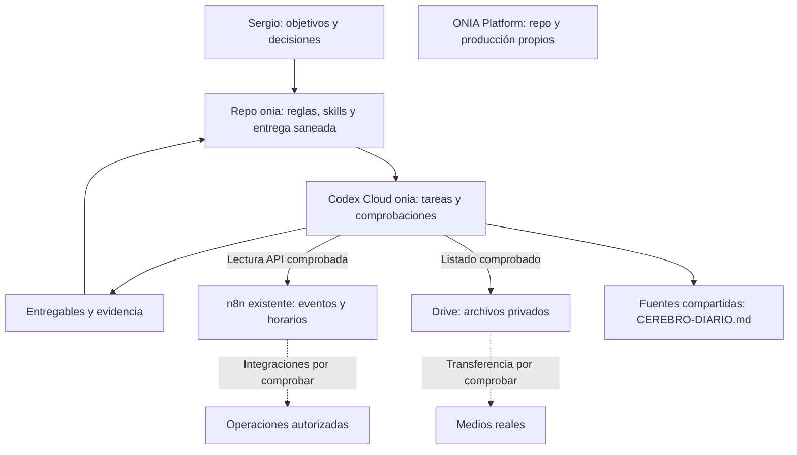

# Arquitectura vigente de ONIA

Preparada el 3 de noviembre de 2026; actualizada el 4 de noviembre, UTC−4. Esta versión ordena la distribución del trabajo. Las [reglas comunes](reglas-comunes.md) son la fuente de permisos y prioridades; [ESTADO.md](ESTADO.md) conserva la entrega vigente. Los errores y decisiones sustituidas permanecen en el [registro de errores](registro-de-errores.md), no como alternativas operativas de este documento.

## Distribución del trabajo

El harness vive en el repositorio privado [oninteligenciaartificial/onia](https://github.com/oninteligenciaartificial/onia) y usa el entorno limpio **onia**. La decisión más reciente de Sergio es trabajar **sólo con Codex por ahora**, aprovechando n8n existente. ONIA Platform conserva su repositorio de producto y su producción. El VPS existente aloja la startup y n8n; no se le asignan navegadores, render de video, modelos locales ni workers de agentes.

Las líneas punteadas son conexiones pendientes. n8n no tiene acreditada una conexión que despache tareas a Codex Cloud; no existe un scheduler de agentes habilitado por este esquema.

| Componente y ubicación | Estado observado | Próxima comprobación |
|---|---|---|
| Reglas, código y skills en el repo privado `onia` | Fuentes propias, manifiesto de seis áreas y CLI de encargos. Catálogo vigente en SKILLS-POR-AREA.md. | Resultado y pruebas en ESTADO.md. |
| Setup reutilizable de Codex Cloud `onia` | Instalación y habilidad de inicio configurables; cada cambio se prepara, prueba y publica antes de aceptar una sesión nueva. | La revisión y aceptación vigente se registran en ESTADO.md. |
| Desarrollo y pruebas en Codex Cloud | Suites de bootstrap, continuidad y selección de área, más navegador. | Retomar un encargo desde otra tarea con fuentes y resultado verificables. |
| Skills en Codex Cloud | Fuentes únicas enlazadas; inicio selecciona la skill por orquestacion.json. | Separar lectura por archivo de anuncio en catálogo nativo y comprobar ambos en la nueva sesión. |
| Playwright en Codex Cloud | Instalador y test aprobados en preparación; clic/estado/captura aprobados en una tarea nueva. | Usar ejecución autorizada con red cuando el sandbox del comando lo requiera. |
| HyperFrames en Codex Cloud | Render sintético cloud comprobado; evidencia y límites en ESTADO.md. | Validar una pieza con grabación y audio reales, y recuperar su entrega fuera de la VM. |
| n8n en el VPS existente | GET HTTP 200 en preparación y tarea nueva, sin escrituras. | Definir un flujo y comprobar sus permisos antes de implementarlo. |
| Archivos en Drive | Carpeta ONIA archivos creada; la tarea onia cloud leyó sus cuatro hijos directos. Referencia y permisos en accesos.md. | Descargar una entrada real y recuperar una salida desde otra tarea. |
| Contexto y operación cotidiana | Fuentes y responsabilidades en CEREBRO-DIARIO.md; panel en PANEL-DIARIO.md. | Consultar el acceso y la continuidad comprobados en ESTADO.md antes de retomar un encargo. |
| Cuenta de investigación y navegador remoto | Cuenta no creada; navegador interactivo con sesión persistente no acreditado. | Resolver una superficie cloud compatible y completar registro con intervención de Sergio. |
| Meta, calendario y otras aplicaciones | Cada conexión se prueba desde `onia`; perfiles válidos no acreditan todas las operaciones. El inventario vigente está en accesos.md. | Completar las operaciones pendientes del encargo, sin duplicar autenticaciones probadas. |
| ONIA Platform | Producto separado del harness. | Cotejar instrucciones y estado del producto al recibir un encargo específico. |

## Persistencia y contexto

`operacion/` y `privado/` están excluidos de Git. Los registros locales de tareas, evidencia y contexto personal no llegan a nuevas tareas cloud por subir el repo. La **entrega mínima saneada y versionada vive en ESTADO.md**: objetivo, estado comprobado, archivos, evidencia accesible y siguiente paso. [CEREBRO-DIARIO.md](CEREBRO-DIARIO.md) identifica las fuentes compartidas y quién mantiene cada una; la continuidad comprobada allí no implica transferencia de archivos entre VMs. Drive tiene lectura de metadatos comprobada desde Cloud; descarga y entrega de medios reales conservan su prueba independiente pendiente.

Cada tarea debe guardar sus cambios útiles en el repo o exportar sus entregables al almacén elegido antes de descartarse. No existe sincronización automática de esos registros privados. La documentación de Codex distingue el estado de cada tarea de la preparación publicada para tareas nuevas; las skills personales locales tampoco se sincronizan automáticamente. [Entornos cloud](https://learn.chatgpt.com/docs/environments/cloud-environments).

El CLI `scripts/harness.py` diagnostica archivos, prepara encargos por área y los retoma; usa `scripts/trabajo.py` como registro local de esos encargos. El agente coordinador ejecuta y delega según [ORQUESTACION.md](ORQUESTACION.md); no hay otro proceso residente. La continuidad entre procesos y la recuperación de contexto compartido tienen evidencias distintas en ESTADO.md. El [plan](PLAN.md) conserva los criterios de entrega; el estado vigente determina qué falta comprobar.

## Navegador, cuentas y conexiones

En la inspección del 3 de noviembre, Sergio mostró una pestaña de navegador junto al entorno. La VM de «Editar onia» ejecutó Chromium mediante Playwright; su estado declaraba remote_desktop habilitado y estado unknown, sin herramientas oficiales de control interactivo expuestas en ese turno. Esa prueba verifica automatización sintética en nube; no acredita acceso web actual, inicio de sesión, handoff ni persistencia de cuentas. La prueba posterior y el fallo TLS observado en Desarrollo se registran en [ESTADO.md](ESTADO.md). La [documentación general](https://learn.chatgpt.com/docs/environments/cloud-environments#current-limitations) se consulta junto con la superficie y herramientas reales del ejecutor.

La cuenta de investigación y su uso interactivo en nube quedan pendientes de resolver esta limitación dentro del alcance elegido. No se conectan Work Cloud, dots ni otros ejecutores ahora. Grok Bot queda como opción futura: Sergio confirma que no tiene cuota y dará acceso después. No hay integración Codex–Grok ni rutina acreditada. El estado del registro y los accesos se mantiene en [accesos.md](accesos.md).

Un MCP es una posible interfaz, no un requisito por cada servicio. Para el piloto n8n alcanza la API de lectura preparada. Antes de incorporar otro MCP se comprobarán sus herramientas, autenticación y necesidad real. Los plugins disponibles en este chat no se consideran automáticamente disponibles en Cloud.

## Skills, sesiones y mejora

Las skills vigentes, selección entre treinta referencias y capacidades pendientes están en [SKILLS-POR-AREA.md](SKILLS-POR-AREA.md); sus fuentes editables viven en `compartibles/skills/`. El setup crea los enlaces de descubrimiento y configura la lectura por área. Cada capacidad nueva se desarrolla con un caso de trabajo real y una prueba de aceptación, siguiendo las reglas comunes.

Los seis chats por área están identificados en [SESIONES.md](SESIONES.md); la coordinación cotidiana se describe en [CEREBRO-DIARIO.md](CEREBRO-DIARIO.md). Reciben encargos delimitados con entradas y entregables; no se abre un chat por skill. Los subagentes reciben alcance y resultado concreto, y sus cambios se integran con revisión y evidencia.

El aprendizaje consiste en convertir resultados o correcciones en mejoras versionadas de instrucciones, comprobarlas y conservar la posibilidad de revertirlas. No hay entrenamiento automático del modelo ni proceso autónomo continuo acreditado. La recurrencia se habilitará para una tarea concreta con estado compartido, límites medidos, manejo de duplicados y una prueba real de ejecución.
