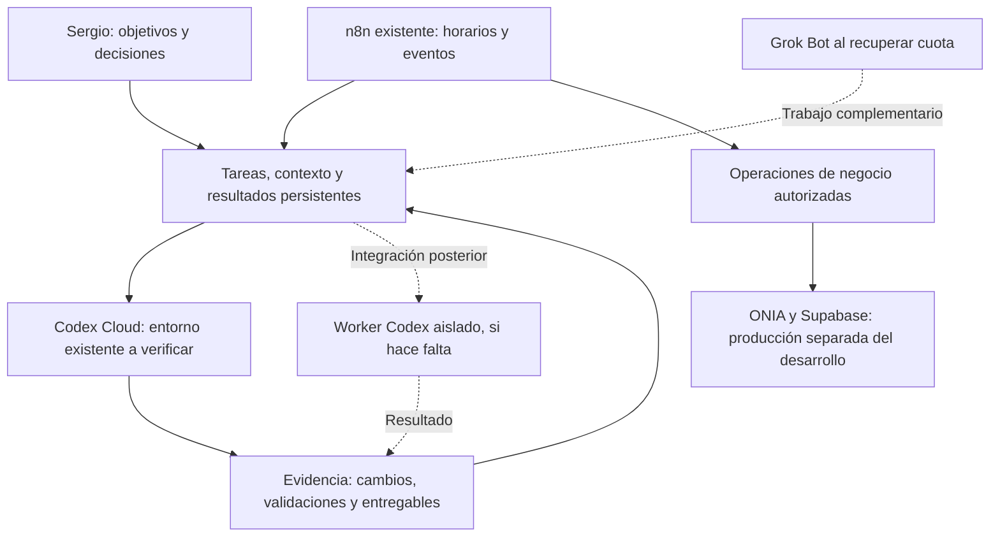

**Arquitectura inicial de operación: Codex, n8n y ONIA**

**Corrección que prevalece sobre las secciones históricas:** el harness tendrá repositorio privado propio desde la base vigente de esta carpeta y usará el entorno limpio `onia` creado por Sergio. La prueba en ONIA Platform fue detenida por ámbito equivocado; no seguir configurando ese entorno para coordinación. ONIA Platform conserva sólo el producto. El setup y la prueba de aceptación de `onia` siguen pendientes de vincular el repositorio.

## Requisito actualizado: operación en nube

**Última precisión de Sergio:** evitar llenar el VPS porque aloja ONIA Platform. No instalar allí navegador remoto, modelos locales, render de video ni workers de agentes. Codex Cloud asume desarrollo y pruebas. n8n ya existe; no se migra ni amplía su carga sin inspeccionar recursos y necesidad. Para administrarlo sin depender del control de Chrome local, comprobar API desde Codex Cloud. Un navegador remoto, si llega a ser necesario, requeriría un entorno separado y costo/alcance comprobados; no está elegido ni instalado. Esta decisión reemplaza la alternativa previa de instalar navegador en este VPS.

URL n8n recibida y comprobada hasta Sign in: https://n8n-sergio-n8n.hqdqgh.easypanel.host/ . Recursos y servicios observados en [inspección inicial del VPS](operacion/evidencias/vps-inspeccion-2026-11-03.md). El acceso autenticado y la API siguen pendientes; no pedir claves en el chat.

Sergio aclaró el 3 de noviembre de 2026 que quiere operar Meta y las automatizaciones sin depender de su PC. n8n permanece en el VPS existente. Las credenciales de los flujos se guardarán en esa instancia y se comprobarán con operaciones acotadas; falta recibir su URL HTTPS e inspeccionar versión y configuración. La integración de Meta mediante API es la ruta propuesta, sujeta a permisos y endpoints necesarios. La documentación actual de n8n describe OAuth2 y tokens para Facebook Graph API, con una app de Meta; no se ha creado ni conectado ninguna app por este encargo. [Credenciales Facebook Graph API](https://docs.n8n.io/integrations/builtin/credentials/facebookgraph/).

Chrome local está conectado y permitió ver Meta Business Suite con Onia/oniahq. Esa comprobación sólo acredita acceso local: no copia sesiones a Codex Cloud ni al VPS. Un navegador remoto en VPS queda como alternativa por evaluar para tareas que requieran UI y no tengan API adecuada; no está instalado ni se propone exportar el perfil personal de Chrome.

La primera tarea en Codex Cloud ya fue creada en el entorno existente ONIA Platform: `01a1a3e6-50ac-7052-9243-cafe9e8a200c`, host `durable`. Su primer estado fue `active/inProgress`; los resultados se consultan en el registro `cloud-001`. Preparación y pruebas en ese chat no equivalen a actualizar el entorno reutilizable. La sección siguiente conserva la preparación previa, no el estado actual de ejecución.

## Preparación de nube registrada — 3 de noviembre de 2026

Pedido de Sergio: dejar anotada la creación/preparación del entorno en nube y aclarar dónde ejecutarlo. Tarea: `cloud-001`. Recomendación: **Codex Cloud para encargos de desarrollo; el VPS existente para los servicios y automatizaciones persistentes**. La preparación de Codex Cloud no depende de esperar el acceso SSH al VPS.

**Estado observado hoy:** la herramienta de cuenta devuelve `ONIA Platform` como `ready`, `runnable: true`, vinculado a `github-1208814283`, ref `master`. Identificador de configuración: `d8e8a883-9403-432a-b1f6-de5023890a92~asenvcfg_a1a0b45437488191b47bc0d72b6d29f3`. Es una configuración guardada, no prueba de un agente trabajando o de que los tests pasen. Se recomienda revisar y aprovechar este entorno antes de crear otro duplicado. No se creó ni modificó un entorno con esta anotación.

### Distribución propuesta

| Lugar | Trabajo asignado | Qué falta comprobar |
|---|---|---|
| Codex Cloud | Cambios de código, pruebas y entregables del repositorio en tareas remotas. | Setup, reglas/skills presentes y una ejecución real. |
| VPS Hostinger existente | n8n, aplicación, base y automatizaciones del negocio que deban permanecer disponibles. | Acceso, recursos, servicios, backups y capacidad libre. |
| PC local, por ahora | Edición y render HyperFrames, ya probado aquí. | Portar el render al VPS sólo después de comprobar recursos y dependencias. |

Codex Cloud permite continuar tareas con la computadora dormida. Las skills del repositorio pueden usarse allí; las personales locales no se sincronizan automáticamente. La documentación actual indica que la superficie cloud no soporta uso de computadora/navegador. Por eso no damos por portable la prueba visual local de HyperFrames. [Documentación de entornos cloud](https://learn.chatgpt.com/docs/environments/cloud-environments).

### Trabajo anotado para cloud-001

1. Abrir el entorno existente en Codex: `Work in > Cloud > Select environment`. Revisar su setup y acceso al repositorio; crear uno sólo si el existente no sirve. La ruta para uno nuevo es `Create environment` desde ese selector.
2. Preparar la entrega versionada de las reglas y skills pertinentes al producto. Las junctions de Windows apuntan a archivos locales y no son una distribución cloud. No subir todo C:/dev/proyectos, credenciales, historial personal ni datos privados para resolverlo.
3. Cotejar instalación y comandos de prueba con la versión real del repositorio. Conservar las reglas comunes de esta conversación como fuente; no importar ONIA-CENTRAL.
4. Preparar variables/secretos mínimos para el encargo y comprobar acceso sin imprimir sus valores. No es requisito compartir todas las cuentas.
5. Preparar y verificar el entorno; publicar/actualizar su configuración dentro del alcance autorizado. Después ejecutar una tarea pequeña que lea las reglas/skill, produzca un resultado verificable y deje una entrega retomable. Revisar disponibilidad y límites efectivos de la cuenta antes de depender de ejecución recurrente.

Cada tarea cloud mantiene sus propios archivos; cambiar un archivo durante una tarea no actualiza por sí solo el entorno reutilizable. La configuración de futuras tareas se actualiza y vuelve a publicar por separado. [Modos y preparación de entornos](https://learn.chatgpt.com/docs/environments/modes).

**Criterio de terminado:** una tarea remota ejecutada con las reglas previstas, resultado y comprobaciones accesibles, y un estado que pueda retomarse. No basta el indicador `runnable`. La conexión n8n → ejecutor, el scheduler y un worker en el VPS son trabajos posteriores que requieren pruebas y límites de consumo; no se presuponen activos ni incluidos sin límite en la suscripción.

---

**Procedencia corregida:** Sergio excluyó explícitamente el repositorio ONIA-CENTRAL como referencia. Este diseño se debe desarrollar desde sus instrucciones en esta conversación, el código vigente de ONIA Platform y las fuentes externas pertinentes. La propuesta hecha dentro de ONIA-CENTRAL queda sin adoptar. Las integraciones de este documento siguen siendo propuestas salvo evidencia explícita de ejecución.

Estado al 3 de noviembre de 2026: diseño y preparación. Los servicios del VPS fueron declarados por Sergio; no se inspeccionó ni modificó producción. Los entornos Codex Cloud se consultaron mediante herramienta de cuenta.

El objetivo inmediato es que Codex pueda completar tareas de desarrollo con continuidad, mientras n8n conecta procesos repetibles del negocio. Grok Bot queda como colaborador futuro cuando vuelva su cuota. La organización debe permitir a Sergio ver qué entró, qué se ejecutó, qué resultado existe y qué decisión queda pendiente.

Las flechas punteadas representan componentes o integraciones propuestos, no conectados. No se verificó un endpoint que permita a n8n enviar trabajo a este chat ni una conexión nativa entre Codex y Grok Bot.

| Componente | Responsabilidad propuesta | Estado |
|---|---|---|
| Codex Cloud | Desarrollar y comprobar cambios en el repositorio correcto. | `ONIA Platform` corresponde al repositorio identificado y a `master`; falta probar su ejecución. |
| n8n | Recibir eventos, encadenar operaciones definidas, registrar y notificar. | Instalación declarada existente; falta inspección. |
| Registro de trabajo | Mantener objetivo, estado, evidencia, dueño y próximo paso. | Esta base conserva contexto; el registro automatizado se elegirá tras revisar lo existente. |
| Supabase | Conservar datos del producto y, si corresponde, registros operativos con permisos separados. | No se propone ninguna migración hasta inspeccionar estructura y versión. |
| Worker propio | Consumir tareas autorizadas y ejecutar Codex CLI/SDK cuando la vía cloud nativa no cubra el flujo. | Alternativa por evaluar, no creada. |
| Grok Bot | Tareas remotas complementarias, con entregables y acceso acotados. | Sin cuota según Sergio; no condiciona el comienzo. |

Para la continuidad, una tarea necesita identificador, objetivo, fuentes, ámbito de escritura, resultado esperado, criterio de terminación, límite de tiempo/consumo y estado. Al terminar o interrumpirse se registra lo efectivamente hecho, evidencia, fallos y siguiente paso. Una tarea iniciada o un comando lanzado no equivalen a resultado validado.

La documentación oficial indica que Codex Cloud tiene espacios por tarea, puede trabajar con la computadora personal apagada y dispone de secretos personales. Las skills locales no se sincronizan automáticamente: las del repositorio pueden viajar al entorno. Actualmente esa superficie no incluye uso de navegador/computadora. [Entornos cloud](https://learn.chatgpt.com/docs/environments/cloud-environments).

La primera preparación cloud debería cotejar repositorio y rama, leer sus instrucciones, reproducir instalación y ejecutar una comprobación de desarrollo. El resultado esperado es un cambio pequeño revisable o un informe técnico reproducible. Un entorno marcado `runnable` no demuestra que la aplicación funcione.

Si después hace falta un ejecutor conectado a n8n, la opción a evaluar es un worker que consuma trabajos de una cola o servicio interno autenticado, ejecute Codex y devuelva estado y resultados. Codex documenta ejecución por scripts con `codex exec` y salida estructurada. La integración, el método de autenticación y su consumo deberán probarse; la suscripción no se considera un presupuesto API ilimitado. [Modo no interactivo](https://learn.chatgpt.com/docs/non-interactive-mode), [Codex SDK](https://learn.chatgpt.com/docs/codex-sdk).

En el VPS, el ejecutor de desarrollo necesitaría usuario, carpetas, límites y accesos propios. Evitar montar los volúmenes de producción o entregar control irrestricto del daemon de Docker a tareas abiertas. Los cambios de producto se preparan como entregables revisables; el despliegue usa el flujo y la autorización correspondientes. El control del daemon tiene implicaciones sobre el host. [Seguridad de Docker](https://docs.docker.com/engine/security/).

Las áreas personales, comerciales y de clientes mantienen datos y permisos separados. Un espacio de coordinación puede mostrar estados sin contener todas las credenciales o datos sensibles. Los cobros y permisos del producto se basan en confirmaciones y reglas del backend. La [revisión de ONIA Platform](revision-onia-platform.md) identificó código de QR BCP para cobrar la suscripción y activar el plan; la configuración bancaria, el despliegue y un cobro real siguen sin comprobarse.

La operación debe tolerar interrupciones y cuota agotada: conservar estado, limitar reintentos, reconocer tareas duplicadas y permitir detener trabajo. Las notificaciones se reservan para resultados, fallos y decisiones accionables. Los límites exactos se fijarán con consumo medido, no con una promesa de funcionamiento continuo sin costo.

Los primeros criterios de aceptación propuestos son:

1. Una tarea de desarrollo conserva contexto y entrega una evidencia revisable.
2. Otra sesión puede retomar esa tarea sin reconstruir toda la historia.
3. Repetir una entrada no duplica una acción externa.
4. Falta de cuota o acceso produce un estado claro sin anunciar éxito.
5. Los permisos del trabajo permiten la operación necesaria y rechazan una operación fuera de su alcance.

El repositorio vigente quedó identificado como `oninteligenciaartificial/onia-platform`, rama `master`, asociado al entorno cloud `ONIA Platform`. Ya contiene protocolos, backlog y 16 skills versionadas. Se propone reutilizarlos con un índice de contexto vigente, sin instalar duplicados. La revisión del servidor determinará las integraciones siguientes. No se agregaron contenedores, claves, integraciones o tareas programadas.
