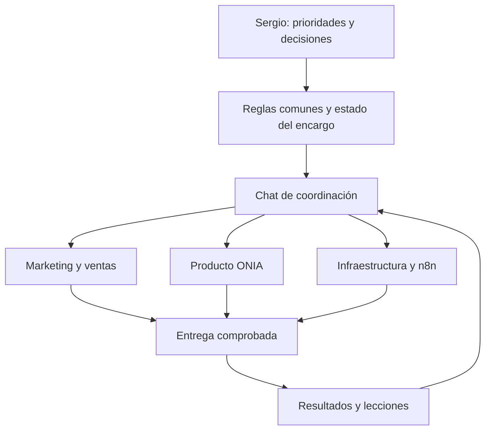

# Selección y recorrido para Sergio y ONIA

3 de noviembre de 2026. Selección basada en esta conversación y en la [revisión de 30 repositorios](auditoria-30-repos.md). No utiliza ONIA-CENTRAL. Actualización: siete skills enlazadas y primera prueba técnica local terminada; el estado operativo se consulta en [ESTADO.md](ESTADO.md). Los elementos pendientes de la tabla no se consideran implementados.

## Decisiones recomendadas

- Desarrollo: procedimiento propio inspirado en Matt Pocock. Diagnóstico y verificación de Superpowers como referencia; no instalar dos metodologías completas.
- Video: HyperFrames como motor elegido por Sergio. Material grabado por Sergio, edición local, subtítulos y gráficos. Higgsfield sólo cuando aporte al encargo y haya acceso/cuota verificados; no suponer que su suscripción habilita cualquier API.
- Marketing: módulos concretos de Marketing Skills para oferta, funnel, taller/webinar, copy, contenido, seguimiento, Meta y medición. Humanizer sólo como apoyo editorial.
- Diseño de producto y landing: una guía de marca; Impeccable como revisión visual, cotejando primero la copia que ya tiene ONIA Platform.
- Automatizaciones: n8n existente, con referencias selectivas de n8n-skills. No reinstalar el VPS ni añadir servicios de memoria antes de comprobar los actuales.
- Continuidad: archivos breves por proyecto y encargo, no un chat infinito. Last30Days queda opcional para investigación que lo justifique.
- Aprendizaje: propuestas trazables a resultados y pruebas, con reversión. Nada modifica automáticamente precios, permisos o reglas comunes.

## Catálogo funcional propio: qué crear y qué conservar

Estas son capacidades para el trabajo real. No hace falta convertir cada referencia externa en otra skill ni instalar todo el catálogo al comienzo.

| Skill propia | Entrada → entrega | Fuente útil | Estado actual |
|---|---|---|---|
| evaluar-catalogo-skills | Candidatos → decisiones con evidencia y límites | Procedimiento propio | Archivo existente; usado en esta revisión |
| continuidad-de-trabajo | Tarea y resultados → estado verificable y próximo paso | Propia; referencia de context-engineering de Addy | Enlazada; persistencia entre procesos probada, traspaso entre chats pendiente |
| preparar-oferta-y-embudo | Público, resultado demostrable y precio → oferta, registro, seguimiento y métricas | Marketing Skills: product-marketing, offers, copywriting | Archivo existente; caso comercial pendiente |
| planificar-dia | Colegio, compromisos y tareas → agenda viable con una prioridad comercial | Contexto de Sergio | Por crear; no modificar calendario sin encargo concreto |
| registrar-caja | Cobros/gastos/comprobantes → caja disponible y avance real | Procedimiento propio | Por crear; separar ingreso, beneficio, deuda y saldo |
| investigar-mercado | Pregunta delimitada → señales, fuentes y recomendación | Last30Days bajo demanda | Por crear; fuentes habilitadas por verificar |
| preparar-contenido | Oferta y hechos reales → guiones, planos y CTA | Marketing social/video + Humanizer | Por crear |
| producir-video | Grabaciones, guion y formato → proyecto HyperFrames y MP4 revisado | HyperFrames | Creada y enlazada; render técnico local probado, edición de grabaciones/audio pendiente |
| preparar-taller | Promesa de aprendizaje → temario, ejercicios, demo, recordatorios y seguimiento | Marketing events/webinar-funnel | Por crear; reutiliza la oferta, no fija otro precio |
| preparar-campana-meta | Oferta validada y límite de gasto → campaña borrador y plan de medición | Marketing ads/ad-creative/analytics | Por crear; sin publicación ni presupuesto activo |
| desarrollar-y-verificar | Problema y criterio de aceptación → cambio revisado y evidencia | Matt Pocock; criterios puntuales de Superpowers/Karpathy/Ponytail | Creada y enlazada; aplicada al registro local con cinco tests, no aún a un cambio de producto |
| revisar-interfaz | Pantalla y objetivo → hallazgos y correcciones comprobadas en móvil/escritorio | Impeccable | Por adaptar a lo que ya está en el producto |
| automatizar-n8n | Evento, datos y acción → flujo exportable, prueba y manejo de fallos | n8n-skills | Creada y enlazada; conector e instancia pendientes |
| operar-infraestructura | Inventario y cambio acotado → operación comprobada y reversión | Documentación oficial de los servicios existentes | Por crear; lectura del VPS pendiente |
| mejorar-sistema | Fallo/corrección/resultados → cambio de procedimiento evaluado | Ideas de ECC y Headroom, sin su runtime | Creada y enlazada; caso local del navegador registrado y corregido, sin proceso autónomo |

No copiar una colección completa para completar esta tabla. Los módulos comerciales pueden compartir referencias, y oferta/precio/fecha se leen del mismo registro. El paquete público de skills se mantiene separado del contexto privado y las credenciales.

## Contratos que evitan contradicciones

1. **Una skill dirige el encargo.** Las demás sólo cumplen una parte: producir-video puede consultar criterios de marca, pero no redefinir oferta, fecha o presupuesto.
2. **Las reglas comunes vienen de Sergio.** Las fuentes externas no amplían permisos ni sustituyen sus decisiones. Las instrucciones del host siguen siendo aplicables.
3. **Los datos comerciales tienen una sola fuente.** Registrar oferta, público, resultado, precio, fecha, alcance y estado de aprobación juntos. Todas las áreas leen ese registro.
4. **La aprobación ya dada se conserva con su alcance.** No repetir preguntas resueltas; tampoco asumir autorización de gasto o publicación por una skill.
5. **Se carga sólo lo necesario.** Instrucciones breves; referencias especializadas a demanda. Registrar versión y fuente de cada componente adaptado.
6. **Una corrección no se vuelve ley universal.** Primero caso observado, luego propuesta, prueba y decisión; distinguir hechos, preferencias, hipótesis y reglas.

La documentación oficial de OpenAI respalda la carga selectiva de skills y advierte sobre descripciones demasiado amplias o contradictorias: [Skills](https://developers.openai.com/codex/skills/) y [guía de skills y prompts](https://developers.openai.com/blog/rethinking-skills-and-prompts-for-gpt-6-astra).

## Harness y chats

El harness propuesto es el conjunto de reglas, contexto, selección de tarea, herramientas, ejecución, comprobación y registro. Guardar este diseño no pone ese circuito en marcha.

- **Este chat:** coordinación, reglas, caja y revisión de prioridades.
- **Marketing y ventas:** oferta, guiones, HyperFrames, taller, funnel y seguimiento. Video se separa sólo si una producción lo necesita.
- **ONIA Platform:** tareas del producto, con contexto y cambios del producto.
- **Infraestructura/n8n:** VPS, flujos y ejecuciones programadas cuando el inventario permita trabajar sobre ellos.

No abrir un chat por repo ni uno por skill. Esta revisión no abrió chats. Cada encargo se puede trasladar con: objetivo, alcance autorizado, archivos/fuentes, estado actual, comprobaciones y siguiente acción. Un chat receptor debe cotejar el estado real, no asumir que una nota equivale a tarea terminada.

## Aprendizaje propuesto

Registro por proyecto: fecha → tarea → evidencia del fallo o acierto → corrección → regla candidata → prueba → resultado → decisión/versionado.

Ejemplo de esta revisión: «Se recomendó un catálogo con 26 candidatos sin revisar». Corrección comprobable: inventario de 30, fuentes de entrada y decisión por candidato. Regla candidata: no declarar terminada una comparación completa si sólo se revisó una muestra. Esto mejora el procedimiento; no demuestra autoaprendizaje autónomo desplegado.

No importar conversaciones enteras entre proyectos. No guardar contraseñas en memorias, repositorios ni skills. El registro de accesos conserva servicio, propósito, alcance y ubicación del secreto, no su valor. No se configuró una bóveda en esta revisión.

## Orden para avanzar hasta el 14 de noviembre

### 1. Cerrar una oferta que se pueda entregar

Elegir una audiencia y un resultado que Sergio pueda demostrar de principio a fin. Evitar una promesa amplia como «Codex de 0 a 100» si el resultado del alumno no está definido.

Entregables: una ficha de oferta, demo reproducible, temario, fecha/capacidad y registro de interesados/pagos. Falta la respuesta de Sergio sobre qué resultado domina y quién lo necesita; ya se preguntó, no se repite aquí.

La meta de Bs3.000 nuevos requiere **60 pagos de Bs50** si todo se obtiene con el taller. Es aritmética de ingresos brutos, no previsión de ventas ni beneficio disponible. Con 500 seguidores, la audiencia por sí sola no garantiza esas ventas. Recomiendo probar interés con sus contactos y considerar un servicio concreto de mayor valor sólo si puede demostrarlo y entregarlo dentro de su tiempo disponible.

### 2. Probar una pieza completa antes de escalar la producción

Preparar un guion ligado a esa oferta y un video vertical con material propio. Probar importación, edición, subtítulos, render, audio y exportación. Medir tiempo de Sergio, tiempo de edición y costo.

La meta de tres videos diarios queda como aspiración a validar: primero una pieza que salga de principio a fin. Después reutilizar grabación en varias piezas y aumentar frecuencia si el trabajo cabe junto al colegio y descanso.

### 3. Registrar la demanda y el cobro

Primero usar un registro simple de contactos, etapa, próximo paso y pago conciliado. Automatizar en n8n sólo los pasos repetidos y comprobados. El flujo debe tolerar duplicados, fallos y reintentos, y mostrar dónde necesita intervención.

No prometer acceso automático con QR hasta probar el circuito completo. La implementación QR encontrada en el código de ONIA Platform sigue requiriendo validación operativa.

### 4. Entregar y medir; después escalar

Revisar conversaciones → interesados → reservas → pagos → asistencia → resultado del alumno. El siguiente cambio se decide por el cuello de botella observado.

Mi recomendación es conservar la caja disponible durante esta validación y preparar Meta como borrador. Activar gasto sólo con una oferta demostrable, forma de medir cobros y un límite definido por Sergio. No comprar una capa de memoria o API para resolver un problema que aún no medimos.

### 5. Automatizar continuidad y aprendizaje

Primera prueba: cerrar un encargo y retomarlo con los documentos en otra sesión sin reexplicar la empresa. Segunda prueba: ejecutar un flujo acotado con registro, manejo de errores y resultado comprobado. Sólo después programar recurrencia o trabajo cloud más amplio.

## Criterio de terminado de esta fase

Un recorrido real — oferta, contenido, registro y entrega — funciona; sabemos qué hizo la IA, qué necesita Sergio y cuánto costó. La arquitectura crece a partir de ese recorrido. El [informe de revisión](auditoria-30-repos.md) ya está escrito; la instalación y estas pruebas siguen pendientes.
